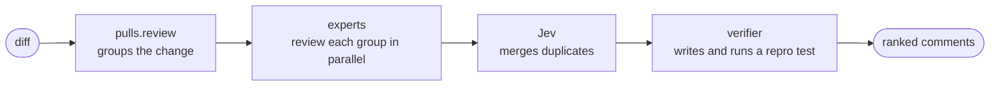

# eyeful

<p align="center"></p>

> "Given enough eyeballs, all bugs are shallow." — Linus's Law

eyeful reviews code changes with a group of agents and tries to prove each bug it reports with a
test it runs itself. A finding counts as verified only when eyeful's verifier, not the agent that
wrote it, saw its reproduction fail on the change and not on the base commit; the suggested fix is
then checked against the same test. Everything else is marked with the weaker evidence it has. eyeful never approves a change; a person does.

It runs on your machine with the coding agent you already use (Claude Code, Codex or pi), from the
command line or a desktop app. eyeful is a final-year project and is in active development.

## How a review works



1. **Plan.** Rules set aside lockfiles, generated and vendored files. The rest is grouped by intent
   with [pulls.review](https://github.com/antfu/pulls.review), and Go picks the experts each group
   needs.
2. **Review.** Up to seven experts (design, correctness, skeptic, security, tests, usability,
   readability) read their groups in parallel with read-only tools, each against the published
   standards for its area.
3. **Merge.** Findings on the same lines that describe one problem are merged with
   [Jev](https://docs.typesafe.ai), and the comment records how many experts reported it.
4. **Verify.** For each `error` or `warning` finding that a test could show, an agent writes a
   reproduction and the verifier runs it five times on the change, once on the base, then with the
   suggested fix. What cannot run is read by a judge, which may dispute it.
5. **Report.** Comments are labelled `issue`, `question`, `suggestion` or `nitpick` and ranked:
   undisputed before disputed, reproduced before unreproduced, then by how many experts agree.

Details: [A review, end to end](docs/REVIEW.md).

## Quick start

```sh
mise trust && mise install && mise run setup
mise run install          # puts eyeful on your PATH
eyeful connect claude     # or codex, pi
eyeful review             # review your uncommitted changes, reading only
```

`eyeful review --head HEAD --base main` reviews a branch instead. Each run is saved under
`.eyeful/runs/` as Markdown, findings JSON and SARIF. `mise run dev:desktop` opens the same review in
a window, with the findings beside the diff.

### Reproductions

By default nothing runs and a judge reads every finding. To have eyeful write and run a reproduction
for each bug, give the repository a `.eyeful/config.yml` with its test commands
([Configuration](docs/CONFIGURATION.md#project)) and ask for execution:

```yaml
setup: pip install -e ".[test]"
test: pytest -x -q --junitxml=report.xml
test_one: pytest -x -q {test}
```

```sh
eyeful review --verification execution
```

eyeful shows these commands and runs them only after you confirm, in a throwaway checkout of the
snapshot. The agents themselves get read-only tools.

## Status and limits

- **Works:** local reviews from the CLI and the desktop app.
- **In progress:** the evaluation, offline on Code Review Bench, ReviewBench and a set of injected
  defects. Every run so far uses DeepSeek, not the Claude Sonnet 5 the benchmarks judge with, so how
  eyeful compares with other reviewers is not yet known ([Evaluation](docs/EVALUATION.md)).
- **Planned:** reviews of GitHub pull requests through a self-hosted GitHub App, with reproductions
  in a sandbox ([Running in the cloud](docs/cloud/CLOUD.md)).
- It can only prove what a unit-sized test shows. Timing, performance and behaviour that needs a
  database or a browser are read by the judge, never run.
- It reports only what the change introduces, and a review without findings proves nothing.
- Locally there is no sandbox: confirmed commands run with your permissions.

## Documentation

<https://github.yiming1234.cn/eyeful/>, starting with [Running locally](docs/LOCAL.md). The
[roadmap](docs/ROADMAP.md) says what each version delivers.

## License

[AGPL-3.0-only](LICENSE).
