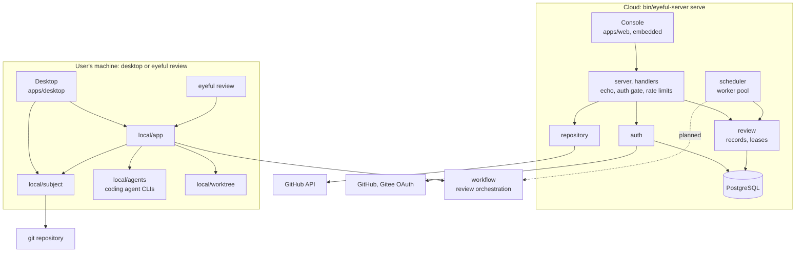
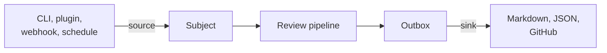
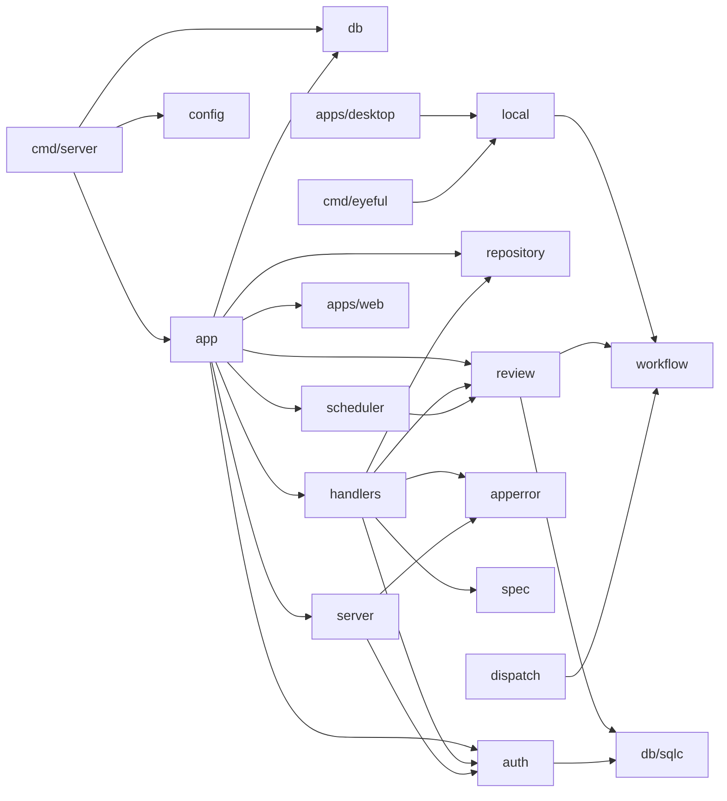
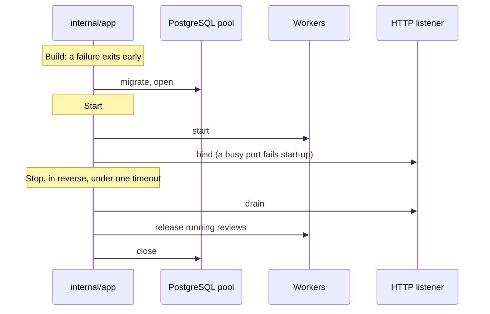

# Architecture

eyeful has a cloud side and a local side, and both run the same review workflow. The cloud server,
`eyeful-server`, is one Go binary with the console, the migrations and the API document embedded;
its only dependency is PostgreSQL. The local side is the desktop app and the `eyeful` command, which
need no server. Each binary holds only its own side's code, and the two sides exchange no data.

## Components

Dashed edges are planned.

- **Cloud.** A request passes through `server` (authentication, rate limits) to `handlers`, which
  call `auth`, `review` and `repository`. The `scheduler` runs workers that claim queued reviews.
  They end each review with a placeholder executor, because the pi runtime and the sandbox are not
  built.
- **Local.** The desktop app and the CLI both call `local/app`, which reads the change with
  `local/subject`, checks out the snapshot with `local/worktree` and runs `workflow` through
  `local/agents` ([Running locally](LOCAL.md)).
- `workflow` is the only code the two sides share.

## The review workflow {#workflow}

`workflow` runs one review through the [stages](REVIEW.md#stages). It runs no agent, command or
storage itself: the caller passes three interfaces in a `Session`.

| Interface   | Provides                                                         | Cloud (planned)      | Local            |
| ----------- | ---------------------------------------------------------------- | -------------------- | ---------------- |
| `Agents`    | One call per role, returning a typed result and the tokens spent | pi processes         | `local/agents`   |
| `Workspace` | The CI check, `setup`, reading a file, test runs on a fresh copy | The review's sandbox | `local/worktree` |
| `Archive`   | Loading and saving each stage's output                           | The run archive      | `local/archive`  |

Go owns every loop: `workflow` checks each plan and report, keeps the budget, decides retries, and
saves each stage before the next starts. It has no fx, database or server types.

## Languages

- Go: the server, the CLI, the workflow, scheduling and the REST API.
- TypeScript: the console, the desktop frontend and the pi extension, with HTTP types generated
  from the spec.
- Python: the evaluation only.

eyeful has no agent loop of its own. Agents run in pi in the cloud and in the user's coding agent
CLIs locally.

## Layout {#layout}

### Modules

The shared and the local code are separate Go modules, so the compiler enforces the boundary:

| Module     | Holds                                            | May import          |
| ---------- | ------------------------------------------------ | ------------------- |
| `workflow` | Orchestration and its interfaces                 | nothing here        |
| `local`    | What the CLI and the desktop share               | `workflow`          |
| root       | `cmd/` (both binaries), `internal/` (the server) | `workflow`, `local` |

`cmd/eyeful` imports nothing under `internal/`, and `cmd/server` imports nothing from `local`. The
desktop app is a fourth module, which keeps Wails and cgo out of the server build.

### Directories

| Path                      | Owns                                                                                      |
| ------------------------- | ----------------------------------------------------------------------------------------- |
| `cmd/eyeful`              | The local CLI (kong): `review`, `provider`, `connect`, `commit`                           |
| `cmd/server`              | The server binary (kong): `serve`, `migrate`                                              |
| `apps/web`                | The cloud console: SvelteKit, embedded                                                    |
| `apps/desktop`            | The local GUI: Wails v3, its own Go module                                                |
| `apps/desktop/frontend`   | The desktop's SvelteKit frontend and its Wails bindings                                   |
| `packages/ui`             | Shared components: diff view, file tree, theme                                            |
| `packages/pulls`          | Builds `workflow/pulls/core.js` from `@pulls.review/core`                                 |
| `workflow`                | Review orchestration: triage, plan check, experts, verifier, summary, budget, checkpoints |
| `workflow/prompts`        | Expert and role prompts, tool definitions, vendored skills                                |
| `workflow/pulls`          | `@pulls.review/core` as `core.js`, run with moejs                                         |
| `workflow/project`        | `.eyeful/config.yml`: commands, `skip`, `risk`                                            |
| `workflow/report`         | A result as Markdown and SARIF 2.1.0                                                      |
| `local/subject`           | The snapshot of a local branch, commit or uncommitted changes                             |
| `local/app`               | The local composition root; the only package the CLI and desktop call                     |
| `local/agents`            | `workflow.Agents` over the claude, codex and pi CLIs                                      |
| `local/worktree`          | The snapshot's disposable checkout; `workflow.Workspace`                                  |
| `local/store`             | `.eyeful/runs/` and the confirmed commands                                                |
| `local/settings`          | The connected agent and the desktop's last repository                                     |
| `local/archive`           | Stage checkpoints as files                                                                |
| `local/git`, `local/tail` | Running git with a fixed environment; keeping the end of an output                        |
| `internal/app`            | The cloud composition root: fx wiring and lifecycle                                       |
| `internal/config`         | The `Config` struct, filled by kong                                                       |
| `internal/server`         | echo, middleware, the authentication gate, rate limits, Problem rendering                 |
| `internal/handlers`       | CRUD routes with swag annotations, one file per resource                                  |
| `internal/apperror`       | The Problem body and error codes                                                          |
| `internal/auth`           | Users, sessions, API keys, sign-in, sealed provider tokens                                |
| `internal/repository`     | The signed-in user's GitHub repositories                                                  |
| `internal/review`         | Review records and leases; `reviewtest` holds the memory store                            |
| `internal/scheduler`      | The worker pool                                                                           |
| `internal/dispatch`       | Provider routing for agent runs (not wired in)                                            |
| `internal/db`, `db/`      | The pgx pool, migrations, SQL queries and sqlc output                                     |
| `spec/`, `packages/sdk`   | The generated OpenAPI 3.1 document and TypeScript client                                  |
| `eval/`                   | The [evaluation](EVALUATION.md#tooling) scripts, in Python                                |

Planned: `internal/checkout`, `internal/pi`, `internal/sandbox`, `internal/source`, `internal/sink`,
`internal/outbox` and `plugins/`.

### Frontends

The two frontends share components, not pages or state. The console makes only same-origin requests
and uses the hash router, so `#/repositories` cannot collide with the API route `/repositories`. The
desktop frontend calls only its own Go services through the Wails bindings.

## Data flow {#data-flow}

Producers and consumers attach at the two ends of the pipeline and do not know about each other.

Today the API admits reviews. Other sources, the outbox and the sinks are planned.

## Dependency direction {#dependency-direction}

An arrow means "imports". Dependencies point inward from the entry point.

- Handlers translate HTTP and hold no business rules.
- `server` knows no resource. It hands the bearer token and session cookie to `auth`, which does
  not see HTTP.
- Only `auth` and `review` call `db/sqlc`.
- `repository` gets tokens through an interface `auth` implements, and `app` connects them.

## Lifecycle {#lifecycle}

[fx](https://github.com/uber-go/fx) is the dependency injection container. `internal/app` is the
only server package that imports it and owns every start and stop hook. `local/app` wires plain
constructors without fx.

Shutdown runs in reverse. TODO(sandbox): sandbox and agent processes join the worker stop hook.

## Design decisions

1. The binary embeds what it needs: migrations, the spec and the console.
2. Packages follow the domain, and each owns its types, queries and rules.
3. Contracts are generated: annotations give the spec, the spec gives the TypeScript client, SQL
   gives Go.
4. Every background task has an owner and a way to stop.
5. A failure affects only the unit that failed and records why.
6. Waiting for capacity is not a failure, and committed output is not retried elsewhere.
7. PostgreSQL is the only database, because the queue relies on `SKIP LOCKED`.

Avoided: package-level state, goroutines without an owner, controller/service/model layers, and
hand-written CLI parsing.
