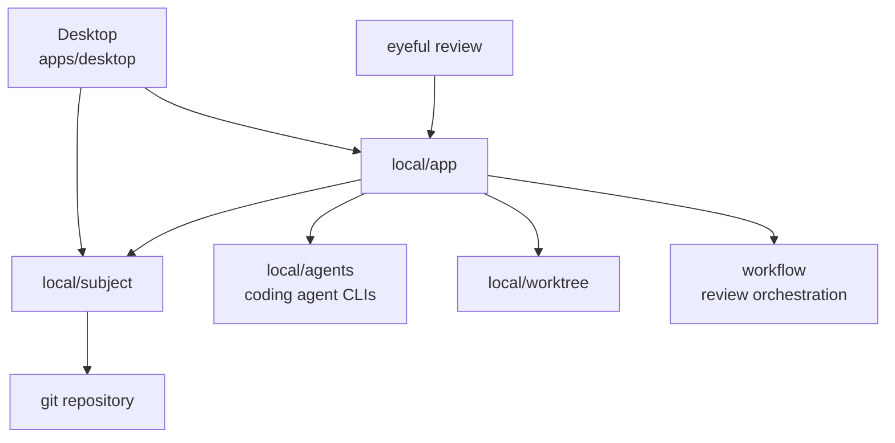
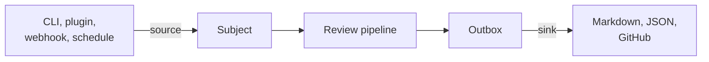

# Architecture

eyeful is a review workflow and the two programs that run it on a user's machine: the `eyeful`
command and the desktop app. Neither needs a server. The [cloud server](cloud/SERVER.md) is another
program, `cmd/eyeful-server` with its packages in `internal/`. It shares the `workflow` module and
`local`, and exchanges no data with the local side. `local/app` stays with the CLI and the desktop.

## Components

The desktop app and the CLI both call `local/app`, which reads the change with `local/subject`,
checks out the snapshot with `local/worktree` and runs `workflow` through `local/agents`
([Running locally](LOCAL.md)). `local/app` wires plain constructors.

## The review workflow {#workflow}

`workflow` runs one review through the [stages](REVIEW.md#stages). It runs no agent, command or
storage itself: the caller passes four interfaces in a `Session`.

| Interface    | Provides                                                                | Cloud                                                                 | Local            |
| ------------ | ----------------------------------------------------------------------- | --------------------------------------------------------------------- | ---------------- |
| `Agents`     | One call per role, returning a typed result and the tokens spent        | A `pi`, `claude` or `codex` process, named by `EYEFUL_AGENT`          | `local/agents`   |
| `Classifier` | The probability that two findings are one problem, and the tokens spent | TypeSafe's API when `EYEFUL_TYPESAFE_API_KEY` is set                  | `local/classify` |
| `Workspace`  | The CI check, `setup`, reading a file, test runs on a fresh copy        | GitHub Actions for the CI check. Setup and tests wait for the sandbox | `local/worktree` |
| `Archive`    | Loading and saving each stage's output                                  | The review directory under `EYEFUL_DATA_DIR`                          | `local/archive`  |

Go owns every loop: `workflow` checks each plan and report, keeps the budget, decides retries, and
saves each stage before the next starts. It has no fx, database or server types.

### Jev {#jev}

[Jev](https://docs.typesafe.ai) is TypeSafe's classifier: it answers a typed question about the
state it is given with a probability, and writes no text. eyeful gives it a judgement only when
everything the judgement needs fits in that state.

| Where                           | Jev is asked                                                  | Through                        |
| ------------------------------- | ------------------------------------------------------------- | ------------------------------ |
| `workflow`, before verification | Whether two findings on the same lines are one problem        | `Classifier.Same`, with go-jev |
| `eval/score.py`                 | Whether a comment is about the same issue as a golden finding | TypeSafe's Python SDK          |

## Languages

- Go: the server, the CLI, the workflow and scheduling.
- TypeScript: the desktop frontend and the pi extension.
- Python: the evaluation only.

eyeful has no agent loop of its own. Agents run in pi in the cloud and in the user's coding agent
CLIs locally.

## Layout {#layout}

### Modules

Each part is its own Go module, so the compiler enforces the boundary. The root module holds both
programs; a depguard rule in `.golangci.yml` keeps `cmd/eyeful` off `internal/`.

| Module         | Holds                                    | May import          |
| -------------- | ---------------------------------------- | ------------------- |
| `workflow`     | Orchestration and its interfaces         | nothing here        |
| `local`        | What the CLI and the desktop share       | `workflow`          |
| root           | `cmd/eyeful`, the local CLI              | `workflow`, `local` |
|                | `cmd/eyeful-server`, `internal/`         | `workflow`, `local` |
| `apps/desktop` | The desktop app; Wails and cgo stay here | `workflow`, `local` |

### Directories

| Path                             | Owns                                                                                      |
| -------------------------------- | ----------------------------------------------------------------------------------------- |
| `cmd/eyeful`                     | The local CLI (kong): `review`, `provider`, `connect`, `commit`                           |
| `apps/desktop`                   | The local GUI: Wails v3, its own Go module                                                |
| `apps/desktop/frontend`          | The desktop's SvelteKit frontend and its Wails bindings                                   |
| `packages/ui`                    | The desktop's components: diff view, file tree, theme                                     |
| `packages/pulls`                 | Builds `workflow/pulls/core.js` from `@pulls.review/core`                                 |
| `packages/worker`                | The Cloudflare Worker that runs `eyeful-server` in a Container                            |
| `workflow`                       | Review orchestration: triage, plan check, experts, verifier, summary, budget, checkpoints |
| `workflow/prompts`               | Expert and role prompts, tool definitions, vendored skills                                |
| `workflow/pulls`                 | `@pulls.review/core` as `core.js`, run with moejs                                         |
| `workflow/project`               | The project's commands, found from its manifests                                          |
| `workflow/report`                | A result as Markdown and SARIF 2.1.0                                                      |
| `local/subject`                  | The snapshot of a local branch, commit or uncommitted changes                             |
| `local/app`                      | The local composition root; the only package the CLI and desktop call                     |
| `local/agents`                   | `workflow.Agents` over the claude, codex and pi CLIs                                      |
| `local/worktree`                 | The snapshot's disposable checkout; `workflow.Workspace`                                  |
| `local/store`                    | `.eyeful/runs/` and the confirmed commands                                                |
| `local/settings`                 | The connected agent and the desktop's last repository                                     |
| `local/classify`                 | `workflow.Classifier` over Jev, through go-jev                                            |
| `local/archive`                  | Stage checkpoints as files                                                                |
| `local/git`, `local/tail`        | Running git with a fixed environment; keeping the end of an output                        |
| `eval/`                          | The [evaluation](EVALUATION.md#tooling) scripts, in Python                                |
| `cmd/eyeful-server`, `internal/` | The [cloud server](cloud/SERVER.md#layout)                                                |

### Frontends

The desktop frontend calls only its own Go services through the Wails bindings. Its components live
in `packages/ui`.

## Data flow {#data-flow}

Producers and consumers attach at the two ends of the pipeline and do not know about each other.

The webhook admits a review, and the worker posts a `COMMENT` review and the ranked report. The
outbox is planned.
