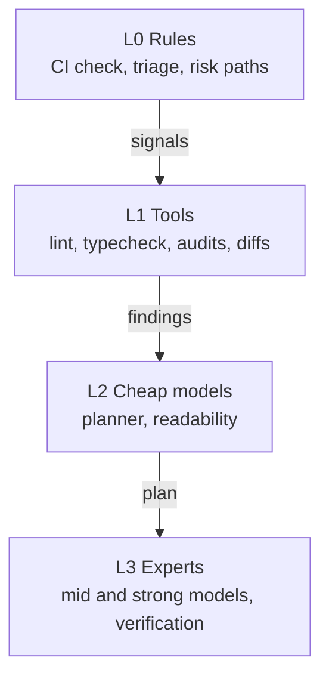

# Levels

A review should cost about as much as the change needs. To get there, eyeful starts each agent only
when a cheaper check has found something for it. Rules run first, then tools, then cheap models,
and the experts last. Each layer looks only at what the layer before it flagged. The level of a
review is a ceiling on that cost: the highest layer it may reach and whether it verifies. It never
decides what an expert may report. `workflow` implements the levels, the routing rules and the
budget; the L1 tools themselves are not built yet.

## The four layers

| Layer | Runs                                                                                                  | Model cost |
| ----- | ----------------------------------------------------------------------------------------------------- | ---------- |
| L0    | The CI check, triage, matching `risk` paths and file types                                            | none       |
| L1    | `lint`, `typecheck`, `secret_scan`, `dependency_audit`, `openapi_diff`, `complexity`, `coverage_diff` | none       |
| L2    | The planner, the readability expert, turning tool output into comments                                | small      |
| L3    | The correctness, skeptic, security, design, tests and usability experts, and reproduction             | most       |

L0 and L1 are deterministic and use no tokens, so every review runs them. Their output is also what
the upper layers act on.

## Levels

| Level    | Always runs     | Experts                                                                | Verification                                                   |
| -------- | --------------- | ---------------------------------------------------------------------- | -------------------------------------------------------------- |
| quick    | L0, L1          | Up to 2 experts on cheap models, only where an L1 tool found something | none                                                           |
| standard | L0, L1, planner | Picked by Go from the plan's groups; core groups get more              | The project's tests before the review, then every reproduction |

The quick level has no planner. Rules send tool output to experts: a `secret_scan` hit to security,
a `typecheck` error to correctness, an `openapi_diff` break to usability. If no tool finds anything,
a quick review is just the list of tool results and uses no tokens. For this reason quick is the one
level that does not require every line to be reviewed ([Planning and triage](PLANNER.md#triage)).

At standard pulls.review core groups the change and Go picks the experts each group needs
([The plan](PLANNER.md#the-plan)); there is no limit on how many. The heavier tools inside an expert
run only on request: `sast`, `e2e_run` and `a11y_check` run when the expert calls them.

A few signals start an expert at every level:

| Signal                                         | Effect         |
| ---------------------------------------------- | -------------- |
| A known CVE in an added or upgraded dependency | security runs  |
| A secret in the diff                           | security runs  |
| A breaking change in the API document          | usability runs |

## Who decides how closely to look {#choosing-the-level}

Nobody picks a level, and no rule about the size of a change picks one either. Every review a person
starts runs at standard, the way revmux runs one default profile instead of asking. How closely it
looks is left to the models, in three places:

- The planner marks the groups where a mistake costs the most as core, and a project can add to them
  with `risk` paths in `.eyeful/config.yml`. A core group gets the correctness, skeptic, security
  and design experts whatever its category ([The plan](PLANNER.md#the-plan)).
- Each expert reads until it has seen everything the change does to its files and reports every
  problem it finds, large or small. No level tells it to leave anything out.
- Each expert grades its own findings. A finding above `low` is verified and shown on its own; a
  `low` finding, which changes no behaviour, is not verified and is folded into the nitpicks at the
  end of the report ([Review feedback](REPORT.md#ranked-report)).

Quick is never chosen for a change. A hidden flag fixes it, for the [evaluation](EVALUATION.md) to
measure what the planned review adds over routing by rules once the L1 tools exist.

## Budget

A review has a budget in tokens and money, and each command the verifier runs has its own timeout.
There is no limit on total minutes, since a project's own tests may take longer than any fixed
limit. Go checks the budget before it starts each agent, so agents already running when it runs out
still finish. The planner and the experts may spend three quarters of it and the rest is kept for
verification and the summary, so a review whose experts read a great deal still verifies what they
found; at most four experts run at once, which bounds how far they can go over
([Running locally](LOCAL.md#agents)). From then on the review starts no more agents and returns what
it has verified, with result `partial`.

## Why start agents on demand

Running every expert on every change is simple but expensive. Most changes need two or three
experts, and a linter or an audit already catches many problems. Starting experts only on a signal
keeps the cost in line with the change. Whether this loses findings is measured in the
[evaluation](EVALUATION.md#ablations), which compares it with running every expert.
