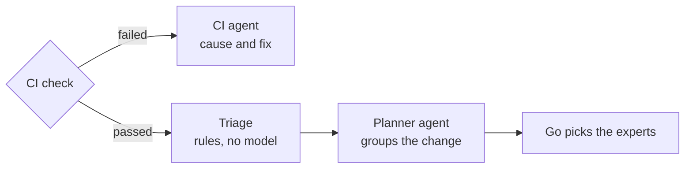

# Planning and triage

The first stage checks that the change is ready to review, sets aside files that need no review,
and decides which experts review the rest. Reading CI on GitHub and the cloud's `submit_plan` tool
are not built.



## CI check {#ci-check}

In the cloud, eyeful reads the GitHub Actions runs of the head commit and waits while any is in
progress. Locally the verifier runs the `lint` command from
[`.eyeful/config.yml`](CONFIGURATION.md#project). The `test` command is not part of this check
([Tests the change breaks](VERIFICATION.md#regressions)).

If the check fails, no expert starts. The CI agent reads the logs and reports each failure, its
cause and how to fix it, and the review ends with `ci_failed`.

## Triage {#triage}

Rules, with no model, set aside lockfiles, generated code, vendored code, binary files, the `skip`
paths of `.eyeful/config.yml`, and any file whose diff is over 512 KB. These go to no expert and
are listed as not reviewed. Every other line goes to at least one expert, following Google's
[Every Line](https://google.github.io/eng-practices/review/reviewer/looking-for.html#every-line).

The remaining files become a manifest:

```text
path                      class   +lines  -lines
app/auth/session.py       code        12       3
web/src/Login.svelte      code        40      18
commits: "fix session expiry at the boundary"
```

## Large changes {#large}

A change of more than 2,000 changed lines is split into scopes before planning. Go splits by path
alone, so the same change always gives the same scopes:

1. Files are grouped by their first directory, then by their first two. A group still over 2,000
   lines is cut in path order; a larger single file is a scope on its own.
2. Neighbouring groups are packed together up to 2,000 lines.
3. Each scope gets its own plan, its own experts and an equal share of the budget. A scope that
   uses up its share starts no more agents, and the review ends `partial`.

The project's tests, verification and the summary run once for the whole change. The report lists
the scopes in order ([The ranked report](REPORT.md#ranked-report)).

## The plan {#the-plan}

### Grouping the change

The planner is one call to the connected agent, driven by
[`@pulls.review/core`](https://github.com/antfu/pulls.review). `packages/pulls` bundles it into
`workflow/pulls/core.js`, which Go runs with [moejs](https://github.com/Calcium-Ion/moejs), so the
binaries need neither Node nor cgo.

1. core parses the diff and builds the prompt: the manifest, the hunk headers, and the diffs where
   they fit.
2. The agent answers with a summary of the change and its groups. Each group has a `category`, a
   label, its files, and `critical` where it needs extra care.
3. core checks the answer against its schema and that every file is in exactly one group. A
   rejected answer is retried once. After that the review uses the first four experts of the roster
   on one group, and the feedback says so.

```json
{
	"overallSummary": "Sessions now expire at the exact expiry second.",
	"groups": [
		{
			"key": "session-expiry",
			"label": "Session expiry",
			"category": "security",
			"critical": true,
			"filePaths": ["app/auth/session.py"]
		}
	]
}
```

A group is core when it is `critical` or holds a `risk` path from `.eyeful/config.yml`.

### Picking the experts

Go maps each group to experts with a fixed table:

| Category                     | Experts                                |
| ---------------------------- | -------------------------------------- |
| `security`                   | correctness, skeptic, security         |
| `core`, `api`, `data`, `cli` | correctness, skeptic                   |
| `ui`                         | usability, correctness                 |
| `i18n`                       | usability                              |
| `tests`                      | tests                                  |
| `docs`, `examples`           | readability                            |
| `scripts`                    | security, correctness                  |
| `config`, `build`, `deps`    | security                               |
| `assets`, `other`            | none                                   |
| a core group, in addition    | correctness, skeptic, security, design |

Each expert runs once over all of its groups ([Experts](EXPERTS.md)).
