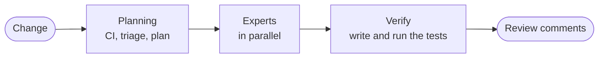

# Overview

eyeful reviews code changes with a group of agents. A planner groups the change, the experts each
group needs review it in parallel. When eyeful finds the project's test commands, it then has a
test written for each reported bug and runs it; otherwise a judge reads the findings. The result reaches a person as review comments.

## Status

- **Works:** local reviews. `eyeful review`, `provider`, `connect`, `commit` and the desktop app run
  the whole workflow with your own coding agent ([Running locally](LOCAL.md)).
- **In progress:** the evaluation, whose tooling is built and whose experiment has not run
  ([Evaluation](EVALUATION.md)). Cloud reviews run each pull request in a GitHub Actions job and verify
  in a sandbox container per review ([Running in the cloud](cloud/CLOUD.md)).
- **Planned:** the L1 tools and the experts' own tools ([Roadmap](ROADMAP.md)).

## Limits {#limits}

- **It is not a testing tool.** It writes one test per finding and runs the project's own suite. It
  does not generate a suite or measure coverage ([Relation to CI](VERIFICATION.md#relation-to-ci)).
- **It does not see a running interface.** The usability expert reads markup and component code;
  nothing renders a page ([Experts](EXPERTS.md#usability)).
- **A review without findings proves nothing.** It finds what a model notices in the changed files,
  and two reviews of one change can differ.
- **It reports only what the change introduces.** Flaws the base commit had, and anything outside
  the repository, are left out.
- **It proves only what a unit-sized test can show.** Performance, timing between threads, and
  behaviour that needs a database or a browser are read by the judge and never run.
- **It does not approve or merge** ([A review](REVIEW.md#rules)).
- **Locally there is no sandbox.** Its agents run as the user ([Running locally](LOCAL.md)).

## Documents

How a review works:

| Document                                     | Covers                                             |
| -------------------------------------------- | -------------------------------------------------- |
| [A review, end to end](REVIEW.md)            | Stages, results, the review standard, rules, gaps  |
| [Planning and triage](PLANNER.md)            | The CI check, triage, large changes, the plan      |
| [Levels](LEVELS.md)                          | Who decides how closely to look, the budget        |
| [Experts](EXPERTS.md)                        | Each expert's standards, skills and tools          |
| [Evidence and verification](VERIFICATION.md) | The verifier, oracles, the judge, SARIF            |
| [Review feedback](REPORT.md)                 | Comment format, the ranked report, rounds          |
| [Running locally](LOCAL.md)                  | Desktop and CLI, the snapshot, agents, local risks |
| [Questions and answers](FAQ.md)              | What is reviewed, large changes, changing files    |
| [References](REFERENCES.md)                  | Standards and borrowed projects                    |
| [Principles](PRINCIPLES.md)                  | The author's eight working principles              |

How eyeful is measured: [Evaluation](EVALUATION.md).

How the code is built:

| Document                               | Covers                                    |
| -------------------------------------- | ----------------------------------------- |
| [Architecture](ARCHITECTURE.md)        | Components, the workflow, layout          |
| [Local development](DEVELOPMENT.md)    | Setup, commands, code generation          |
| [Code style and review](STYLEGUIDE.md) | Coding rules and how changes are reviewed |

The cloud, which is separate. A pull request is reviewed in a GitHub Actions job and verified in its
own sandbox:

| Document                                | Covers                                        |
| --------------------------------------- | --------------------------------------------- |
| [Running in the cloud](cloud/CLOUD.md)  | Pull requests, agents and models, the sandbox |
| [The action](cloud/SERVER.md)           | Components, layout, lifecycle                 |
| [Review lifecycle](cloud/SCHEDULING.md) | Triggers, who may start a review, re-runs     |
| [Deployment](cloud/DEPLOYMENT.md)       | The workflow, secrets, the model provider     |

Every setting is in [Configuration](CONFIGURATION.md). What comes next: the [Roadmap](ROADMAP.md).

Each document owns one topic and describes what the code does now; planned work is marked. English
is the source and `zh/` is the translation.
