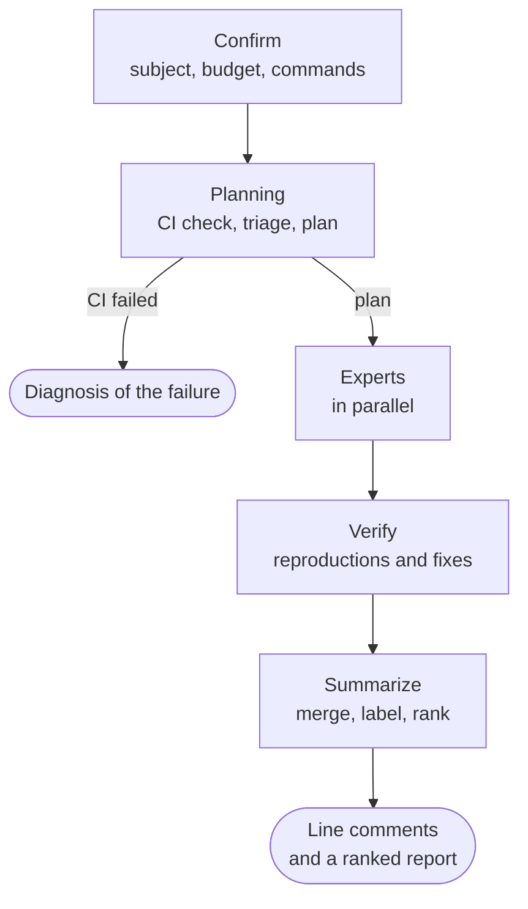

# A review, end to end

A review goes through four stages, implemented in the `workflow` module
([Architecture](ARCHITECTURE.md#workflow)). A local review runs all of them
([Running locally](LOCAL.md)). A cloud review runs the same stages on a pull request in a GitHub
Actions job, with the project's commands in a sandbox ([Running in the cloud](cloud/CLOUD.md)).

## Before it starts {#before-it-starts}

Locally, the client shows what will be reviewed, the budget, and the project commands that will
run, and the review starts when the user confirms. The user confirms the commands again when they
change. In the cloud, adding the eyeful workflow to a repository is that consent, and the commands
come from the base branch. A started review cannot be cancelled.

eyeful finds the commands from the project's manifests
([Project commands](CONFIGURATION.md#project)). When it finds none, nothing runs and the judge reads
every finding.

## Stages {#stages}

| Stage     | Does                                                                 | If it fails                      | Page                                         |
| --------- | -------------------------------------------------------------------- | -------------------------------- | -------------------------------------------- |
| planning  | CI check, checkout and setup, triage, the project's tests, the plan  | See below                        | [Planning and triage](PLANNER.md)            |
| experts   | Each selected expert reviews its files                               | The expert is listed as absent   | [Experts](EXPERTS.md)                        |
| verify    | Writes and runs a reproduction for each `error` or `warning` finding | The judge reads the finding      | [Evidence and verification](VERIFICATION.md) |
| summarize | Merges findings, labels and ranks them by rule                       | It runs no agent and cannot fail | [Review feedback](REPORT.md)                 |

A failed stage loses only its own work, and the feedback says what failed. A failed CI check ends
the review with `ci_failed`; a failed clone ends it with `none`. A failed setup does not end it: the
experts still review and every finding is unverified.

Each stage writes its output to the run archive when it finishes. If the process stops, a review started again
resumes from the last finished stage. A step whose agent call failed, or that the budget refused,
is not kept and runs again. The plan is always kept, because the experts' work rests on it.

## The review standard {#review-standard}

eyeful follows the parts of Google's
[Standard of Code Review](https://google.github.io/eng-practices/review/reviewer/standard.html) that
concern writing comments:

- A comment blocks only when it shows the change introduces a bug, a vulnerability or a regression.
- Ideas for improvement are non-blocking suggestions.
- On style the project's own guide decides. A point it does not mention is a `nitpick`.
- A design comment names the principle it rests on.

[Review feedback](REPORT.md) maps these to comment labels.

## States and results

A review moves from `queued` to `running` to `done`, and ends with one result:

| Result      | Meaning                                             |
| ----------- | --------------------------------------------------- |
| `complete`  | Every stage ran                                     |
| `none`      | Nothing could be reviewed; `reason` says why        |
| `ci_failed` | The CI check failed, and the feedback diagnoses it  |
| `partial`   | The budget ran out or an expert handed in no report |

When a cloud review runs and how a re-run behaves is in [Review lifecycle](cloud/SCHEDULING.md).

## Rules {#rules}

1. The agent decides what to do. Go decides whether it may, and owns every loop, budget and stop
   condition.
2. eyeful does not approve changes or block merges. A person merges.
3. Every run is recorded: who ran, what ran and what it cost.
4. A re-review starts by running the last review's reproductions again
   ([Rounds](REPORT.md#rounds)).
5. A review starts only with consent: the user's confirmation locally, the eyeful workflow in the
   cloud. A started review runs to the end.
6. If CI fails, the change gets a diagnosis instead of a review.

## Known gaps {#known-gaps}

- What the panel adds over one agent, and how eyeful compares with other reviewers, is not yet
  measured ([Evaluation](EVALUATION.md)).
- No tool runs. The checks planned to run before and beside the experts are not built
  ([Levels](LEVELS.md#planned)).
- The skills are unmeasured. Every expert now gets its skills in the prompt, and no run has been
  made without them.
- Whether each expert should give an overall verdict, and whether "coverage does not decrease"
  should be a hard rule, are undecided.
