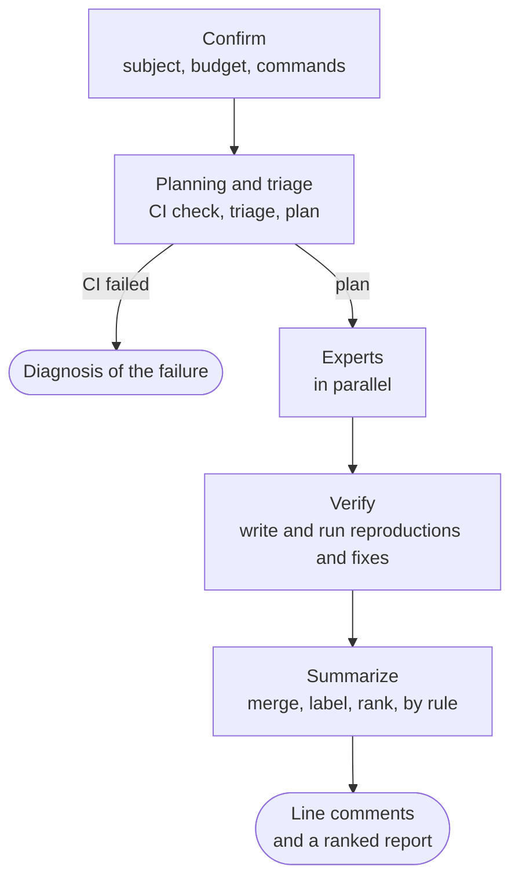

# A review, end to end

This page follows one review from the user's confirmation to the comments a person reads. The
stages are implemented in the `workflow` module ([Architecture](ARCHITECTURE.md#workflow)), and a
local review runs all of them ([Running locally](LOCAL.md)). No cloud review does yet: the API
accepts a review and a worker claims it, then a placeholder executor ends it with result `none`,
because the cloud's agents and sandbox are not built.

## Before it starts {#before-it-starts}

Before creating a review, the client shows what will be reviewed (a branch against its base, or
local changes), the budget, and the project commands that will run. How closely the review looks is
not a setting ([Levels](LEVELS.md#choosing-the-level)). The review is
created when the user confirms. Once it starts it cannot be cancelled; a review that is still queued
can be deleted.

The commands come from `.eyeful/config.yml`. Locally, the user confirms them again whenever they
change. If the repository has no such file, nothing runs and every finding stays unverified; an
agent proposing commands for the user to confirm is planned.

## Stages {#stages}

| Stage     | What it does                                                                                         | If it fails                                | Page                                         |
| --------- | ---------------------------------------------------------------------------------------------------- | ------------------------------------------ | -------------------------------------------- |
| planning  | CI check, checkout and setup, triage, the project's tests, the last review's reproductions, the plan | See below                                  | [Planning and triage](PLANNER.md)            |
| experts   | Each selected expert reviews its files with its standards and tools                                  | The expert is dropped and listed as absent | [Experts](EXPERTS.md)                        |
| verify    | A reproduction is written for each `error` or `warning` finding and run, then its fix                | The judge reads the finding instead        | [Evidence and verification](VERIFICATION.md) |
| summarize | Merges findings, forms them into Conventional Comments by rule, ranks them                           | It runs no agent and cannot fail           | [Review feedback](REPORT.md)                 |

When a stage fails, only that stage's work is lost, and the feedback says what failed. Two failures
end a review early. If the CI check fails, the review ends with result `ci_failed` and a diagnosis.
If the clone fails, it ends with `none`. A failed setup does not end the review: the experts still
review, and every finding is marked unverified
([Evidence and verification](VERIFICATION.md#the-verifier)).

Each stage writes its output (the plan, each expert's findings, each verifier run) to the run
archive when it finishes. If a worker dies, the next worker resumes from the last finished stage,
and model calls that already completed are not repeated.

The budget of a review is a ceiling on what it may spend, and it never decides what an expert reports
([Levels](LEVELS.md#budget)).

## The review standard {#review-standard}

eyeful follows Google's
[Standard of Code Review](https://google.github.io/eng-practices/review/reviewer/standard.html). It
never approves a change, so it uses the parts of that standard about writing comments.

A comment is blocking only when it shows that the change introduces a bug, a vulnerability or a
regression. Ideas for making the change better are non-blocking suggestions. A finding the
verifier saw fail is ranked above every finding that still needs a person to decide. On style, the project's own style
guide decides, and a style point it does not mention can only be a `nitpick`. A design comment has
to name the engineering principle it is based on.

[Review feedback](REPORT.md) maps these rules to comment labels, and [References](REFERENCES.md)
lists the sources.

## States and results

A review moves from `queued` to `running` to `done`. A finished review has one of these results:

| Result      | Meaning                                                                          |
| ----------- | -------------------------------------------------------------------------------- |
| `complete`  | Every stage ran                                                                  |
| `none`      | Nothing could be reviewed; `reason` explains why, for example a failed clone     |
| `ci_failed` | The CI check failed, and the feedback explains the failure                       |
| `partial`   | The budget ran out or an expert handed in no report; the feedback holds the rest |

How workers claim, renew and finish reviews, and what happens when one dies, is in
[Scheduling and leases](SCHEDULING.md#reviews-over-workers).

## Rules {#rules}

The review standard above, taken from the literature, decides what a comment says. The rules below
decide how the workflow runs, and several of them enforce hard measures from `.agents/POLARIS.md`.

1. The agent decides what to do. Go decides whether it may, and owns every loop, budget and stop
   condition.
2. eyeful does not approve changes or block merges. A person merges.
3. Every run is recorded: who ran, what ran and what it cost. These records are also the thesis
   data.
4. A re-review starts from what the last review reproduced, not from what it said: those tests run
   again before any agent reads the change ([Rounds](REPORT.md#rounds)).
5. The user confirms before a review starts, and a started review runs to the end.
6. If CI fails, the change gets a diagnosis of the failure instead of a review.

## Open decisions {#open-decisions}

- Verdicts: should each expert give an overall verdict on its part, or should the kind of each
  finding alone go on deciding what is blocking?
- Coverage: should "coverage does not decrease" be a hard rule, or an ordinary finding of the tests
  expert?

## Known gaps {#known-gaps}

These are faults eyeful has and has not fixed, with the reason each is still open.

- The panel is no better than one agent at the findings that matter most. On ReviewBench's test
  pull requests it found 5 of 11 high-severity findings and the single agent 6, while costing three
  times the tokens; what it adds is in medium and low findings
  ([Evaluation](EVALUATION.md#reviewbench-pilot)). It is open because the cause is not known: 11
  findings are too few to say which were missed and why, and the scores that would show it could
  not be computed again once the judge's model account ran out. Changing how the experts divide the
  work without that would be a guess fitted to one small set.
- No tool runs. The checks meant to run before any agent, and the ones an expert would call, are
  not built ([Levels](LEVELS.md#planned)); the experts read with their agent's own file tools and
  nothing else. It is open for two reasons. Each tool needs a program for each language, installed
  on the user's machine or in the sandbox, which is a decision about what eyeful may run there and
  not only code. And none of the benchmark repositories has an `.eyeful/config.yml`, so today no
  tool would run in any measured review and its effect could not be shown. The history of the
  changed files is the one piece that needed neither and is built ([Experts](EXPERTS.md#skills-and-tools)).
- The skills are unmeasured. In the runs that were inspected about a third of the correctness and
  skeptic experts opened a skill at all. Whether the 22 vendored skills change what is found needs a
  run without them, which has not been made.
