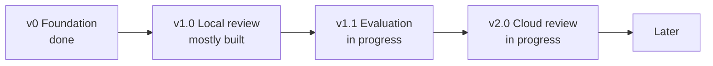

# Roadmap

The versions follow one line: build the review, measure it, then take it to pull requests. A
version is released when its exit criteria hold and no hard measure in `.agents/POLARIS.md` has
regressed.

## v0: Foundation (done)

- The desktop window, and CI running `mise run check`.

## v1.0: Local review (mostly built)

The core chain, find → reproduce → fix → regress, on the user's machine with the coding agent they
already use ([Running locally](LOCAL.md)).

| Part                                                                              | State |
| --------------------------------------------------------------------------------- | ----- |
| The `workflow` module: planning, the seven experts, the verifier, merging, report | Built |
| The verifier's six gates, the graded oracle, the read-only judge                  | Built |
| Project commands found from manifests and confirmed by the user                   | Built |
| The run archive and stage checkpoints; feedback as SARIF and Markdown             | Built |
| `eyeful review`, `provider`, `connect`, `commit`, and the desktop app             | Built |
| A tagged release with binaries for macOS and Linux                                | To do |

Exit criteria:

- `eyeful review` on eyeful's own repository returns feedback, and no credential or model key
  leaves the machine.
- Every `issue (blocking)` was seen failing by the verifier and has a `specified` or `implicit`
  oracle, or a `derived` one that is a test of the project's own.
- A review that runs out of budget returns what it verified, marked partial. A review restarted on
  its run directory resumes from its last finished stage.

## v1.1: Evaluation (in progress)

The experiment that measures v1.0 ([Evaluation](EVALUATION.md)), run from the command line against
public datasets. The desktop app gets no new features until this is done. Cloud review is under way
in v2.0.

| Part                                                                         | State         |
| ---------------------------------------------------------------------------- | ------------- |
| `eval/`: subject builders, runners, the isolation audit, labelling, analysis | Built         |
| Code Review Bench and ReviewBench subjects                                   | Built         |
| SWE-bench subjects                                                           | 1 of about 30 |
| Running SWE-bench's own failing tests on eyeful's fix                        | To do         |
| Three repetitions of every review, and the labelling                         | To do         |

Exit criteria: the main experiment has run on every dataset, in every configuration and every
condition the dataset allows, three times each; the findings are labelled; and the results
show what the panel adds over the single agent and what it costs.

## v2.0: Cloud review (in progress)

The workflow on pull requests through a self-hosted GitHub App
([Running in the cloud](cloud/CLOUD.md)).

| Part                                                                       | State |
| -------------------------------------------------------------------------- | ----- |
| The webhook, one review per head commit                                    | Built |
| Checkout of the pull request, with commands taken from the base commit     | Built |
| The CI check against GitHub Actions                                        | Built |
| One Durable Object and Container per review, running the local workflow    | Built |
| Models and Jev through AI Gateway; stages in R2, so a review resumes       | Built |
| A `COMMENT` review for line comments, and the ranked report as one comment | Built |
| The sandbox, so the project's commands run only there                      | To do |
| The outbox, so a comment GitHub has accepted is posted once                | To do |
| The `eyeful` Check Run, required before merging                            | Built |
| Waiting for CI in the Durable Object instead of the Container              | To do |
| An end-to-end run on a real pull request                                   | To do |

Exit criterion: a cloud review of an untrusted pull request finishes with code running only inside
its sandbox, and a Container stopped mid-review loses nothing and posts nothing twice.

## Later

- The L1 tools and the routing that uses their output ([Levels](LEVELS.md#planned)).
- The experts' own tools ([Experts](EXPERTS.md)).
- A performance expert, and scheduled sources.
