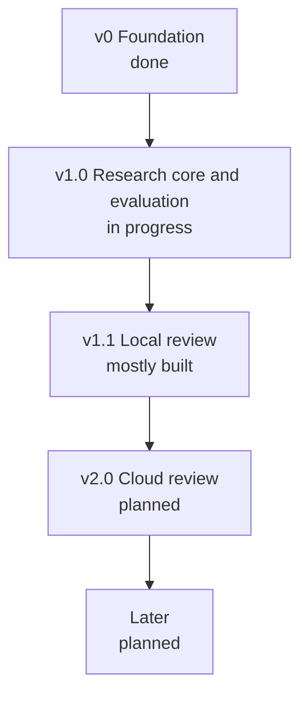

# Roadmap

What each version delivers and what it must show before release. A version is released when its
exit criteria hold and no hard measure in `.agents/POLARIS.md` has regressed.

## v0: Foundation (done)

- GitHub App and Gitee sign-in, API keys and sealed provider tokens ([Auth](cloud/AUTH.md)).
- The CRUD API, its OpenAPI document and the TypeScript SDK ([API](cloud/API.md)).
- The PostgreSQL queue with leases, fencing and a reaper; provider routing, built but not wired in
  ([Scheduling](cloud/SCHEDULING.md)).
- The console's repository browser, the desktop window, and CI running `mise run check`.

## v1.0: Research core and evaluation (in progress)

Only what the [research questions](EVALUATION.md#research-question) need, driven from the command
line against a dataset.

| Part                                                                                 | State                              |
| ------------------------------------------------------------------------------------ | ---------------------------------- |
| The `workflow` module: planning, experts, verifier, summary                          | Built                              |
| The correctness and security experts, and the generalist baseline                    | Built                              |
| The verifier's six gates, the graded oracle, the read-only judge                     | Built                              |
| The run archive and stage checkpoints; feedback as SARIF and Markdown                | Built                              |
| `eval/`: subject builders, runners, labelling sheet, analysis                        | Built                              |
| Pilots on Code Review Bench, ReviewBench and the injected defects                    | Run ([Pilot](EVALUATION.md#pilot)) |
| Agents in pi with keys eyeful controls ([Agents in pi](cloud/CLOUD.md#agents-in-pi)) | To do                              |
| The injected-defect subjects                                                         | To do                              |
| Three repetitions of every review, and the labelling                                 | To do                              |

Exit criteria:

- The main experiment has run on both datasets, in both configurations and all three conditions,
  three times each, and the findings are labelled.
- Every `issue (blocking)` in those runs was seen failing by the verifier and has a `specified` or
  `implicit` oracle, or a `derived` one that is a test of the project's own.
- A review that runs out of budget returns what it verified, marked partial. A worker killed in
  mid-review resumes from its last finished stage.
- The thesis can report what the panel adds over the single agent and what it costs.

Until v1.0 is released, the console, the desktop app, Gitee sign-in, CORS, rate limits and MCP get
no new features.

## v1.1: Local review (mostly built)

The same workflow on the user's machine ([Running locally](LOCAL.md)). Built ahead of v1.0, so the
experts and the verifier can be tried on real changes:

- `local/agents`, the snapshot and its checkout;
- all six experts with skills from skills.sh;
- `eyeful review`, `provider`, `connect`, and the desktop app.

Still to do: migrations move from editing `0001_init` to one file per change
([Persistence](cloud/PERSISTENCE.md)).

Exit criterion: `eyeful review` on eyeful's own repository returns feedback without calling the
server, and no credential or model key leaves the machine.

## v2.0: Cloud review (planned)

The workflow on pull requests ([Running in the cloud](cloud/CLOUD.md)): the CI check against GitHub
Actions, `cloud/internal/checkout` and `cloud/internal/sandbox`, sources, the outbox and sinks, comments posted
as a `COMMENT` review, E2E runs, SSE progress and a `runner` command.

Exit criterion: a cloud review of an untrusted pull request finishes with code running only inside
its sandbox, and a worker killed mid-review loses nothing and runs nothing twice.

## Later (planned)

MCP on `POST /mcp` ([API](cloud/API.md#mcp-planned)), webhook and scheduled sources, a performance expert,
and team ownership of reviews.
