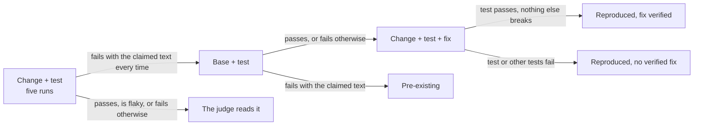

# Evidence and verification

This page describes how eyeful decides how far to trust a finding. Experts read code, call their
tools and propose tests. The verifier, which is plain Go code in `workflow`, runs those tests and
records the outcome. It runs them through the review's workspace: locally a disposable checkout of
the snapshot ([Running locally](LOCAL.md#how-a-local-review-runs)); the cloud sandbox is not built yet.

## The oracle problem {#oracle}

When a test fails, all it shows is that the code and the test disagree. It does not show that the
test is right. An expert that misreads what the code should do will write a test that fails by its
own reading, then a fix that makes the test pass, and both steps succeed. Whether a session should
expire at `expires_at` or one second later is a question for the specification. The code cannot
settle it.

A reproduction therefore lets a finding block only when the expected behaviour comes from somewhere
other than the agent. Each reproduction test declares its oracle, the source of the behaviour it
expects, and the verifier records it. The kinds are not eyeful's own: they are the four into which
Barr et al.'s survey of the oracle problem sorts every test oracle, by where its knowledge of
correct behaviour comes from ([References](REFERENCES.md#testing)):

| Oracle      | In the survey                                                                                            | In eyeful                                                                                                   | A test that fails as claimed is |
| ----------- | -------------------------------------------------------------------------------------------------------- | ----------------------------------------------------------------------------------------------------------- | ------------------------------- |
| `specified` | A specification says what is correct                                                                     | Text the finding quotes: the issue, the pull request description, documentation, a docstring, an API schema | `fail`                          |
| `derived`   | Derived from another artefact; in regression testing "the previous version can serve as an oracle"       | A test already in the repository that now fails                                                             | `fail`                          |
|             |                                                                                                          | The base commit behaves differently, shown by a new test that passes there                                  | `review`                        |
| `implicit`  | General knowledge that needs no specification: "buffer overflows and segfaults are nearly always errors" | A crash, an unhandled error, a data race (`-race`), a sanitizer report, a timeout                           | `fail`                          |
| `human`     | No automated oracle exists and a person is the final source of what is correct                           | Only the agent's own reading of the code, so the author has to decide                                       | `review`                        |

The last column is the [kind](#kind-and-severity) of the result. A `derived` oracle has two forms
because the survey's regression oracle holds for functionality a change means to keep: a test the
project wrote says the project means to keep it, while a new test that merely passes on the base
commit shows a difference the change may have intended.

The verifier grades the oracle and does not take the agent's word for it. A `specified` oracle
names the file that holds its quote, or no file when the quote is a commit message of the change,
and the verifier looks the quote up; a quote it cannot find there, ignoring line breaks and
spacing, turns the oracle into `human`. An `implicit` oracle claims a failure the runtime prints,
such as a crash, so its `fails` text must not be something the test wrote itself: when the test
file contains that text, the expectation is the test's own and the oracle becomes `human`. A
`derived` oracle that hands in no test of its own names a test already in the repository, and the
verifier runs that. One that hands in a new test is decided by the run on the base commit and not
by the agent: it holds only when the test passes there, and an oracle that would otherwise be
`human` becomes `derived` when it does, because the base commit was then seen to behave
differently. The finding keeps the oracle the agent declared, and the verification records the
reproduction as it ran with the graded oracle, so the evaluation can measure what the oracle rule
changes.

A reproduction whose result is `review` cannot be blocking. It is turned into a `question` for the
author, with the failing test attached. The suggested fix is written by a separate agent, which
sees the finding and the test but not the expert's reasoning, so that the fix is not just the
expert's assumption written a second time.

## Evidence kinds {#evidence-kinds}

`evidence` says how a finding can be checked. Its values are verification methods of ISO/IEC/IEEE
29148, the requirements engineering standard, which names four ways of showing that something
holds: inspection, analysis, demonstration and test ([References](REFERENCES.md#testing)):

| Method       | Produced by                    | What it means here                                                    | What ran                        |
| ------------ | ------------------------------ | --------------------------------------------------------------------- | ------------------------------- |
| `test`       | correctness, skeptic, security | A test that calls the code can show the problem                       | A test that fails on the change |
| `analysis`   | skeptic, security              | The expert reasons through the path that reaches the problem          | Nothing                         |
| `inspection` | every expert                   | The expert reads the code against a standard, a convention or its use | Nothing                         |

These three are the methods the code has. The fourth, demonstration, is operating the system and
watching what it does; it comes with the tool that opens the pages, and methods that rest on another
tool's result come with those tools ([Levels](LEVELS.md#planned)).

An expert finds problems and does not prove them: it hands in a finding with the scenario that
triggers it, and a `test` finding says only that a test could show it. The reproduction is
written afterwards, by another agent, so the cost of proof never decides what an expert reports.
When no reproduction can run, because verification is not `execution`, the project has no test
command or could not be set up, the judge reads the finding instead.

## Kind and severity {#kind-and-severity}

How settled a finding is and how much it would cost are two questions, and eyeful answers both in
the words of [SARIF 2.1.0](https://docs.oasis-open.org/sarif/sarif/v2.1.0/sarif-v2.1.0.html), the
OASIS standard for the results of code analysis, so that no scale of its own stands between a
finding and the tools that read it.

The kind is set by the verifier and the judge, never by the expert:

| Kind     | In SARIF (§3.27.9)                                                                              | A comment has it when                                                                                                |
| -------- | ----------------------------------------------------------------------------------------------- | -------------------------------------------------------------------------------------------------------------------- |
| `fail`   | "The result represents a problem whose severity is specified by the level property"             | The verifier saw its reproduction fail on the change and not on the base commit, by an oracle whose result is `fail` |
| `review` | "The result requires review by a human user to decide if it represents a problem"               | Nothing ran, the judge confirmed it by reading, or its reproduction rests on a `review` oracle                       |
| `open`   | "the tool concluded that there was insufficient information to decide whether a problem exists" | The expert reported it and the judge disputes it                                                                     |

Only a `fail` comment is an `issue (blocking)` ([Review feedback](REPORT.md#comment-format)).

The severity is the expert's judgement of what the problem costs if the change is merged as it is,
in SARIF's levels (§3.27.10):

| Severity  | In SARIF                                                          | An expert gives it to                                                                                                     |
| --------- | ----------------------------------------------------------------- | ------------------------------------------------------------------------------------------------------------------------- |
| `error`   | "a serious problem was found"                                     | Data lost or exposed, a system that cannot be used, or a wrong result, a crash or a broken contract on a path people take |
| `warning` | "a problem was found"                                             | The same on a path few take, or a fault that needs an unusual input or state                                              |
| `note`    | "a minor problem or an opportunity to improve the code was found" | Nothing behaves differently: a name, style, wording, a comment or a small simplification                                  |

SARIF lets a result carry a level only when its kind is `fail`; for every other kind the level is
`none`. The file eyeful writes follows that, and keeps the severity an expert claimed for a `review`
or `open` result in the property bag ([Findings as SARIF](#sarif)).

## Tests prove findings

eyeful does not write tests to raise coverage. A test is how an expert shows that a functional error
exists: if the expert is right, a small test fails on the change. The test belongs to the finding,
and it is offered to the author only together with the fix it proves.

## Tests the change breaks {#regressions}

Running code is also a way to find problems, and not only to prove the ones an expert already
suspects. With `execution`, before any expert starts, the verifier runs the project's tests (`test`)
on the change. When they fail it runs them once more on the base commit, and whatever passes there
and fails on the change is a regression: a fact about the change that no reading of the diff gives.

Each expert that can report `test` findings is given the failing tests and the end of the
failing run. It looks for the changed line behind each failure its files can explain and reports it
as a finding that names the failing test, so the reproduction is that test as it stands and its
oracle is `derived`. The feedback lists the tests the change breaks whether or not an expert
explained them.

Locally the workspace cannot tell the tests of one failing command apart, so a regression names the
command and the output names the tests. In the cloud the [CI check](PLANNER.md#ci-check) has already
required the project's own CI to pass, so this step finds only what that CI does not run. When the
tests cannot run at all, the feedback says so, the experts get no lead, and no fix is verified,
because `pass_to_pass` compares against this same run.

## The verifier {#the-verifier}

The verifier is the only part of eyeful that runs the project's code. It runs only the commands in
[`.eyeful/config.yml`](CONFIGURATION.md#project) and eyeful's own tools.

The kind is known only after verification, so the verifier needs an order that does not depend on
it. It sorts findings by the severity the expert declared, then by how many experts reported the
same lines. A `note` finding is not verified at all: it claims no behaviour that a test or the judge could check, and it is
reported as a nitpick ([Review feedback](REPORT.md#ranked-report)).

For each `test` finding a reproduction agent writes a test from the finding and its scenario;
the agents of all findings write at once. The reproduction is accepted only when the test passes
every gate below, in this order. The gates are the ones benchmarks use to accept a bug or a generated test: fail-to-pass and
pass-to-pass from SWE-bench, the base commit from Defects4J, and repeated runs from Meta's
TestGen-LLM ([References](REFERENCES.md)).

| Gate               | The verifier                                                                 | When it does not hold                                            |
| ------------------ | ---------------------------------------------------------------------------- | ---------------------------------------------------------------- |
| `runs`             | adds the test to a fresh copy of the change and runs it                      | the judge reads the finding: the reproduction could not run      |
| `not_flaky`        | runs it five times; every run has to end the same way                        | the judge reads the finding: the reproduction is flaky           |
| `fails_as_claimed` | looks for the reproduction's `fails` text in the failing output              | the judge reads the finding: the test passes, or fails otherwise |
| `introduced`       | runs it once on the base commit, where it must not fail with the same text   | `pre_existing`: reported, never blocking                         |
| `fail_to_pass`     | applies the suggested fix to a fresh copy that also has the test and runs it | reproduced, no verified fix                                      |
| `pass_to_pass`     | runs the tests of the packages the change touches on that copy               | reproduced, no verified fix                                      |

`fails` is a short text the reproduction agent says the test prints when it fails for the claimed reason, such
as its assertion message. It separates the failure the finding predicts from a test that does not
compile or cannot import its subject, which would otherwise count as a reproduction. On the base
commit the same text decides between two cases: a test that fails there with `fails` shows a problem
that was already present, while a test that fails there in another way, usually because the code it
calls is new, says nothing against the finding, and verification goes on. An agent on a user's machine cannot run its own test before handing it in, so when the first
five runs fail without the `fails` text the verifier asks the reproduction agent once for a
corrected reproduction, showing the one that ran, the command and the output, and starts the gates
again with the answer. The verification records the reproduction that ran last. Two rules keep the test honest: it is always a new file, so it cannot replace code or a test that is already there, and a
fix that edits the reproduction test is not verified. Experts often report the same defect more than once, so findings of different experts on the same
file within two lines are checked together; two findings of one expert are checked apart. The reproduction is written and run for the one with the highest severity;
the others are not checked again, since they end up in the same comment, which takes its evidence
from the one that was. When the reproduction shows nothing they all go to the judge, which gives each
its own verdict, so a wrong finding cannot take a right one beside it down with it. `pass_to_pass`
compares with the run on the change that was made before the review
([Tests the change breaks](#regressions)): nothing that passed before the fix may fail after it.



Each verification records what the runs showed, in the test statuses of SWE-bench's harness: every
run on the change, the run on the base commit and the run with the fix is `PASSED`, `FAILED` when it
fails with the `fails` text, or `ERROR` when it fails in any other way. The gate a finding stopped
at follows from these, so the [evaluation](EVALUATION.md) can count how many findings each gate
turns away. A reproduced finding then has the kind its oracle gives it. A finding
whose test did not show it, because none was written, it passed on the change, was flaky or failed
in another way, is not dropped: the test may have been the part at fault, so the judge reads the
finding with the record of that attempt and confirms or disputes it. A confirmed or pre-existing
finding stays `review`, so it cannot block.

## The judge {#the-judge}

A reproduction is not the only way a finding is checked. With `execution`, a finding that no test
can show, or whose test did not show it, goes to a judge agent, and with `read_only`, where no
command runs, every finding does. The judge reads the code and the finding, and the record of the test when one was tried, and
calls the finding valid only when the problem exists in the changed code, the change introduces or
exposes it (behaviour that a caller in the repository or the users of a public interface still
rely on, and that is gone without a commit message announcing it, counts as introduced), and it changes observable behaviour or breaks a stated contract (an issue,
documentation, an API schema or an existing test). Style remarks and concerns that name no failing
input are not valid.

One judge reads the findings of one group of the plan together, at most eight at a time, and up to
four judges run at once. The findings of a group lean on the same files and callers, which a judge
for each finding read again every time: in the Code Review Bench runs that judge was 30 to 50% of a
review's tokens. Read together on the same findings, the judges used 55% of those tokens and gave
62 of 67 verdicts as before, which is within how far two judgements of one finding differ anyway.
Batches of eight across groups saved little more, because a judge reading two groups reads twice
the code. Letting a finding two experts agree on skip the judge was considered and left out for the
same reason, since the cost is in the files a judge reads and not in the findings it answers for,
and it would take the check away from the findings a reader meets first. Every finding still gets its own verdict and reason; one the judge's answer leaves out
stays unverified and is listed in the uncertainty checklist.

The judge does not decide whether a finding is shown. Evidence sets the kind of a comment, never
whether it exists: a finding the judge rejects stays in the feedback as an `open`, non-blocking
comment, folded under "Disputed" with the judge's reason beside it
([Review feedback](REPORT.md#ranked-report)), and the person reading decides. One
agent reading one finding once is not reliable enough to delete it. Two judgements of the same
finding can differ, and a rejection that removed the finding would lose real problems without a
trace. The cost is more comments to read, which the [evaluation](EVALUATION.md) measures as
precision.

This is the definition the evaluation's labelling uses, so the two conditions
differ in their evidence and not in what they count as a defect.

All of this depends on the project installing and its tests running, which is the main practical
limit of the approach. Many repositories need services such as a database, or more than one setup
command. When `setup` fails, the review continues as a read-only review. Every finding is marked
unverified, and the feedback explains why.

## An example

A correctness expert reviewing `app/auth/session.py` proposes this test:

```python
from app.auth.session import Session, is_expired

def test_expired_at_exact_boundary():
    assert is_expired(Session(expires_at=100), now=100)
```

The fix agent proposes:

```python
def is_expired(session, now):
    return now > session.expires_at  # [!code --]
    return now >= session.expires_at  # [!code ++]
```

The test fails on the change and passes with the fix. What the finding becomes depends on the
oracle. If the pull request says "a session expires at `expires_at`", the oracle is `specified`,
the result is `fail`, and the finding becomes an `issue (blocking)` with the fix attached. If
nothing says where the boundary should be, the oracle is `human`, the result is `review`, and the
same test becomes a `question`: "Should a session still be
valid at exactly `expires_at`? This test fails on the change." The verifier writes the result; the
expert cannot mark its own test as passed.

## Findings as SARIF {#sarif}

Every finding, whatever produced it, is stored as a result in
[SARIF 2.1.0](https://docs.oasis-open.org/sarif/sarif/v2.1.0/sarif-v2.1.0.html), the OASIS standard
format for static analysis results. Output from tools that already write SARIF, such as Semgrep and
gitleaks, is read as it is. An expert's `submit_report` findings are converted into the same shape.
Standard fields hold what the standard defines them for, and eyeful's own fields go in the property
bag:

| SARIF field        | Holds                                                                                                      |
| ------------------ | ---------------------------------------------------------------------------------------------------------- |
| `ruleId`, `taxa`   | The rule or tool check, and the CWE identifier where there is one                                          |
| `kind`             | The [kind](#kind-and-severity): `fail`, `review` or `open`                                                 |
| `level`            | The severity of a `fail` result; `none` for any other kind, as the standard requires                       |
| `baselineState`    | Of a reproduced result: `new`, or `unchanged` when the base commit fails too                               |
| `message`          | The subject and the discussion of the comment                                                              |
| `locations`        | File and line                                                                                              |
| `relatedLocations` | The other places the same problem shows                                                                    |
| `codeFlows`        | A security trigger path, step by step                                                                      |
| `fixes`            | The suggested fix, as artifact changes                                                                     |
| `properties`       | `expert`, `severity`, `evidence`, `oracle`, `label`, `decorations`, `corroboratedBy`, `repro`, `objection` |

The finding from the example, with the pull request description as its oracle:

```json
{
	"ruleId": "eyeful/correctness/boundary",
	"level": "error",
	"kind": "fail",
	"baselineState": "new",
	"message": { "text": "A session is still valid at exactly expires_at." },
	"locations": [
		{
			"physicalLocation": {
				"artifactLocation": { "uri": "app/auth/session.py" },
				"region": { "startLine": 11 }
			}
		}
	],
	"fixes": [
		{
			"description": { "text": "Treat the expiry second as expired" },
			"artifactChanges": [
				{
					"artifactLocation": { "uri": "app/auth/session.py" },
					"replacements": [
						{
							"deletedRegion": { "startLine": 11, "endLine": 11 },
							"insertedContent": { "text": "    return now >= session.expires_at\n" }
						}
					]
				}
			]
		}
	],
	"properties": {
		"expert": "correctness",
		"severity": "error",
		"evidence": "test",
		"oracle": "specified",
		"label": "issue",
		"decorations": ["blocking", "correctness"],
		"corroboratedBy": ["security"]
	}
}
```

The same SARIF file is used to write the review comments, to upload to GitHub code scanning, and for
the [evaluation](EVALUATION.md).

## Relation to CI {#relation-to-ci}

For the test suites eyeful does not run, the project's own CI remains the authority. In the cloud,
the [CI check](PLANNER.md#ci-check) has already required them to pass before the review started.
