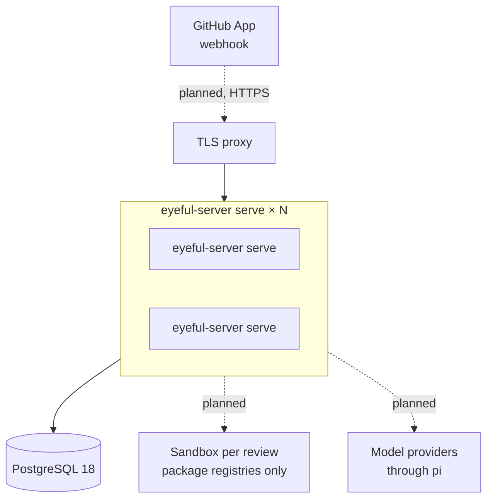

# Deployment

This page covers what eyeful ships, where each part runs, and what a production deployment needs.
Running eyeful from a checkout is in [Development](../DEVELOPMENT.md), every variable is in
[Configuration](../CONFIGURATION.md#server), and release timing is in the [Roadmap](../ROADMAP.md).

A cloud deployment consists of the `eyeful-server serve` binary, a PostgreSQL 18 database and a TLS
proxy; a GitHub App joins them with the webhook. To add capacity, run more copies of the binary against the same
database. The local side is the desktop app and the `eyeful` command, and needs no server. Nothing is published
until CI passes on it: the documentation site goes to GitHub Pages after each green CI run on `main`
(`docs.yml`), and a `v*` tag runs CI and then GoReleaser (`release.yml`, `.goreleaser.yml`), which
attaches the `eyeful` CLI for Linux and macOS, as archives, `.deb` and `.rpm`, to a GitHub release.
No version has been tagged yet.

## Artifacts

| Artifact            | Built by                                       | Runs on                         |
| ------------------- | ---------------------------------------------- | ------------------------------- |
| `bin/eyeful-server` | `mise run build`                               | A server, next to PostgreSQL 18 |
| Container image     | `Dockerfile` (distroless, port 8080)           | Any container runtime           |
| Desktop app         | `mise run package:desktop` (Wails)             | macOS, Windows, Linux           |
| `eyeful`            | `mise run install`, or a `v*` tag (GoReleaser) | The user's machine              |
| Documentation site  | `mise run build:docs` (VitePress)              | GitHub Pages at `DOCS_URL`      |

The binary embeds the migrations. A cloud deployment is that one file plus a database URL, with no
separate migration step. CI
(`.github/workflows/ci.yml`) currently runs `mise run check` and nothing else.

## Cloud

All `eyeful-server serve` processes are identical, so the proxy can send any request to any of them.
Dashed edges are planned; until they exist, nothing queues a review
([Running in the cloud](CLOUD.md)).

### Processes and scaling

Each process serves the health routes and runs `--workers` workers. Workers take reviews from a
queue in PostgreSQL, so adding capacity means starting more processes on the same database. The
processes share the queue without talking to each other ([Scheduling](SCHEDULING.md)).

### Database schema

`eyeful-server serve` applies pending migrations when it starts, which is enough for a single process. With
several processes, run `eyeful-server migrate up` once before the rollout and start every process with
`--no-migrate`, so they do not race to migrate.

### TLS and secrets

The server speaks plain HTTP and expects a proxy in front of it to terminate TLS. The database URL
is the only secret today and belongs in the platform's secret store; the App's credentials join it
with the webhook ([Credentials](CLOUD.md#credentials)).

### Health checks and stopping

Use `GET /health` as the liveness probe and `GET /ready` as the readiness probe. To stop a process,
send `SIGTERM`. It stops accepting requests and returns its running reviews to the queue within
`--shutdown-timeout`, where another process picks them up ([Lifecycle](SERVER.md#lifecycle)).

### Trying it on one machine

`compose.yaml` runs the same setup locally: `docker compose --profile server
up` builds the image and starts it next to PostgreSQL, and `http://localhost:8080/ready`
answers once it is up.

## Local

Local mode installs only the app itself. It needs no server, database, eyeful account or model key,
because the agents are the coding tools the user is already signed in to.

`eyeful review` runs a review with the agent chosen by `eyeful connect`; the desktop app does the
same from a window ([The desktop app](../LOCAL.md#desktop)). What
a local review may run, and how it is contained, is described in [Running locally](../LOCAL.md).
