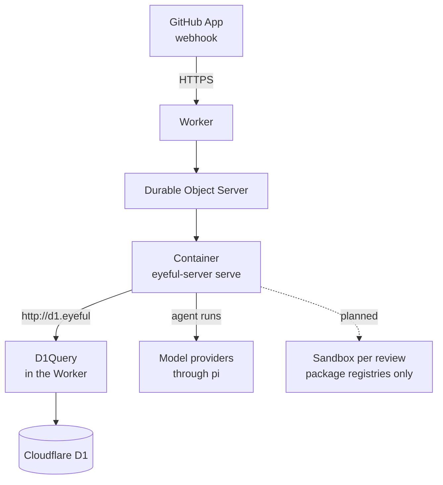

# Deployment

This page covers what eyeful ships, where each part runs, and what a production deployment needs.
Running eyeful from a checkout is in [Development](../DEVELOPMENT.md), every variable is in
[Configuration](../CONFIGURATION.md#server), and release timing is in the [Roadmap](../ROADMAP.md).

The cloud runs on Cloudflare: one Worker, `packages/worker`, starts `eyeful-server serve` in a
Container and gives it a D1 database. A GitHub App sends its webhook to the Worker. The local side
is the desktop app and the `eyeful` command, and needs no server. Nothing is published until CI
passes on it: the documentation site goes to GitHub Pages after each green CI run on `main`
(`docs.yml`), and a `v*` tag runs CI and then GoReleaser (`release.yml`, `.goreleaser.yml`), which
attaches the `eyeful` CLI for Linux and macOS, as archives, `.deb` and `.rpm`, to a GitHub release.
No version has been tagged yet. CI (`.github/workflows/ci.yml`) currently runs `mise run check` and
nothing else.

## Artifacts

| Artifact                | Built by                                        | Runs on                         |
| ----------------------- | ----------------------------------------------- | ------------------------------- |
| Worker and server image | `cf deploy` in `packages/worker` (`Dockerfile`) | Cloudflare Workers + Containers |
| Desktop app             | `mise run package:desktop` (Wails)              | macOS, Windows, Linux           |
| `eyeful`                | `mise run install`, or a `v*` tag (GoReleaser)  | The user's machine              |
| Documentation site      | `mise run build:docs` (VitePress)               | GitHub Pages at `DOCS_URL`      |

The image holds `eyeful-server`, git and pi `1.3.0`.

## Cloud

`packages/worker/cloudflare.config.ts` declares everything: the Worker `eyeful`, the D1 database
`eyeful`, the Container `eyeful-server` (`standard-1`, one instance) and the three required secrets.
The Worker sends every request to one Durable Object, `Server`, which starts the Container on the
first request and forwards the request to port 8080. The dashed edge is the sandbox. Until it exists,
a review does not run the project's commands ([Running in the cloud](CLOUD.md)).

### D1 from the container

The server keeps its REST client. The Worker points `EYEFUL_D1_API` at `http://d1.eyeful/client/v4`
and intercepts that host with `D1Query`, which runs each query on the D1 binding and answers in the
REST query API's shape. No Cloudflare API token is needed, and the queries do not count against the
API rate limit of 1,200 requests per five minutes. The token in `EYEFUL_D1_API_TOKEN` is drawn fresh
each time the Container starts.

### Lifetime

Every Worker secret and variable is passed to the Container as its environment when it starts; a
changed secret reaches it on the next start. The Container stops ten minutes after the last request.
While D1 has a review that is queued or running, the Durable Object's alarm checks every minute and
keeps the Container up, or starts it again. The Container's disk is lost when it stops, so a review
cut short starts again from the beginning. A rollout sends `SIGTERM`, and the server returns its
running reviews to the queue ([Lifecycle](SERVER.md#lifecycle)).

### Deploy

Docker must be running, because `cf deploy` builds the image. From `packages/worker`:

1. Write a secrets file, JSON or `.env`, outside the repository, with `EYEFUL_WEBHOOK_SECRET`,
   `EYEFUL_GITHUB_APP_ID`, `EYEFUL_GITHUB_APP_PRIVATE_KEY` (the PEM) and the model key pi uses, for
   example `DEEPSEEK_API_KEY`.
2. `pnpm exec cf deploy --secrets-file <file>` builds the image, creates the D1 database on the first
   deploy, and uploads the Worker and the secrets.
3. `pnpm exec cf d1 list` prints the database id. Apply the schema with
   `pnpm exec cf d1 migrations apply <id> --dir ../../internal/db/migrations`.
4. In the GitHub App, set the webhook URL to `https://eyeful.<subdomain>.workers.dev/webhook` and the
   secret to `EYEFUL_WEBHOOK_SECRET`. The App needs the permissions in
   [Development](../DEVELOPMENT.md#commands).

`pnpm exec cf workers secrets update` changes one secret later. `GET /health` answers once the
Container is up; `GET /ready` answers once D1 answers `SELECT 1`.

## Local

Local mode installs only the app itself. It needs no server, database, eyeful account or model key,
because the agents are the coding tools the user is already signed in to.

`eyeful review` runs a review with the agent chosen by `eyeful connect`; the desktop app does the
same from a window ([The desktop app](../LOCAL.md#desktop)). What
a local review may run, and how it is contained, is described in [Running locally](../LOCAL.md).
