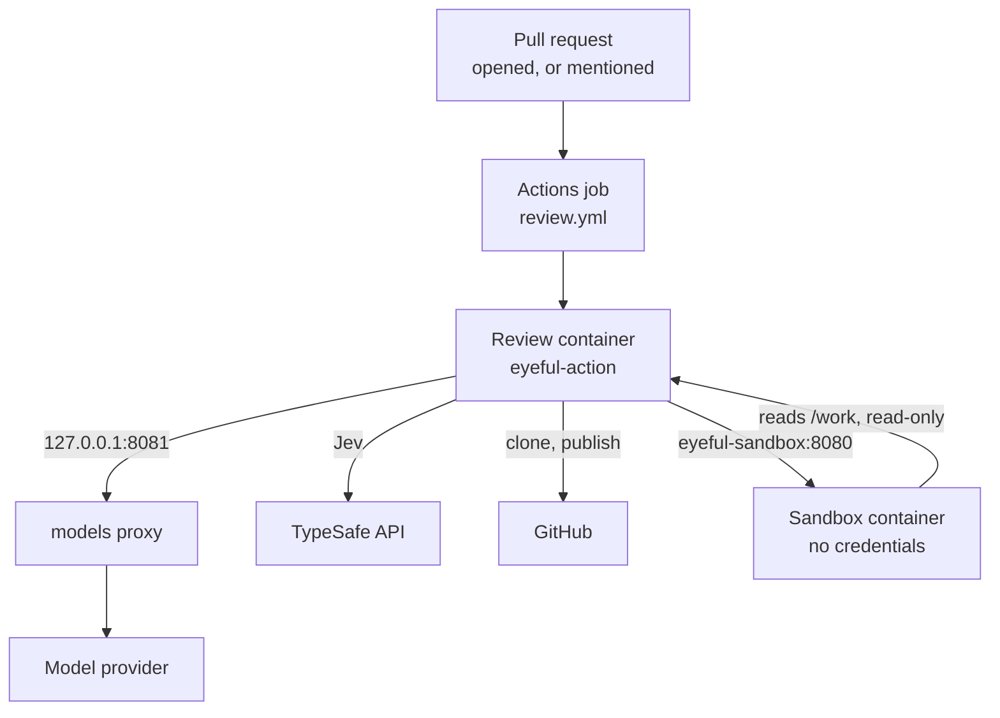
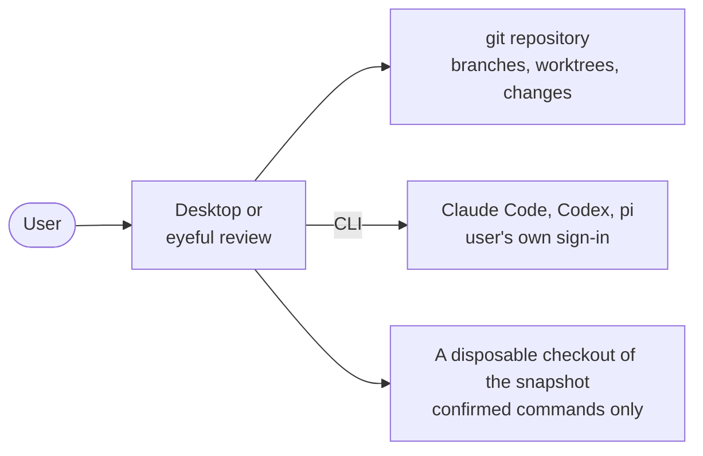

# Deployment

This page covers what eyeful ships, where each part runs, and how to turn on cloud reviews. Running
eyeful from a checkout is in [Development](../DEVELOPMENT.md), every variable is in
[Configuration](../CONFIGURATION.md#action), and release timing is in the [Roadmap](../ROADMAP.md).

Cloud reviews run in GitHub Actions through the composite action `action.yml` at the repository
root. The local side is the desktop app and the `eyeful` command, and needs no server. Nothing is
published until CI passes on it: the documentation site goes to GitHub Pages after each green CI run
on `main` (`docs.yml`), and a `v*` tag runs CI and then GoReleaser (`release.yml`, `.goreleaser.yml`),
which attaches the `eyeful` CLI for Linux and macOS, as archives, `.deb` and `.rpm`, to a GitHub
release. No version has been tagged yet. CI (`.github/workflows/ci.yml`) runs `mise run check`.

## Artifacts

| Artifact                  | Built by                                                      | Runs on                    |
| ------------------------- | ------------------------------------------------------------- | -------------------------- |
| Review and sandbox images | `action.yml` in each job (`Dockerfile`, `Dockerfile.sandbox`) | A GitHub Actions runner    |
| Desktop app               | `mise run package:desktop` (Wails)                            | macOS, Windows, Linux      |
| `eyeful`                  | `mise run install`, or a `v*` tag (GoReleaser)                | The user's machine         |
| Documentation site        | `mise run build:docs` (VitePress)                             | GitHub Pages at `DOCS_URL` |

The review image holds `eyeful-action`, git, pi `1.4.0` under `/opt/pi`, the user `agent` with pi's
settings from `cmd/eyeful-action/pi/`, and `/usr/local/bin/pi`, which runs pi as `agent`. The
sandbox image holds `eyeful-sandbox` and the Go, Node and Python toolchains.

## Cloud



Both containers share a Docker network `eyeful` and the directory `$RUNNER_TEMP/eyeful`, mounted at
`/work`: read-write for the review, read-only for the sandbox.

### Turn on reviews {#turn-on-reviews}

1. In the repository's Settings → Secrets and variables → Actions, add two secrets:
   `EYEFUL_MODEL_KEY`, an API key from the [Volcengine Ark console](https://console.volcengine.com/ark)
   with the Coding Plan, and `EYEFUL_TYPESAFE_API_KEY`, a key from [TypeSafe](https://docs.typesafe.ai).
2. Add `.github/workflows/eyeful.yml`:

```yaml
name: eyeful

on:
  pull_request_target:
    types: [opened, ready_for_review]
  issue_comment:
    types: [created]

permissions:
  contents: read
  pull-requests: write
  issues: write
  actions: read

jobs:
  review:
    uses: Pleasurecruise/eyeful/.github/workflows/review.yml@main
    secrets: inherit
```

The reusable workflow `.github/workflows/review.yml` holds the rest: who may start a review, one
review per pull request at a time, and the action's inputs. It never checks out the pull request;
`eyeful-action` clones it and runs its code only in the sandbox.

## Local



Local mode installs only the app itself. It needs no server, database, eyeful account or model key,
because the agents are the coding tools the user is already signed in to; only Jev needs a TypeSafe
API key.

`eyeful review` runs a review with the agent chosen by `eyeful connect`; the desktop app does the
same from a window ([The desktop app](../LOCAL.md#desktop)). What
a local review may run, and how it is contained, is described in [Running locally](../LOCAL.md).
