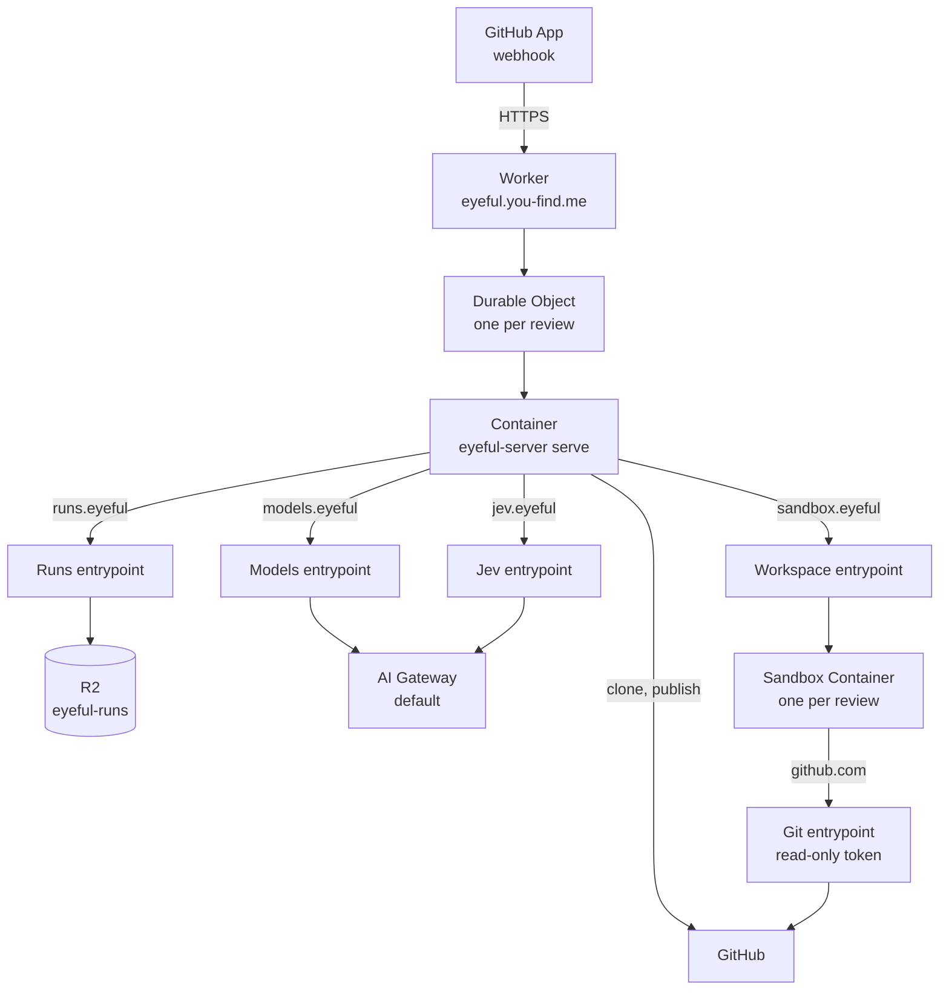

# Deployment

This page covers what eyeful ships, where each part runs, and what a production deployment needs.
Running eyeful from a checkout is in [Development](../DEVELOPMENT.md), every variable is in
[Configuration](../CONFIGURATION.md#server), and release timing is in the [Roadmap](../ROADMAP.md).

The cloud runs on Cloudflare: one Worker, `packages/worker`, with one Durable Object and one
Container per review, R2 for the stages, and AI Gateway for the models and Jev. A GitHub App sends
its webhook to the Worker. The local side is the desktop app and the `eyeful` command, and needs no
server. Nothing is published until CI passes on it: the documentation site goes to GitHub Pages
after each green CI run on `main` (`docs.yml`), and a `v*` tag runs CI and then GoReleaser
(`release.yml`, `.goreleaser.yml`), which attaches the `eyeful` CLI for Linux and macOS, as archives,
`.deb` and `.rpm`, to a GitHub release. No version has been tagged yet. CI
(`.github/workflows/ci.yml`) runs `mise run check` and nothing else.

## Artifacts

| Artifact                | Built by                                        | Runs on                         |
| ----------------------- | ----------------------------------------------- | ------------------------------- |
| Worker and server image | `cf deploy` in `packages/worker` (`Dockerfile`) | Cloudflare Workers + Containers |
| Desktop app             | `mise run package:desktop` (Wails)              | macOS, Windows, Linux           |
| `eyeful`                | `mise run install`, or a `v*` tag (GoReleaser)  | The user's machine              |
| Documentation site      | `mise run build:docs` (VitePress)               | GitHub Pages at `DOCS_URL`      |

The image holds `eyeful-server`, git, pi `1.3.0`, and pi's settings from `packages/worker/pi/`.
`Dockerfile.sandbox` builds the sandbox.

## Cloud

`packages/worker/cloudflare.config.ts` declares everything: the Worker `eyeful` on the custom domain
`eyeful.you-find.me` with `workers.dev` and Preview URLs off, the Containers `eyeful-server` and
`eyeful-sandbox` (`standard-1`, at most five each), the R2 bucket `eyeful-runs`, the Workers AI binding, the gateway id
(`default`) and the six required secrets. The Durable Object routes the three internal hosts to the
Worker's entrypoints before it starts the Container, so the Container holds no gateway token, R2
credential or webhook secret ([Running in the cloud](CLOUD.md#credentials)).

### AI Gateway

The account's `default` gateway is authenticated and holds the provider keys in its Secrets Store.
The models use the `volcengine` custom provider; its key is the secret `default_volcengine_default`.
Jev uses Workers AI and needs no provider key.

### Deploy

The account needs the Workers Paid plan, because Containers require it. Docker must be running,
because `cf deploy` builds the image.

1. Fill the root `.env` from `.env.example`. `EYEFUL_AI_GATEWAY_TOKEN` is a Cloudflare API token
   with AI Gateway Run and Workers AI Read on the account; `EYEFUL_GITHUB_APP_PRIVATE_KEY` is the
   App's PEM on one line, with `\n` for each line break, in double quotes.
2. From `packages/worker`, `pnpm exec cf deploy --secrets-file ../../.env` builds the image, creates
   the R2 bucket on the first deploy, and uploads the Worker, the Container and the secrets.
3. In the GitHub App, turn the webhook on, set its URL to `https://eyeful.you-find.me/webhook` and
   its secret to `EYEFUL_WEBHOOK_SECRET`, subscribe to the Pull request and Issue comment events, and grant Contents
   (read), Pull requests (read and write), Issues (read and write), Checks (read and write), Actions
   (read) and Metadata (read). Install the App on the repositories to review.
4. In each repository's rules for `main`, require the `eyeful` status check.

`pnpm exec cf workers secrets update` changes one secret later; a running Container sees the new
value when the next one starts.

## Local

Local mode installs only the app itself. It needs no server, database, eyeful account or model key,
because the agents are the coding tools the user is already signed in to.

`eyeful review` runs a review with the agent chosen by `eyeful connect`; the desktop app does the
same from a window ([The desktop app](../LOCAL.md#desktop)). What
a local review may run, and how it is contained, is described in [Running locally](../LOCAL.md).
