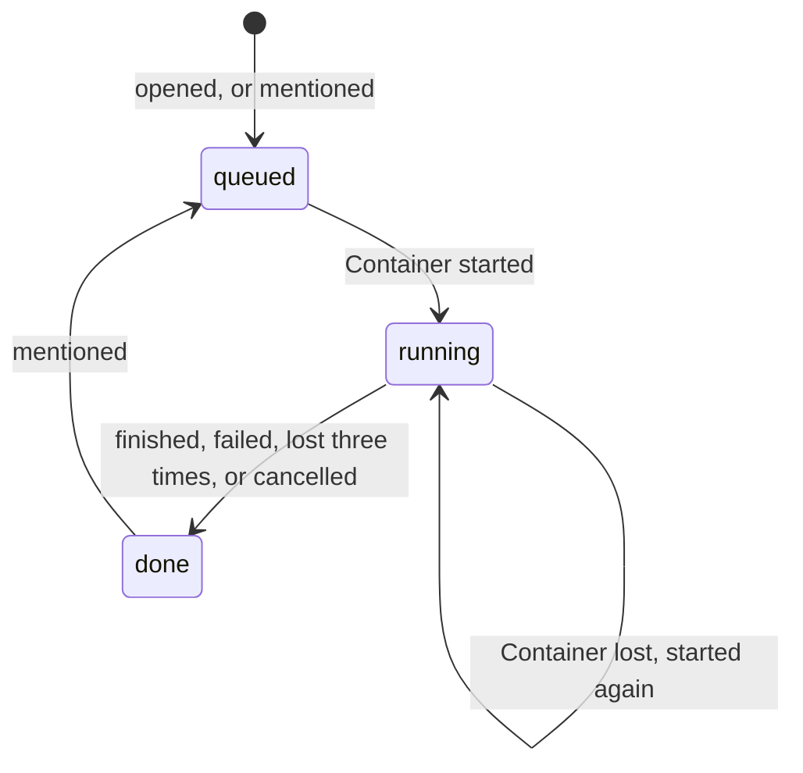

# Review lifecycle

Each pull request has one Durable Object, `Server` in `packages/worker`, named by the repository and
the pull request number. It keeps the current review in its own SQLite storage and drives that
review's Container from an alarm. At most one review of a pull request runs at a time.

| Mechanism | Behavior                                                                                                              |
| --------- | --------------------------------------------------------------------------------------------------------------------- |
| Once      | An opened, reopened or ready pull request is reviewed if it has never been; later ones need a mention.                |
| Mention   | A mention by an allowed user starts a review of the current head, numbered one more than the last.                    |
| Busy      | While a review is queued or running, a mention gets a reply and starts nothing.                                       |
| Closed    | A mention on a closed pull request is ignored.                                                                        |
| Alarm     | Set at admission, then every 30 seconds while the review runs. Each run reads the stored record.                      |
| Start     | When no Container runs, the alarm starts one with the pull request and counts an attempt.                             |
| Watch     | When a Container runs, the alarm reads its `GET /review`; `done` or `failed` is recorded and the Container destroyed. |
| Startup   | A Container that has not answered five minutes after it started is destroyed and counts as lost.                      |
| Lost      | After three attempts the review is `done`, and the reason is commented on the pull request.                           |
| Report    | A review that ends without posting, failed, lost or empty, comments its reason on the pull request.                   |
| Cancel    | Closing the pull request or turning it into a draft destroys the running Container.                                   |
| Idle      | The Container stops after ten minutes without a request; the alarm's polling keeps a running review alive.            |
| Capacity  | At most five Containers at once (`maxInstances`).                                                                     |

A rollout or any other `SIGTERM` stops the Container; the alarm counts it as lost and the next one
resumes from the stages in R2 ([Storage](PERSISTENCE.md)).

## Not done yet

- Waiting for CI happens inside the Container, which stays up while the pull request's checks run.
  Planned: the alarm waits for them and starts the Container afterwards.
- A review triggered by a mention does not yet reuse the last review's findings.
- There is no list of reviews across Durable Objects, and no daily or monthly quota.
