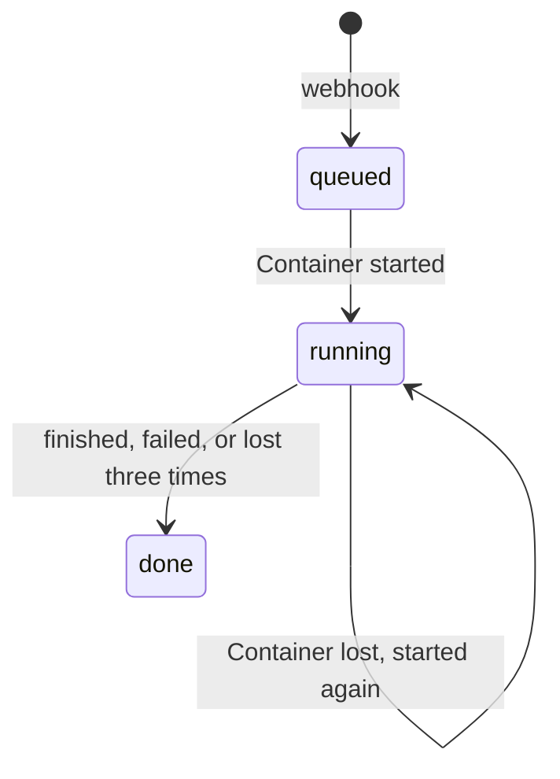

# Review lifecycle

Each review is one Durable Object, `Server` in `packages/worker`, named by the repository, the pull
request number and the head commit. It keeps the review's state in its own SQLite storage and drives
the review's Container from an alarm.

| Mechanism | Behavior                                                                                                                               |
| --------- | -------------------------------------------------------------------------------------------------------------------------------------- |
| Admission | A delivery for a head commit already admitted returns the first review; the same commit with different pull request details is `409`.  |
| Alarm     | Set at admission, then every 30 seconds while the review is running. Each run reads the stored state, so a repeated alarm is harmless. |
| Start     | When no Container runs, the alarm starts one with the pull request and counts an attempt.                                              |
| Watch     | When a Container runs, the alarm reads its `GET /review`. `done` or `failed` is recorded and the Container destroyed.                  |
| Startup   | A Container that has not answered five minutes after it started is destroyed and counts as lost.                                       |
| Lost      | After three attempts the review is `done` with the reason `container lost N times`.                                                    |
| Idle      | The Container stops after ten minutes without a request; the alarm's polling keeps a running review alive.                             |
| Capacity  | At most five Containers at once (`maxInstances`).                                                                                      |

A rollout or any other `SIGTERM` stops the Container; the alarm counts it as lost and the next one
resumes from the stages in R2 ([Storage](PERSISTENCE.md)).

## Not done yet

- Waiting for CI happens inside the Container, which stays up while the pull request's checks run.
  Planned: the alarm waits for them and starts the Container afterwards.
- A newer push does not cancel the review of the older head commit.
- There is no list of reviews across Durable Objects.
