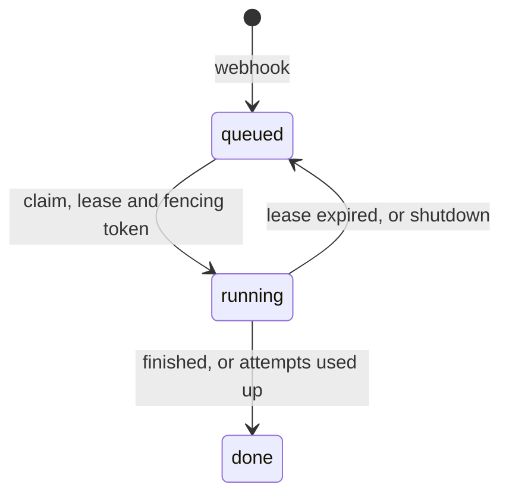

# Scheduling and leases

Reviews are assigned to workers by `internal/scheduler`, which runs today. Agent runs are assigned
to model providers by `internal/dispatch`, which is built and tested but not wired in.

## Reviews over workers {#reviews-over-workers}



| Mechanism | Behavior                                                                                                                                                                       |
| --------- | ------------------------------------------------------------------------------------------------------------------------------------------------------------------------------ |
| Admission | A review created again with the same idempotency key returns the first; different input is a conflict.                                                                         |
| Claim     | One `UPDATE` of the oldest queued review. The fencing token is `MAX(lease_token) + 1` inside that statement. The lease deadline is the worker's clock.                         |
| Renewal   | Every third of `--lease-ttl`; a transient error is retried on the next tick.                                                                                                   |
| Fencing   | `Renew`, `Finish` and `Release` with an outdated token fail with `ErrFenced`.                                                                                                  |
| Finish    | A workflow that finishes, including `ci_failed` and `partial`, returns no error and the result is `complete`. An executor error is result `none`, and the error is the reason. |
| Reaper    | Expired leases go back to the queue; after `--max-attempts` the review is `done` with result `none`.                                                                           |
| Shutdown  | Running reviews are released back to the queue without counting an attempt.                                                                                                    |
| Capacity  | `--workers` per process; more capacity means more processes on the same database.                                                                                              |

The server uses `review.Store`. `reviewtest.MemoryStore` implements the same contract for tests
([Persistence](PERSISTENCE.md#tests)).

## Agent runs over providers {#agent-runs-over-providers}

An agent asks for a tier (`cheap`, `mid` or `strong`). A tier is a list of candidates, one per key:

```yaml
strong:
  - { model: anthropic/claude-sonnet-5-5, priority: 0, weight: 3 }
  - { model: openrouter/anthropic/claude-sonnet-5-5, priority: 0, weight: 1 }
  - { model: deepseek/deepseek-v4, priority: 1 }
```

| Mechanism    | Behavior                                                                                                     |
| ------------ | ------------------------------------------------------------------------------------------------------------ |
| Selection    | The lowest available priority, then weighted random within it; each retry moves down one priority.           |
| Decision     | `Decide` returns retry or stop, with a reason such as `output_committed` or `non_retryable`.                 |
| Cooldown     | Out of credit: 30 min. Quota: until it resets. Rate limit: `Retry-After`. Otherwise 1 min, doubling.         |
| Commit point | Once an agent has reported anything, a later failure fails the agent instead of switching models.            |
| Lanes        | `max_concurrency` per key; extra requests wait in FIFO order. Waiting never causes a fallback or a cooldown. |

Planned: per-review affinity (one candidate per role) and classification of provider errors. Review
budgets are kept by `workflow` ([Levels](../LEVELS.md#budget)).

## Not done yet

- A `runner` command that only claims and executes reviews.
- A worker that stops itself once renewals have failed for longer than the TTL. Until then fencing
  discards the result of a worker that lost its connection, but not its model spend.
- Retrying a failed `Finish`.
