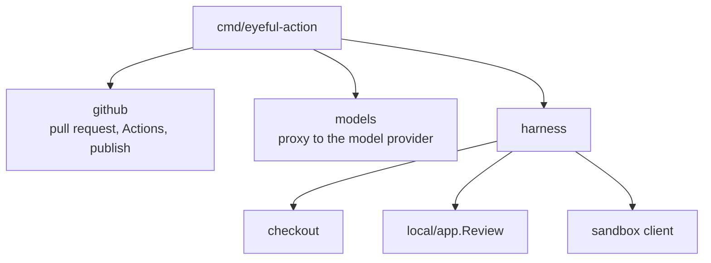
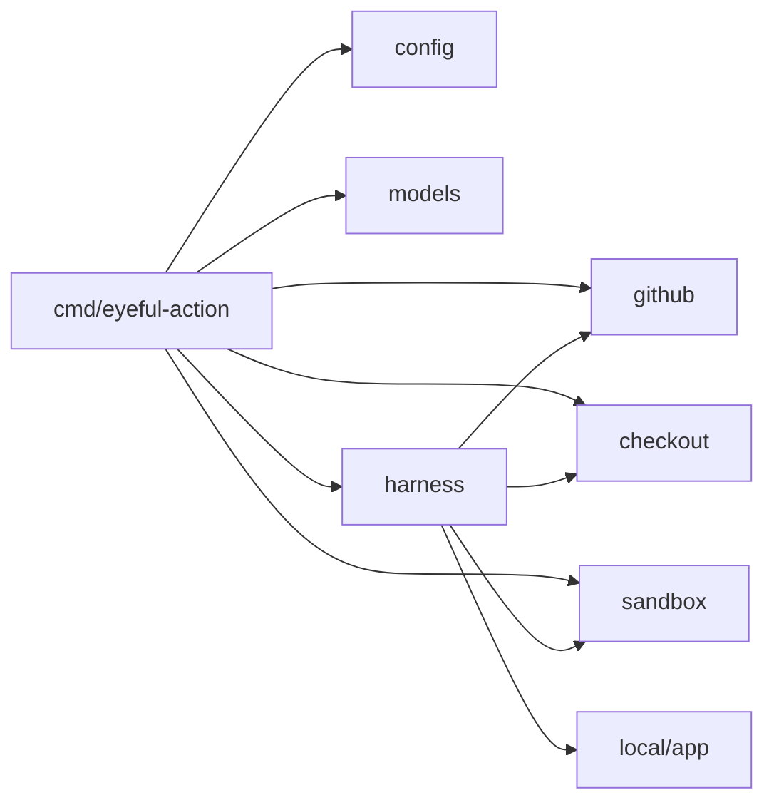

# The action

`eyeful-action` is the program in a review's container: one Go binary, `cmd/eyeful-action`, with its
packages in `internal/`. One process runs one pull request review and exits. It shares the root
module with the local CLI and runs the review through `local/app`, the same path as `eyeful review`.
It has no database, accounts or API; `action.yml` starts it.

## Components

## Layout {#layout}

| Path                           | Owns                                                                                           |
| ------------------------------ | ---------------------------------------------------------------------------------------------- |
| `.github/workflows/review.yml` | The reusable workflow other repositories call: triggers, who may start a review, one at a time |
| `action.yml`                   | The composite action: pull the images, start the sandbox, run                                  |
| `cmd/eyeful-action`            | The binary (kong) and pi's settings in `pi/`                                                   |
| `cmd/eyeful-sandbox`           | The sandbox's HTTP server                                                                      |
| `internal/config`              | The `Config` struct, filled by kong                                                            |
| `internal/review`              | `Source`, the pull request under review                                                        |
| `internal/github`              | The pull request, Actions, the description, publishing                                         |
| `internal/models`              | The proxy that adds the provider key to pi's model calls                                       |
| `internal/checkout`            | The clone of the pull request                                                                  |
| `internal/harness`             | One review: checkout, `local/app.Review`, publish                                              |
| `internal/sandbox`             | The sandbox server and its client                                                              |

## Dependency direction {#dependency-direction}

An arrow means "imports".

## Lifecycle {#lifecycle}

1. It reads its configuration, removes every `EYEFUL_` variable from the environment and connects
   the agent named by `EYEFUL_AGENT`.
2. It listens on `127.0.0.1:8081` for pi's model calls.
3. It reads the pull request; a closed one ends the job without a review.
4. It runs the review, keeping the stages under `<dir>/run`, and exits non-zero if the review
   failed. `SIGTERM`, when the job is cancelled, cancels the review.

The stages live only as long as the job. A re-run starts again from the beginning and, through the
markers, posts only what GitHub does not have yet.

## Design decisions

1. One process, one review. Scaling is more jobs, which Actions owns.
2. Nothing is stored outside the job; GitHub holds the result.
3. Packages follow the domain, and each owns its types and rules.
4. Every background task has an owner and a way to stop.

Avoided: package-level state, goroutines without an owner, controller/service/model layers, and
hand-written CLI parsing.
