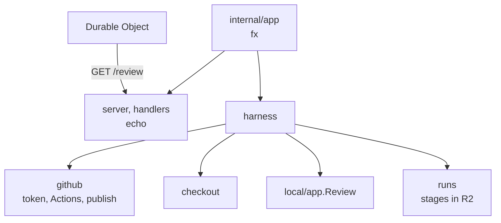
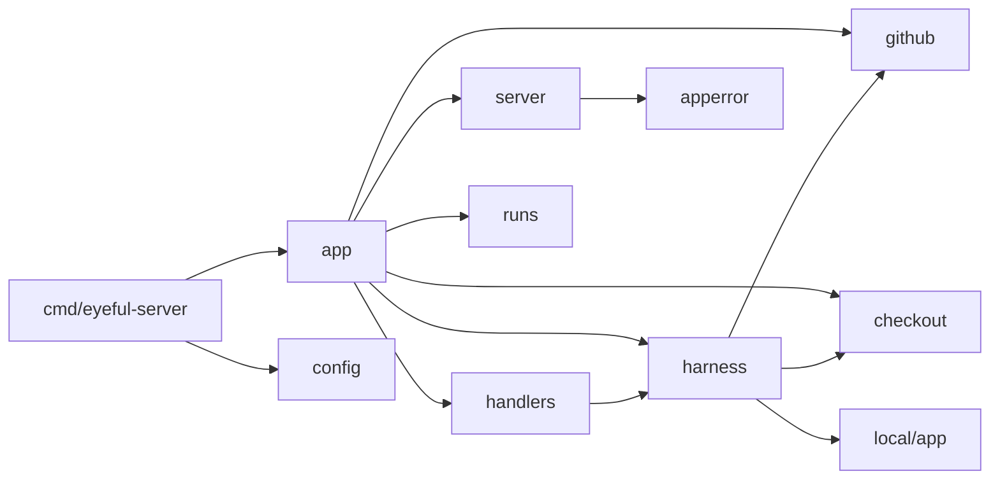

# The server

`eyeful-server` is the program in a review's Container: one Go binary, `cmd/eyeful-server`, with its
packages in `internal/`. One process runs one pull request review. It shares the root module with
the local CLI and runs the review through `local/app`, the same path as `eyeful review`. It has no
database, accounts or public API; the Worker in front of it is the only caller
([Running in the cloud](CLOUD.md)).

## Components

## Routes and errors {#routes}

| Route         | Answers                                                         |
| ------------- | --------------------------------------------------------------- |
| `GET /review` | `{"state", "outcome", "reason"}`: `running`, `done` or `failed` |

The Durable Object polls this route. Every error is an
[RFC 9457](https://www.rfc-editor.org/rfc/rfc9457) Problem with the type `application/problem+json`,
a stable `code` from `internal/apperror` and the `request_id`.

## Layout {#layout}

| Path                | Owns                                                                      |
| ------------------- | ------------------------------------------------------------------------- |
| `cmd/eyeful-server` | The binary (kong): `serve`                                                |
| `internal/app`      | The composition root: fx wiring and lifecycle                             |
| `internal/config`   | The `Config` struct, filled by kong                                       |
| `internal/server`   | echo, middleware, Problem rendering                                       |
| `internal/handlers` | `GET /review`                                                             |
| `internal/apperror` | The Problem body and error codes                                          |
| `internal/review`   | `Source`, the pull request the Worker hands over                          |
| `internal/github`   | The App token, Actions, the pull request description, publishing          |
| `internal/checkout` | The clone of the pull request                                             |
| `internal/harness`  | One review: checkout, `local/app.Review`, publish, the `published` record |
| `internal/runs`     | `workflow.Archive` over the Worker's R2 entrypoint                        |
| `internal/sandbox`  | The sandbox server (`cmd/eyeful-sandbox`) and its client                  |

`packages/worker` holds the Worker, the Durable Object and the entrypoints the Container reaches
([Deployment](DEPLOYMENT.md)).

## Dependency direction {#dependency-direction}

An arrow means "imports".

## Lifecycle {#lifecycle}

[fx](https://github.com/uber-go/fx) is the dependency injection container, and `internal/app` is the
only package that imports it.

1. `serve` reads its configuration, removes every `EYEFUL_` variable from the environment and
   connects the agent named by `EYEFUL_AGENT`.
2. Start runs the review in a goroutine and binds the HTTP listener.
3. Stop, on `SIGTERM`, cancels the review and drains the listener under one timeout. A review
   cancelled this way leaves `GET /review` at `running`; the Durable Object counts the stopped
   Container as lost and starts another, which resumes from R2.

## Design decisions

1. One process, one review. Scaling is more Containers, which the Durable Objects own.
2. The server keeps no state of its own; the Durable Object holds the review and R2 holds the
   stages.
3. Packages follow the domain, and each owns its types and rules.
4. Every background task has an owner and a way to stop.

Avoided: package-level state, goroutines without an owner, controller/service/model layers, and
hand-written CLI parsing.
