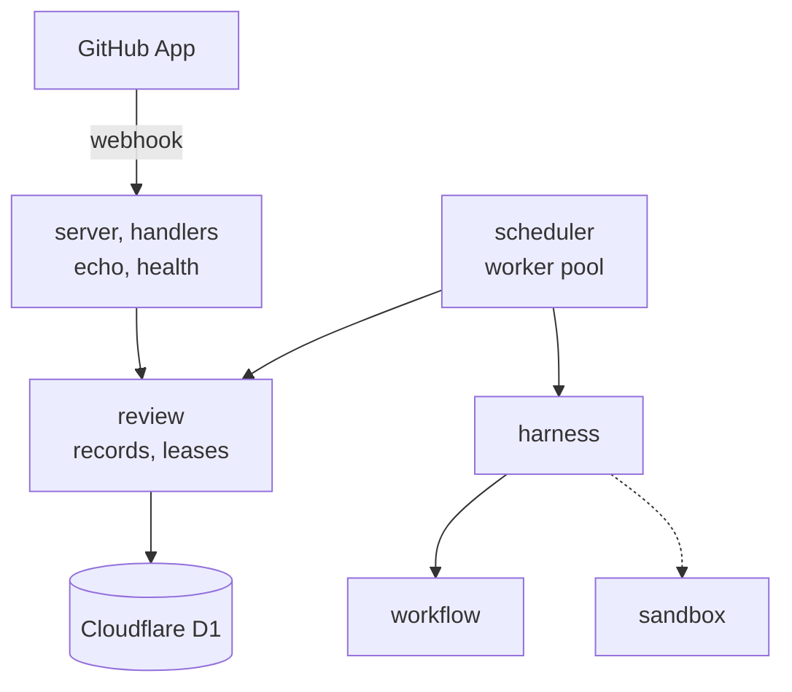
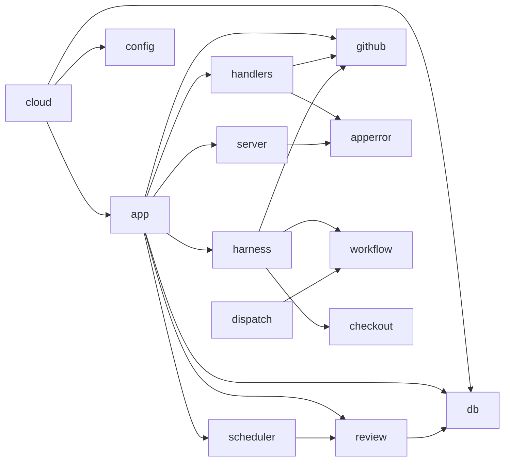
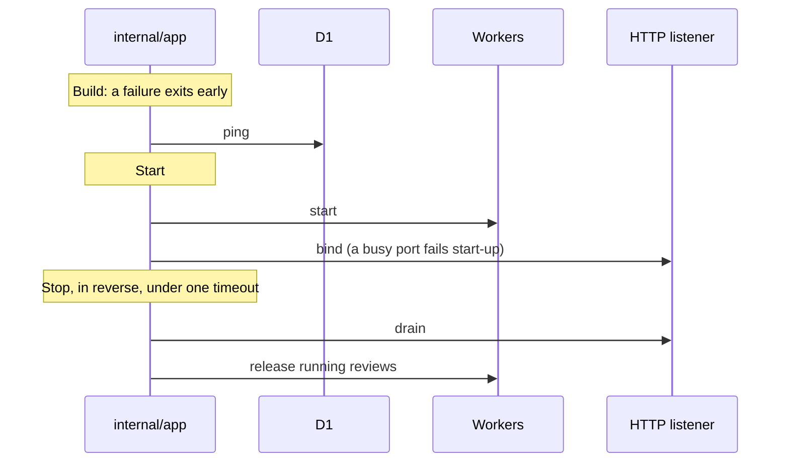

# The server

`eyeful-server` is the cloud side: one Go binary, `cmd/eyeful-server`, with its packages in
`internal/`. It queries Cloudflare D1. It shares the root
module with the local CLI and imports `workflow` and `local`
([Modules](../ARCHITECTURE.md#layout)). `local/app` stays with the CLI and the desktop. It has no
accounts, no console and no public API. A GitHub App's webhook is its only input. `POST /webhook`
queues one review per head commit, and a worker runs that review through `workflow`. The sandbox is
not built, so the project's commands do not run ([Running in the cloud](CLOUD.md)).

## Components

The `scheduler` runs workers that claim queued reviews. The dashed edge is the sandbox, which is
not built.

## Routes and errors {#routes}

| Route           | Answers                                         |
| --------------- | ----------------------------------------------- |
| `GET /health`   | Liveness                                        |
| `GET /ready`    | Readiness: the database answers                 |
| `POST /webhook` | Pull request events: one review per head commit |

Request bodies are limited to 5 MiB. Every error is an
[RFC 9457](https://www.rfc-editor.org/rfc/rfc9457) Problem with the type `application/problem+json`,
a stable `code` from `internal/apperror` and the `request_id`. A 500 response does not include
the underlying error; the error is logged with the request id.

## Layout {#layout}

| Path                 | Owns                                                           |
| -------------------- | -------------------------------------------------------------- |
| `cmd/eyeful-server`  | The server binary (kong): `serve`                              |
| `internal/app`       | The cloud composition root: fx wiring and lifecycle            |
| `internal/config`    | The `Config` struct, filled by kong                            |
| `internal/server`    | echo, middleware, Problem rendering                            |
| `internal/handlers`  | The routes                                                     |
| `internal/apperror`  | The Problem body and error codes                               |
| `internal/review`    | Review records and leases; `reviewtest` holds the memory store |
| `internal/scheduler` | The worker pool                                                |
| `internal/dispatch`  | Provider routing for agent runs (not wired in)                 |
| `internal/github`    | Webhook signature and parse, the App token, Actions, publish   |
| `internal/checkout`  | The clone of the pull request                                  |
| `internal/harness`   | The worker's executor: snapshot, `workflow`, publish           |
| `internal/db`        | The D1 HTTP client and the migrations                          |

Planned: `sandbox` and `sink` (the outbox) under `internal`.

## Dependency direction {#dependency-direction}

An arrow means "imports". Dependencies point inward from the entry point.

- Handlers translate HTTP and hold no business rules.
- `server` knows no route.
- `app` checks readiness through `internal/db`. `review` runs the queue through it.

## Lifecycle {#lifecycle}

[fx](https://github.com/uber-go/fx) is the dependency injection container. `internal/app` is the
only server package that imports it and owns every start and stop hook.

Shutdown runs in reverse. TODO(sandbox): sandbox and agent processes join the worker stop hook.

## Design decisions

1. `cf d1 migrations apply` owns the schema; the binary does not migrate.
2. Packages follow the domain, and each owns its types, queries and rules.
3. Queries are SQL text with `?` placeholders.
4. Every background task has an owner and a way to stop.
5. A failure affects only the unit that failed and records why.
6. Waiting for capacity is not a failure, and committed output is not retried elsewhere.
7. D1 runs one statement at a time, so a claim is one `UPDATE` of the oldest queued row. Several processes share that one database.

Avoided: package-level state, goroutines without an owner, controller/service/model layers, and
hand-written CLI parsing.
