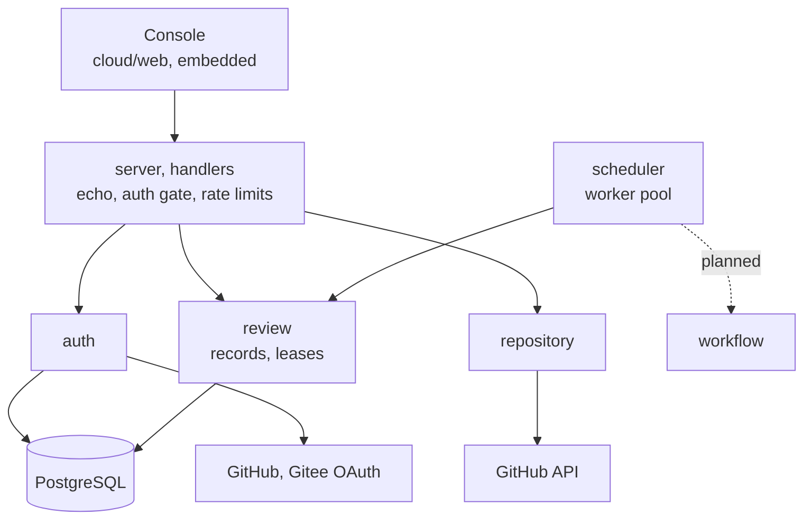
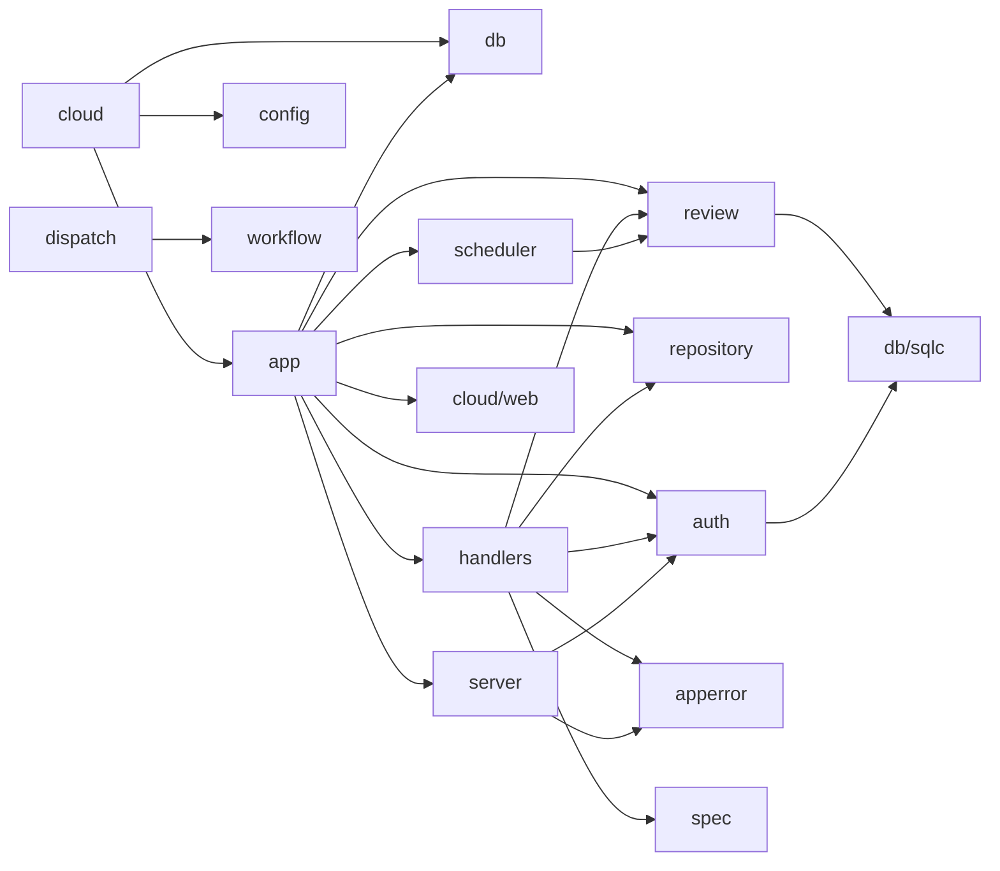
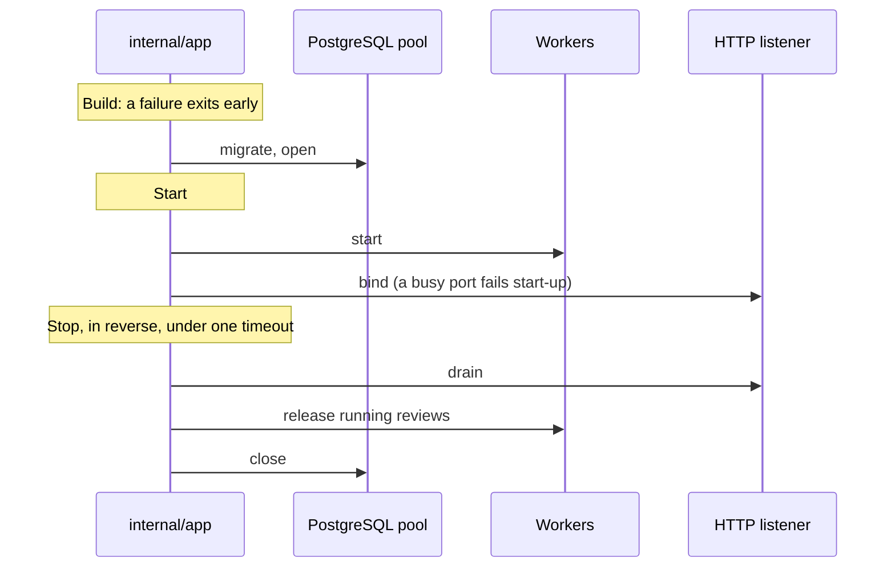

# The server

`eyeful-server` is the cloud side: one Go binary in `cloud/`, with the console, the migrations and
the API document embedded. Its only dependency is PostgreSQL. It is its own Go module and imports
only `workflow`. Reviews do not run on it yet: the pi runtime and the sandbox are not built, so
workers end each review with a placeholder executor ([Running in the cloud](CLOUD.md)).

## Components

A request passes through `server` (authentication, rate limits) to `handlers`, which call `auth`,
`review` and `repository`. The `scheduler` runs workers that claim queued reviews. The console makes
only same-origin requests and uses the hash router, so `#/repositories` cannot collide with the API
route `/repositories`.

## Layout {#layout}

| Path                             | Owns                                                                      |
| -------------------------------- | ------------------------------------------------------------------------- |
| `cloud`                          | The server binary (kong): `serve`, `migrate`                              |
| `cloud/web`                      | The cloud console: SvelteKit, embedded                                    |
| `cloud/internal/app`             | The cloud composition root: fx wiring and lifecycle                       |
| `cloud/internal/config`          | The `Config` struct, filled by kong                                       |
| `cloud/internal/server`          | echo, middleware, the authentication gate, rate limits, Problem rendering |
| `cloud/internal/handlers`        | CRUD routes with swag annotations, one file per resource                  |
| `cloud/internal/apperror`        | The Problem body and error codes                                          |
| `cloud/internal/auth`            | Users, sessions, API keys, sign-in, sealed provider tokens                |
| `cloud/internal/repository`      | The signed-in user's GitHub repositories                                  |
| `cloud/internal/review`          | Review records and leases; `reviewtest` holds the memory store            |
| `cloud/internal/scheduler`       | The worker pool                                                           |
| `cloud/internal/dispatch`        | Provider routing for agent runs (not wired in)                            |
| `cloud/internal/db`, `cloud/db/` | The pgx pool, migrations, SQL queries and sqlc output                     |
| `cloud/spec/`, `cloud/sdk`       | The generated OpenAPI 3.1 document and TypeScript client                  |

Planned: `checkout`, `pi`, `sandbox`, `source`, `sink` and `outbox` under `cloud/internal`, and
`plugins/`.

## Dependency direction {#dependency-direction}

An arrow means "imports". Dependencies point inward from the entry point.

- Handlers translate HTTP and hold no business rules.
- `server` knows no resource. It hands the bearer token and session cookie to `auth`, which does
  not see HTTP.
- Only `auth` and `review` call `cloud/internal/db/sqlc`.
- `repository` gets tokens through an interface `auth` implements, and `app` connects them.

## Lifecycle {#lifecycle}

[fx](https://github.com/uber-go/fx) is the dependency injection container. `cloud/internal/app` is the
only server package that imports it and owns every start and stop hook.

Shutdown runs in reverse. TODO(sandbox): sandbox and agent processes join the worker stop hook.

## Design decisions

1. The binary embeds what it needs: migrations, the spec and the console.
2. Packages follow the domain, and each owns its types, queries and rules.
3. Contracts are generated: annotations give the spec, the spec gives the TypeScript client, SQL
   gives Go.
4. Every background task has an owner and a way to stop.
5. A failure affects only the unit that failed and records why.
6. Waiting for capacity is not a failure, and committed output is not retried elsewhere.
7. PostgreSQL is the only database, because the queue relies on `SKIP LOCKED`.

Avoided: package-level state, goroutines without an owner, controller/service/model layers, and
hand-written CLI parsing.
