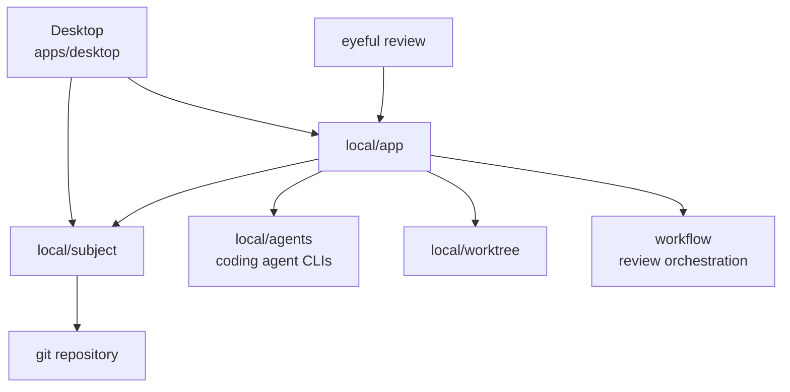
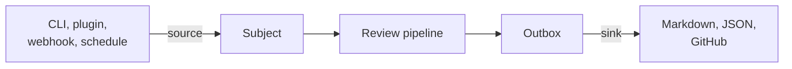

# 架构

eyeful 是一套审查工作流，加上在用户机器上运行它的两个程序：`eyeful` 命令和桌面应用。它们都不需要服务器。[云端服务器](cloud/SERVER.md)是另一个程序：`cmd/eyeful-server`，它的包在 `internal/`。它只共用 `workflow` 模块，不和本地交换任何数据。

## 组件

桌面应用和 CLI 都调用 `local/app`，它用 `local/subject` 读取改动，用 `local/worktree` 检出快照，并通过 `local/agents` 运行 `workflow`（见[本地运行](LOCAL.md)）。`local/app` 直接装配普通构造函数。

## 审查工作流 {#workflow}

`workflow` 让一次审查走完各个[阶段](REVIEW.md#stages)。它自己不运行 agent、命令或存储：调用方在 `Session` 里传入四个接口。

| 接口         | 提供                                             | 云端（规划中）  | 本地             |
| ------------ | ------------------------------------------------ | --------------- | ---------------- |
| `Agents`     | 每个角色一次调用，返回带类型的结果和花费的 token | pi 进程         | `local/agents`   |
| `Classifier` | 两条发现是同一个问题的概率，以及花费的 token     | TypeSafe 的 API | `local/classify` |
| `Workspace`  | CI 检查、`setup`、读文件、在全新副本上运行测试   | 该审查的沙箱    | `local/worktree` |
| `Archive`    | 读取和保存每个阶段的输出                         | 运行存档        | `local/archive`  |

所有循环都由 Go 掌管：`workflow` 检查每份计划和报告、管理预算、决定重试，并在下一阶段开始前保存当前阶段。它不包含 fx、数据库或服务器的类型。

### Jev {#jev}

[Jev](https://docs.typesafe.ai) 是 TypeSafe 的分类模型：它针对给定的 state 回答带类型的问题，返回概率，不生成文字。只有判断所需的信息能全部放进 state 时，eyeful 才把它交给 Jev。

| 位置                 | 问 Jev 的问题                              | 调用方式                     |
| -------------------- | ------------------------------------------ | ---------------------------- |
| `workflow`，验证之前 | 同样几行上的两条发现是不是同一个问题       | `Classifier.Same`，用 go-jev |
| `eval/score.py`      | 一条评论和一条 golden 发现是不是同一个问题 | TypeSafe 的 Python SDK       |

测过之后仍留给 agent 的判断见[评估](EVALUATION.md#jev-pilot)。

## 语言

- Go：服务器、CLI、工作流、调度和 REST API。
- TypeScript：桌面前端和 pi 扩展。
- Python：只用于评估。

eyeful 没有自己的 agent 循环。agent 在云端跑在 pi 里，在本地跑在用户的编码 agent CLI 里。

## 布局 {#layout}

### 模块

每一块是一个独立的 Go 模块，边界由编译器保证。根模块里有两个程序；`.golangci.yml` 里的一条 depguard 规则不让 `cmd/eyeful` 导入 `internal/`。

| 模块           | 内容                             | 可以导入            |
| -------------- | -------------------------------- | ------------------- |
| `workflow`     | 编排及其接口                     | 无                  |
| `local`        | CLI 和桌面端共用的部分           | `workflow`          |
| 根模块         | `cmd/eyeful`，本地 CLI           | `workflow`、`local` |
|                | `cmd/eyeful-server`、`internal/` | `workflow`          |
| `apps/desktop` | 桌面应用，Wails 和 cgo 留在这里  | `workflow`、`local` |

### 目录

| 路径                             | 负责                                                        |
| -------------------------------- | ----------------------------------------------------------- |
| `cmd/eyeful`                     | 本地 CLI（kong）：`review`、`provider`、`connect`、`commit` |
| `apps/desktop`                   | 本地 GUI：Wails v3，独立的 Go 模块                          |
| `apps/desktop/frontend`          | 桌面端的 SvelteKit 前端及其 Wails 绑定                      |
| `packages/ui`                    | 桌面端的组件：diff 视图、文件树、主题                       |
| `packages/pulls`                 | 从 `@pulls.review/core` 构建 `workflow/pulls/core.js`       |
| `workflow`                       | 审查编排：分拣、计划检查、专家、验证器、汇总、预算、检查点  |
| `workflow/prompts`               | 专家和角色的提示词、工具定义、vendored 的 skill             |
| `workflow/pulls`                 | 打包成 `core.js` 的 `@pulls.review/core`，用 moejs 运行     |
| `workflow/project`               | 从清单文件找出的项目命令                                    |
| `workflow/report`                | 把结果渲染成 Markdown 和 SARIF 2.1.0                        |
| `local/subject`                  | 本地分支、提交或未提交改动的快照                            |
| `local/app`                      | 本地的组合根；CLI 和桌面端唯一调用的包                      |
| `local/agents`                   | 基于 claude、codex、pi CLI 实现的 `workflow.Agents`         |
| `local/worktree`                 | 快照的一次性检出；`workflow.Workspace`                      |
| `local/store`                    | `.eyeful/runs/` 和已确认的命令                              |
| `local/settings`                 | 已连接的 agent 和桌面端上次打开的仓库                       |
| `local/classify`                 | 基于 Jev 实现的 `workflow.Classifier`，通过 go-jev 调用     |
| `local/archive`                  | 以文件保存的阶段检查点                                      |
| `local/git`、`local/tail`        | 用固定环境运行 git；保留输出的末尾                          |
| `eval/`                          | [评估](EVALUATION.md#tooling)脚本，Python                   |
| `cmd/eyeful-server`、`internal/` | [云端服务器](cloud/SERVER.md#layout)                        |

### 前端

桌面前端只通过 Wails 绑定调用自己的 Go 服务。它的组件放在 `packages/ui`。

## 数据流 {#data-flow}

生产者和消费者接在管线的两端，彼此不知道对方。

现在由 API 接收审查。其他来源、outbox 和 sink 都在规划中。
