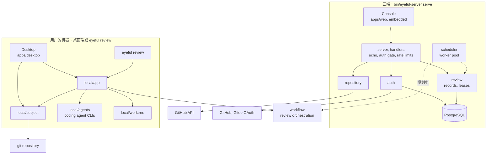
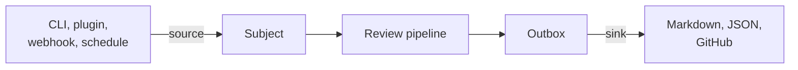
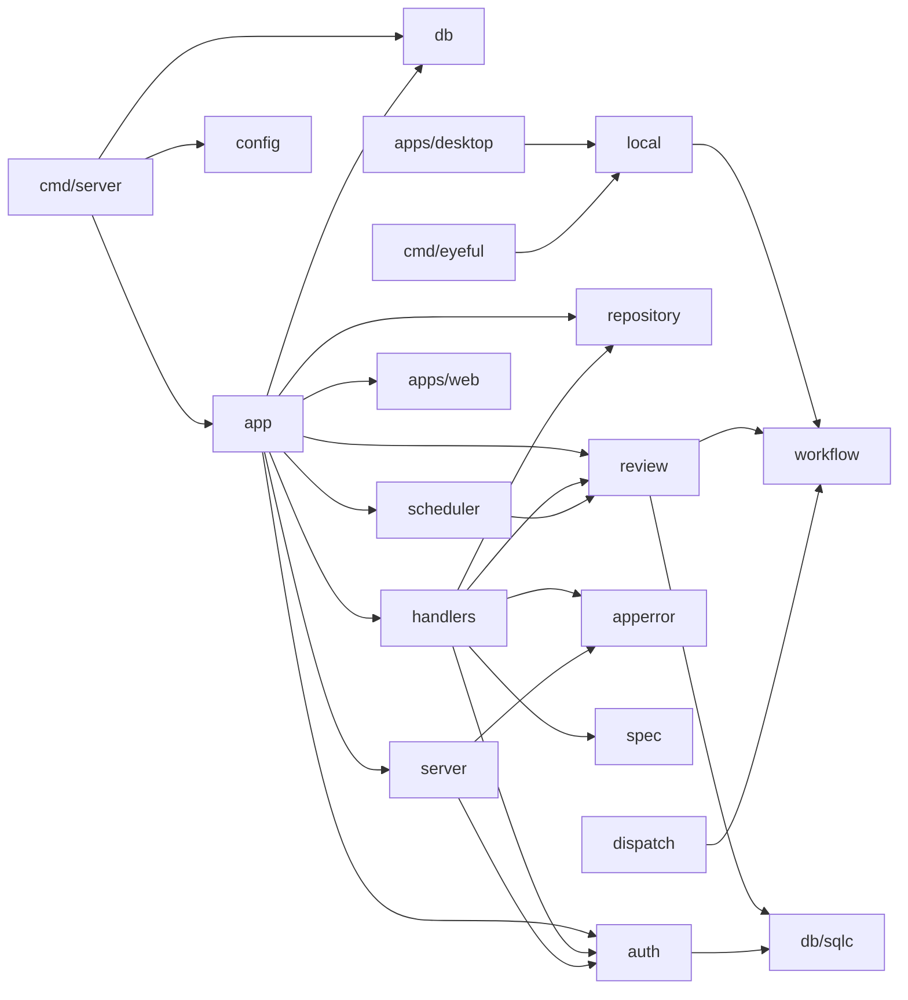
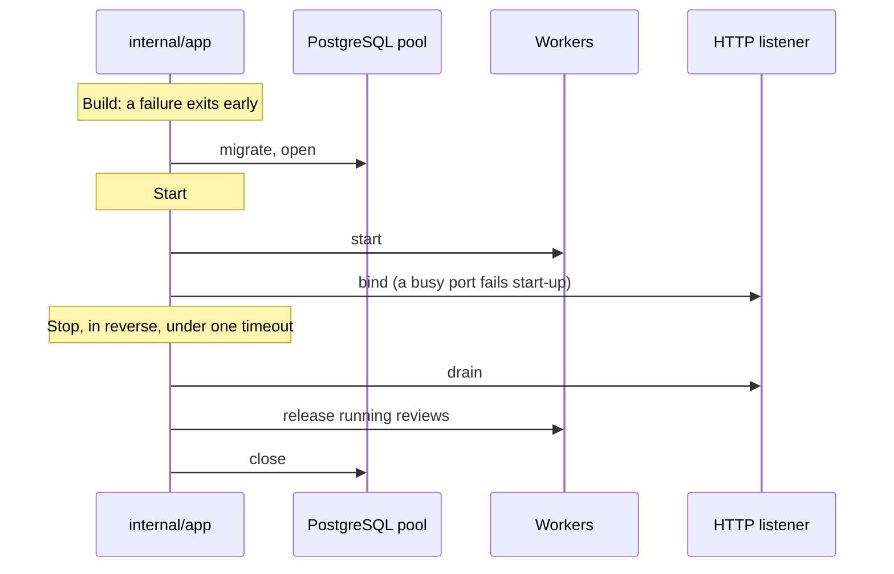

# 架构

eyeful 有云端和本地两侧，两侧运行同一套审查工作流。云端服务器 `eyeful-server` 是一个 Go 二进制，嵌入了控制台、迁移和 API 文档，唯一的依赖是 PostgreSQL。本地一侧是桌面应用和 `eyeful` 命令，不需要服务器。每个二进制只包含自己这一侧的代码，两侧不交换任何数据。

## 组件

虚线表示规划中。

- **云端。** 请求经过 `server`（认证、限流）到达 `handlers`，后者调用 `auth`、`review` 和 `repository`。`scheduler` 运行工作进程来领取排队中的审查。它们用一个占位执行器结束每次审查，因为 pi 运行时和沙箱还没有实现。
- **本地。** 桌面应用和 CLI 都调用 `local/app`，它用 `local/subject` 读取改动，用 `local/worktree` 检出快照，并通过 `local/agents` 运行 `workflow`（见[本地运行](LOCAL.md)）。
- `workflow` 是两侧唯一共用的代码。

## 审查工作流 {#workflow}

`workflow` 让一次审查走完各个[阶段](REVIEW.md#stages)。它自己不运行 agent、命令或存储：调用方在 `Session` 里传入四个接口。

| 接口         | 提供                                             | 云端（规划中）  | 本地             |
| ------------ | ------------------------------------------------ | --------------- | ---------------- |
| `Agents`     | 每个角色一次调用，返回带类型的结果和花费的 token | pi 进程         | `local/agents`   |
| `Classifier` | 两条发现是同一个问题的概率，以及花费的 token     | TypeSafe 的 API | `local/classify` |
| `Workspace`  | CI 检查、`setup`、读文件、在全新副本上运行测试   | 该审查的沙箱    | `local/worktree` |
| `Archive`    | 读取和保存每个阶段的输出                         | 运行存档        | `local/archive`  |

所有循环都由 Go 掌管：`workflow` 检查每份计划和报告、管理预算、决定重试，并在下一阶段开始前保存当前阶段。它不包含 fx、数据库或服务器的类型。

### Jev {#jev}

[Jev](https://docs.typesafe.ai) 是 TypeSafe 的分类模型：它针对给定的 state 回答带类型的问题，返回概率，不生成文字。只有判断所需的信息能全部放进 state 时，eyeful 才把它交给 Jev。

| 位置                 | 问 Jev 的问题                              | 调用方式                     |
| -------------------- | ------------------------------------------ | ---------------------------- |
| `workflow`，验证之前 | 同样几行上的两条发现是不是同一个问题       | `Classifier.Same`，用 go-jev |
| `eval/score.py`      | 一条评论和一条 golden 发现是不是同一个问题 | TypeSafe 的 Python SDK       |

测过之后仍留给 agent 的判断见[评估](EVALUATION.md#jev-pilot)。

## 语言

- Go：服务器、CLI、工作流、调度和 REST API。
- TypeScript：控制台、桌面前端和 pi 扩展，HTTP 类型由 spec 生成。
- Python：只用于评估。

eyeful 没有自己的 agent 循环。agent 在云端跑在 pi 里，在本地跑在用户的编码 agent CLI 里。

## 布局 {#layout}

### 模块

共用代码和本地代码是分开的 Go 模块，边界由编译器保证：

| 模块       | 内容                                        | 可以导入             |
| ---------- | ------------------------------------------- | -------------------- |
| `workflow` | 编排及其接口                                | 这里的任何模块都不行 |
| `local`    | CLI 和桌面端共用的部分                      | `workflow`           |
| 根模块     | `cmd/`（两个二进制）、`internal/`（服务器） | `workflow`、`local`  |

`cmd/eyeful` 不导入 `internal/` 下的任何东西，`cmd/server` 不导入 `local` 的任何东西。桌面应用是第四个模块，这样 Wails 和 cgo 不会进入服务器的构建。

### 目录

| 路径                      | 负责                                                        |
| ------------------------- | ----------------------------------------------------------- |
| `cmd/eyeful`              | 本地 CLI（kong）：`review`、`provider`、`connect`、`commit` |
| `cmd/server`              | 服务器二进制（kong）：`serve`、`migrate`                    |
| `apps/web`                | 云端控制台：SvelteKit，嵌入二进制                           |
| `apps/desktop`            | 本地 GUI：Wails v3，独立的 Go 模块                          |
| `apps/desktop/frontend`   | 桌面端的 SvelteKit 前端及其 Wails 绑定                      |
| `packages/ui`             | 共用组件：diff 视图、文件树、主题                           |
| `packages/pulls`          | 从 `@pulls.review/core` 构建 `workflow/pulls/core.js`       |
| `workflow`                | 审查编排：分拣、计划检查、专家、验证器、汇总、预算、检查点  |
| `workflow/prompts`        | 专家和角色的提示词、工具定义、vendored 的 skill             |
| `workflow/pulls`          | 打包成 `core.js` 的 `@pulls.review/core`，用 moejs 运行     |
| `workflow/project`        | `.eyeful/config.yml`：命令、`skip`、`risk`                  |
| `workflow/report`         | 把结果渲染成 Markdown 和 SARIF 2.1.0                        |
| `local/subject`           | 本地分支、提交或未提交改动的快照                            |
| `local/app`               | 本地的组合根；CLI 和桌面端唯一调用的包                      |
| `local/agents`            | 基于 claude、codex、pi CLI 实现的 `workflow.Agents`         |
| `local/worktree`          | 快照的一次性检出；`workflow.Workspace`                      |
| `local/store`             | `.eyeful/runs/` 和已确认的命令                              |
| `local/settings`          | 已连接的 agent 和桌面端上次打开的仓库                       |
| `local/classify`          | 基于 Jev 实现的 `workflow.Classifier`，通过 go-jev 调用     |
| `local/archive`           | 以文件保存的阶段检查点                                      |
| `local/git`、`local/tail` | 用固定环境运行 git；保留输出的末尾                          |
| `internal/app`            | 云端的组合根：fx 装配和生命周期                             |
| `internal/config`         | `Config` 结构体，由 kong 填充                               |
| `internal/server`         | echo、中间件、认证关卡、限流、Problem 渲染                  |
| `internal/handlers`       | 带 swag 注解的 CRUD 路由，每个资源一个文件                  |
| `internal/apperror`       | Problem 响应体和错误码                                      |
| `internal/auth`           | 用户、会话、API 密钥、登录、加密保存的供应商 token          |
| `internal/repository`     | 已登录用户的 GitHub 仓库                                    |
| `internal/review`         | 审查记录和租约；`reviewtest` 里是内存存储                   |
| `internal/scheduler`      | 工作进程池                                                  |
| `internal/dispatch`       | agent 运行的供应商路由（尚未接入）                          |
| `internal/db`、`db/`      | pgx 连接池、迁移、SQL 查询和 sqlc 输出                      |
| `spec/`、`packages/sdk`   | 生成的 OpenAPI 3.1 文档和 TypeScript 客户端                 |
| `eval/`                   | [评估](EVALUATION.md#tooling)脚本，Python                   |

规划中：`internal/checkout`、`internal/pi`、`internal/sandbox`、`internal/source`、`internal/sink`、`internal/outbox` 和 `plugins/`。

### 前端

两个前端共用组件，不共用页面和状态。控制台只发同源请求，并使用 hash 路由，所以 `#/repositories` 不会和 API 路由 `/repositories` 冲突。桌面前端只通过 Wails 绑定调用自己的 Go 服务。

## 数据流 {#data-flow}

生产者和消费者接在管线的两端，彼此不知道对方。

现在由 API 接收审查。其他来源、outbox 和 sink 都在规划中。

## 依赖方向 {#dependency-direction}

箭头表示“导入”。依赖从入口指向内部。

- handler 只翻译 HTTP，不包含业务规则。
- `server` 不认识任何资源。它把 bearer token 和会话 cookie 交给 `auth`，而 `auth` 看不到 HTTP。
- 只有 `auth` 和 `review` 调用 `db/sqlc`。
- `repository` 通过 `auth` 实现的接口拿 token，由 `app` 把两者接起来。

## 生命周期 {#lifecycle}

[fx](https://github.com/uber-go/fx) 是依赖注入容器。`internal/app` 是服务器里唯一导入它的包，并掌管所有启动和停止钩子。`local/app` 不用 fx，直接装配普通构造函数。

关闭按相反顺序进行。TODO(sandbox)：沙箱和 agent 进程加入工作进程的停止钩子。

## 设计决策

1. 二进制嵌入它需要的东西：迁移、spec 和控制台。
2. 包按领域划分，各自拥有自己的类型、查询和规则。
3. 契约是生成的：注解生成 spec，spec 生成 TypeScript 客户端，SQL 生成 Go。
4. 每个后台任务都有所有者和停止的办法。
5. 失败只影响失败的那个单元，并记录原因。
6. 等待容量不算失败，已经提交的输出不会换个地方重试。
7. PostgreSQL 是唯一的数据库，因为队列依赖 `SKIP LOCKED`。

刻意避免：包级状态、没有所有者的 goroutine、controller/service/model 分层，以及手写的 CLI 解析。
