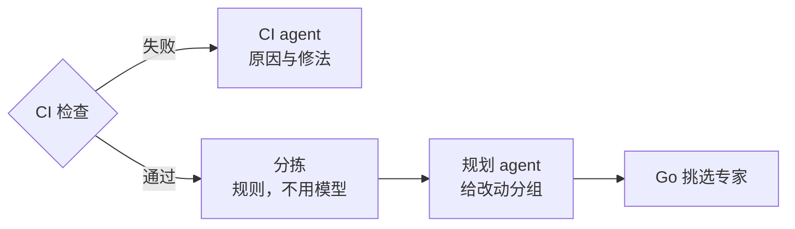

# 规划与分拣

第一个阶段检查改动是否可以审查，把不需要审查的文件放到一边，再决定其余文件由哪些专家审查。读取 GitHub 上的 CI 和云端的 `submit_plan` 工具还没有实现。



## CI 检查 {#ci-check}

在云端，eyeful 读取 head 提交的 GitHub Actions 运行，有运行还在进行时就等待。在本地，验证器运行 [`.eyeful/config.yml`](CONFIGURATION.md#project) 里的 `lint` 命令。`test` 命令不属于这项检查（见[被改动弄坏的测试](VERIFICATION.md#regressions)）。

检查失败时不启动任何专家。CI agent 阅读日志，报告每个失败、它的原因和修法，审查以 `ci_failed` 结束。

## 分拣 {#triage}

用规则、不用模型，把锁文件、生成的代码、vendored 代码、二进制文件、`.eyeful/config.yml` 里的 `skip` 路径以及 diff 超过 512 KB 的文件放到一边。它们不交给任何专家，并被列为未审查。其余每一行都至少交给一个专家，依据是 Google 的 [Every Line](https://google.github.io/eng-practices/review/reviewer/looking-for.html#every-line)。

剩下的文件组成一份清单：

```text
path                      class   +lines  -lines
app/auth/session.py       code        12       3
web/src/Login.svelte      code        40      18
commits: "fix session expiry at the boundary"
```

## 大型改动 {#large}

改动行数超过 2,000 的改动在规划之前先拆成若干范围。Go 只按路径来拆，所以同一个改动总是得到同样的范围：

1. 文件先按第一级目录分组，再按前两级。仍超过 2,000 行的组按路径顺序切开，单个更大的文件自成一个范围。
2. 相邻的组合并到一起，直到 2,000 行为止。
3. 每个范围有自己的计划、自己的专家和均分的预算。用完份额的范围不再启动 agent，审查以 `partial` 结束。

项目的测试、验证和汇总对整个改动只运行一次。报告按顺序列出各个范围（见[排序报告](REPORT.md#ranked-report)）。

## 计划 {#the-plan}

### 给改动分组

规划是对已连接 agent 的一次调用，由 [`@pulls.review/core`](https://github.com/antfu/pulls.review) 驱动。`packages/pulls` 把它打包成 `workflow/pulls/core.js`，Go 用 [moejs](https://github.com/Calcium-Ion/moejs) 运行它，所以二进制既不需要 Node 也不需要 cgo。

1. core 解析 diff 并构建提示词：清单、hunk 头，以及放得下的 diff。
2. agent 给出改动的摘要和分组。每个组有 `category`、标签、文件，需要格外小心的标 `critical`。
3. core 按 schema 检查回答，并确认每个文件恰好属于一个组。被拒绝的回答重试一次。之后审查就用名册里的前四个专家审查一个包含全部文件的组，反馈里会说明。

```json
{
	"overallSummary": "Sessions now expire at the exact expiry second.",
	"groups": [
		{
			"key": "session-expiry",
			"label": "Session expiry",
			"category": "security",
			"critical": true,
			"filePaths": ["app/auth/session.py"]
		}
	]
}
```

被标为 `critical`、或包含 `.eyeful/config.yml` 里 `risk` 路径的组是核心组。

### 挑选专家

Go 用一张固定的表把每个组对应到专家：

| 类别                         | 专家                                   |
| ---------------------------- | -------------------------------------- |
| `security`                   | correctness、skeptic、security         |
| `core`、`api`、`data`、`cli` | correctness、skeptic                   |
| `ui`                         | usability、correctness                 |
| `i18n`                       | usability                              |
| `tests`                      | tests                                  |
| `docs`、`examples`           | readability                            |
| `scripts`                    | security、correctness                  |
| `config`、`build`、`deps`    | security                               |
| `assets`、`other`            | 无                                     |
| 核心组额外加上               | correctness、skeptic、security、design |

每个专家对自己的所有组只运行一次（见[专家](EXPERTS.md)）。
