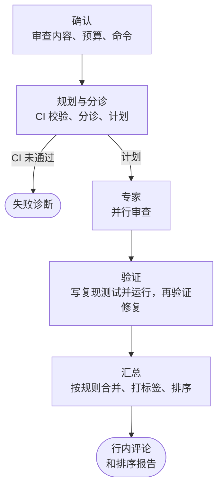

# 一次审查的全过程

本页从用户确认开始，按顺序介绍一次审查，直到有人读到评审意见。各个阶段已经在 `workflow` 模块中实现（见[整体架构](ARCHITECTURE.md#workflow)），本地审查会完整运行这些阶段（见[本地运行](LOCAL.md)）。云端审查还没有用到它：API 能接收审查，工作进程也会领取，随后一个占位执行器以 `none` 结束它，因为云端的 agent 和沙箱还没有。

## 开始之前 {#before-it-starts}

创建审查前，客户端会列出要审查的内容（某个分支相对基础分支的改动，或本地改动）、预算，以及会执行哪些项目命令，用户确认后才创建。审查看得多仔细不是一个可设置的选项（见[档位](LEVELS.md#choosing-the-level)）。审查开始后不能取消，只有还在排队时可以删除。

项目命令写在 `.eyeful/config.yml` 里。本地运行时，命令改过之后要重新确认。仓库里没有这个文件时不运行任何命令，所有发现都保持未验证；由 agent 推测命令、再交给用户确认的做法还在计划中。

## 各个阶段 {#stages}

| 阶段      | 做什么                                                                | 出错时                         | 详见                          |
| --------- | --------------------------------------------------------------------- | ------------------------------ | ----------------------------- |
| planning  | CI 校验，检出代码并安装依赖，分诊，项目的测试，上一轮的复现测试，计划 | 见下文                         | [规划与分诊](PLANNER.md)      |
| experts   | 每个选中的专家按自己的标准和工具审查分到的文件                        | 去掉这个专家，在反馈里标为缺席 | [专家](EXPERTS.md)            |
| verify    | 为每条 `error` 或 `warning` 的发现写复现测试并运行，再验证修复建议    | 改由评判 agent 读这条发现      | [证据与验证](VERIFICATION.md) |
| summarize | 合并发现，按规则写成 Conventional Comments 并排序                     | 不运行 agent，不会失败         | [审查反馈](REPORT.md)         |

某个阶段出错时，只丢掉这个阶段的结果，并在反馈里注明。整个审查提前结束只有两种情况：CI 校验没通过，审查以 `ci_failed` 结束并附上诊断；仓库克隆失败，以 `none` 结束。依赖装不上不会结束审查，专家照常审查，只是所有发现都标为未验证（见[证据与验证](VERIFICATION.md#the-verifier)）。

每个阶段结束时，都会把产出（计划、各专家的发现、每次验证）写入运行归档。工作进程中途退出时，接手的进程从最后一个完成的阶段继续，已经完成的模型调用不会重复执行。

预算是一次审查花费的上限，从不决定专家报告什么（见[档位](LEVELS.md#budget)）。

## 评审标准 {#review-standard}

eyeful 参考 Google 的 [Standard of Code Review](https://google.github.io/eng-practices/review/reviewer/standard.html)。eyeful 不批准任何改动，所以只采用其中关于如何提意见的部分。

只有能说明改动引入了 bug、漏洞或回归的意见才是阻塞的；“还可以写得更好”这类意见都是非阻塞的建议。验证器亲眼看到失败的发现，排在所有还需要人来判断的发现前面。代码风格以项目自己的风格指南为准，指南里没提到的风格问题只能标为 `nitpick`。设计方面的意见要写明依据哪条工程原则。

这些规则怎样对应到评论标签，见[审查反馈](REPORT.md)；出处见[参考文献](REFERENCES.md)。

## 状态与结果

审查依次经过 `queued`、`running`、`done` 三个状态。结束的审查有以下几种结果：

| 结果        | 含义                                              |
| ----------- | ------------------------------------------------- |
| `complete`  | 所有阶段都运行了                                  |
| `none`      | 没有可审查的内容，`reason` 写明原因，比如克隆失败 |
| `ci_failed` | CI 校验没通过，反馈只说明失败原因                 |
| `partial`   | 预算用完，或有专家没有交出报告；反馈包含其余部分  |

工作进程怎样领取、续约和结束审查，进程挂掉时会怎样，见[任务调度与租约](SCHEDULING.md#reviews-over-workers)。

## 审查规则 {#rules}

评论该怎么写，由上面取自文献的评审标准决定；下面的规则决定流程怎么运行，其中几条对应 `.agents/POLARIS.md` 里的硬性指标。

1. agent 决定做什么，Go 决定允不允许，所有循环、预算和停止条件都由 Go 控制。
2. eyeful 不批准改动，也不拦截合并，合并由人来做。
3. 每次运行都有记录：谁运行的、运行了什么、花了多少。这些记录也是论文的数据。
4. 复审从上一轮复现出来的东西开始，而不是从它说过的话开始：在任何 agent 读改动之前，先重跑那些测试（见[多轮审查](REPORT.md#rounds)）。
5. 审查开始前要用户确认，开始后一直运行到结束。
6. CI 没通过的改动只做失败诊断，不做审查。

## 待定事项 {#open-decisions}

- 结论怎么给：每个专家对自己负责的部分给出总体结论，还是继续只按每条发现的类别决定哪些问题阻塞？
- 覆盖率：“覆盖率不能下降”作为硬性规则，还是作为 tests 专家的一条普通发现？

## 已知的缺口 {#known-gaps}

下面是 eyeful 存在、但还没有修的问题，以及各自没修的原因。

- 在最要紧的发现上，专家组并不比单个 agent 强。在 ReviewBench 的测试 pull request 上，高严重程度的发现它找到 11 条中的 5 条，单 agent 找到 6 条，而它花的 token 是三倍；它多出来的部分在中等和低严重程度的发现上（见[评测](EVALUATION.md#reviewbench-pilot)）。没有修是因为原因还不清楚：11 条发现太少，说不出漏的是哪些、为什么漏；能说明这一点的评分，在评判模型的账户用完之后也没法重新计算。在这种情况下去改专家之间的分工，只是照着一小批数据去猜。
- 没有任何工具在运行。计划在所有 agent 之前运行的检查，以及专家可以调用的工具，都还没有实现（见[档位](LEVELS.md#planned)）；专家只能用它所在 agent 自带的读文件工具。没有修有两个原因。其一，每个工具对每种语言都需要一个外部程序，装在用户的机器上或沙箱里，这是“eyeful 可以在那里运行什么”的决定，不只是写代码的事。其二，基准的仓库都没有 `.eyeful/config.yml`，所以现在没有任何一次被测量的审查会运行工具，它的效果无从证明。被改文件的历史是唯一两者都不需要的部分，已经做了（见[专家](EXPERTS.md#skills-and-tools)）。
- skill 的作用没有测过。在检查过的运行里，correctness 和 skeptic 专家大约只有三分之一打开过 skill。22 个内置 skill 是否改变了找到的问题，需要跑一次不带 skill 的审查才能知道，而这还没有做。
