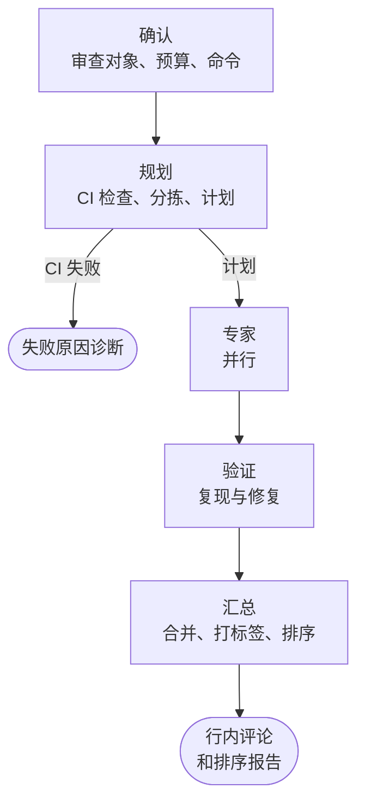

# 一次审查的全过程

一次审查经过四个阶段，都在 `workflow` 模块里实现（见[架构](ARCHITECTURE.md#workflow)）。本地审查会运行全部阶段（见[本地运行](LOCAL.md)）。云端审查在已入队的 pull request 上运行同样的阶段。在沙箱实现之前，`setup` 和项目命令不运行，发现保持未验证（见[云端运行](cloud/CLOUD.md)）。

## 开始之前 {#before-it-starts}

在本地，客户端展示要审查什么、预算是多少、会运行哪些项目命令，用户确认后审查才开始；命令一有变化就要用户重新确认。在云端，在仓库里加上 eyeful workflow 就是这份同意，命令取自 base 分支。已开始的审查不能取消。

eyeful 从项目的清单文件里找出命令（见[项目命令](CONFIGURATION.md#project)）。找不到时什么都不运行，所有发现都由裁判阅读。

## 各个阶段 {#stages}

| 阶段      | 做什么                                         | 失败时                 | 页面                          |
| --------- | ---------------------------------------------- | ---------------------- | ----------------------------- |
| planning  | CI 检查、检出与 setup、分拣、项目的测试、计划  | 见下文                 | [规划与分拣](PLANNER.md)      |
| experts   | 每个被选中的专家审查自己的文件                 | 该专家被列为缺席       | [专家](EXPERTS.md)            |
| verify    | 为每条 `error` 或 `warning` 发现编写并运行复现 | 交给裁判阅读           | [证据与验证](VERIFICATION.md) |
| summarize | 按规则合并发现、打标签、排序                   | 不运行 agent，不会失败 | [审查反馈](REPORT.md)         |

某个阶段失败只损失它自己的工作，反馈会说明哪里失败了。CI 检查失败时审查以 `ci_failed` 结束，克隆失败时以 `none` 结束。setup 失败不会结束审查：专家照常审查，所有发现都是未验证的。

每个阶段完成时把输出写入运行存档。进程中途停止后，重新开始的审查从最后完成的阶段继续。agent 调用失败、或被预算拒绝的步骤不会保存，会重新运行。计划总是保存的，因为专家的工作建立在它之上。

## 评审标准 {#review-standard}

eyeful 遵循 Google [Standard of Code Review](https://google.github.io/eng-practices/review/reviewer/standard.html) 里关于写评论的部分：

- 只有证明改动引入了 bug、漏洞或回归的评论才阻塞。
- 改进的想法是非阻塞的建议。
- 风格问题以项目自己的规范为准，规范没提到的只能是 `nitpick`。
- 设计方面的评论要指出它依据的原则。

[审查反馈](REPORT.md)把这些对应到评论标签上。

## 状态与结果

审查从 `queued` 到 `running` 再到 `done`，结束时有一个结果：

| 结果        | 含义                                |
| ----------- | ----------------------------------- |
| `complete`  | 每个阶段都运行了                    |
| `none`      | 没有可审查的内容，`reason` 说明原因 |
| `ci_failed` | CI 检查失败，反馈给出诊断           |
| `partial`   | 预算用完，或有专家没有交报告        |

云端审查怎样接收和重试，见[审查生命周期](cloud/SCHEDULING.md)。

## 审查规则 {#rules}

1. agent 决定做什么。Go 决定它能不能做，并掌管每个循环、预算和停止条件。
2. eyeful 不批准改动，也不阻止合并。合并由人来做。
3. 每次运行都有记录：谁运行的、运行了什么、花了多少。
4. 再次审查时先重新运行上一次审查的复现（见[多轮审查](REPORT.md#rounds)）。
5. 审查只在得到同意后开始：本地是用户的确认，云端是 App 的安装。开始后运行到结束。
6. CI 失败时，改动得到的是诊断而不是审查。

## 已知的缺口 {#known-gaps}

- 专家组比单个 agent 多带来什么、eyeful 和其他审查工具相比如何，都还没有测量（见[评估](EVALUATION.md)）。
- 没有工具在运行。计划在专家之前和专家身边运行的检查都还没有实现（见[层级](LEVELS.md#planned)）。
- skill 的效果没有测量过。现在每个专家的提示词里都带着它的 skill，也没有做过不带 skill 的运行。
- 每个专家是否该给出整体结论、“覆盖率不下降”是否该成为硬性规则，都还没有决定。
