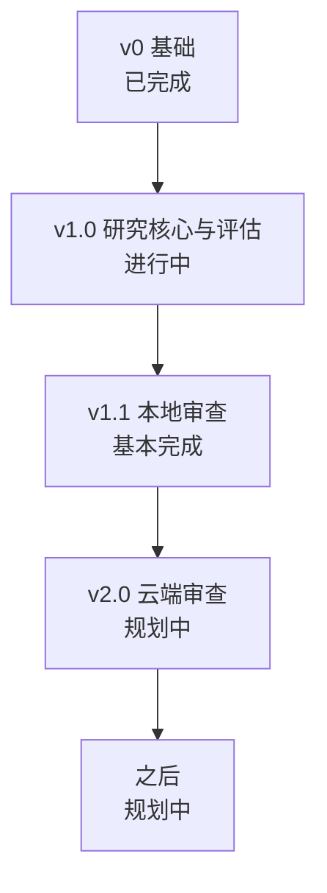

# 路线图

每个版本交付什么，以及发布前必须证明什么。当退出标准成立、且 `.agents/POLARIS.md` 里没有硬性指标倒退时，一个版本才发布。

## v0：基础（已完成）

- 带租约、fencing 和回收器的 PostgreSQL 队列；提供商路由已写好但未接入（见[调度](cloud/SCHEDULING.md)）。
- 桌面窗口，以及运行 `mise run check` 的 CI。

## v1.0：研究核心与评估（进行中）

只包含[研究问题](EVALUATION.md#research-question)需要的东西，从命令行针对数据集驱动。

| 部分                                                                                      | 状态                                    |
| ----------------------------------------------------------------------------------------- | --------------------------------------- |
| `workflow` 模块：规划、专家、验证器、汇总                                                 | 已完成                                  |
| correctness 和 security 专家，以及 generalist 基线                                        | 已完成                                  |
| 验证器的六道关卡、判定依据的核对、只读的裁判                                              | 已完成                                  |
| 运行存档和阶段检查点；SARIF 和 Markdown 形式的反馈                                        | 已完成                                  |
| `eval/`：被试构建、运行器、标注表、分析                                                   | 已完成                                  |
| 在 Code Review Bench 和 SWE-bench 上的试点                                                | 已运行（见[试点](EVALUATION.md#pilot)） |
| 用 eyeful 掌管的密钥在 pi 里运行 agent（见 [pi 里的 agent](cloud/CLOUD.md#agents-in-pi)） | 待做                                    |
| 每次审查重复三次，以及标注                                                                | 待做                                    |

退出标准：

- 主实验已在每个数据集上、以两种配置和全部三种条件各运行三次，发现已标注。
- 这些运行里的每条 `issue (blocking)` 都被验证器看到失败过，并且判定依据是 `specified` 或 `implicit`，或者是项目自己测试的 `derived`。
- 预算用完的审查返回它已验证的部分，并标为 partial。审查中途被杀掉的工作进程从最后完成的阶段继续。
- 论文能够报告专家组相对单 agent 多了什么、花了多少。

在 v1.0 发布之前，桌面应用和云端服务器都不加新功能。

## v1.1：本地审查（基本完成）

同样的工作流跑在用户的机器上（见[本地运行](LOCAL.md)）。它先于 v1.0 完成，这样专家和验证器可以在真实改动上试用：

- `local/agents`、快照及其检出；
- 全部六个专家，带着来自 skills.sh 的 skill；
- `eyeful review`、`provider`、`connect` 和桌面应用。

待做：迁移从修改 `0001_init` 改为每次改动一个文件（见[持久化](cloud/PERSISTENCE.md)）。

退出标准：在 eyeful 自己的仓库上运行 `eyeful review` 能不调用服务器就返回反馈，并且没有凭据或模型密钥离开这台机器。

## v2.0：云端审查（规划中）

工作流跑在 pull request 上（见[云端运行](cloud/CLOUD.md)）：GitHub App 的 webhook 作为唯一来源、针对 GitHub Actions 的 CI 检查、`internal/checkout` 和 `internal/sandbox`、outbox 和 sink、以 `COMMENT` review 提交的评论、E2E 运行和 `runner` 命令。

退出标准：对不可信 pull request 的云端审查完成时，代码只在它的沙箱里运行过；审查中途被杀掉的工作进程不丢任何东西，也不重复运行任何东西。

## 之后（规划中）

定时来源和性能专家。
