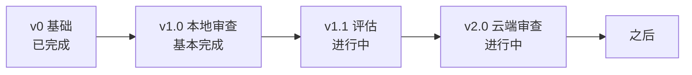

# 路线图

版本沿着一条线走：先把审查做出来，再测量它，最后用到 pull request 上。当退出标准成立、且 `.agents/POLARIS.md` 里没有硬性指标倒退时，一个版本才发布。

## v0：基础（已完成）

- 桌面窗口，以及运行 `mise run check` 的 CI。

## v1.0：本地审查（基本完成）

核心主线：发现 → 复现 → 修复 → 回归，跑在用户的机器上，用的是用户已有的编码 agent（见[本地运行](LOCAL.md)）。

| 部分                                                        | 状态   |
| ----------------------------------------------------------- | ------ |
| `workflow` 模块：规划、七个专家、验证器、合并、报告         | 已完成 |
| 验证器的六道关卡、判定依据的核对、只读的裁判                | 已完成 |
| 从 manifest 找到项目命令，由用户确认                        | 已完成 |
| 运行存档和阶段检查点；SARIF 和 Markdown 形式的反馈          | 已完成 |
| `eyeful review`、`provider`、`connect`、`commit` 和桌面应用 | 已完成 |
| 打 tag 发布，提供 macOS 和 Linux 的二进制                   | 待做   |

退出标准：

- 在 eyeful 自己的仓库上运行 `eyeful review` 能返回反馈，并且没有凭据或模型密钥离开这台机器。
- 每条 `issue (blocking)` 都被验证器看到失败过，并且判定依据是 `specified` 或 `implicit`，或者是项目自己测试的 `derived`。
- 预算用完的审查返回它已验证的部分，并标为 partial。在同一个运行目录上重启的审查从最后完成的阶段继续。

## v1.1：评估（进行中）

测量 v1.0 的实验（见[评估](EVALUATION.md)），从命令行针对公开数据集运行。在它完成之前，桌面应用不加新功能。云端审查在 v2.0 进行。

| 部分                                              | 状态                 |
| ------------------------------------------------- | -------------------- |
| `eval/`：被试构建、运行器、隔离审计、评分器、分析 | 已完成               |
| Code Review Bench 的被试                          | 50 个里建了 10 个    |
| ReviewBench 按语言分层抽取的 50 个                | 已完成               |
| SWE-bench 的被试                                  | 约 30 个里建了 20 个 |
| 固定提示词和预算的试运行                          | 待做                 |
| 主实验和消融，约 860 次审查                       | 待做                 |

退出标准：主实验已在每个数据集上、以每种配置和该数据集能用的每种条件各运行三次，并由各基准自己的评分器打分；结果能说明专家组相对单 agent 多了什么、花了多少。revmux 比较是扩展，计划延误时最先放弃。

## v2.0：云端审查（进行中）

通过 GitHub Action 在 pull request 上运行工作流（见[云端运行](cloud/CLOUD.md)）。

| 部分                                                                              | 状态   |
| --------------------------------------------------------------------------------- | ------ |
| 每个打开的 pull request 和每次 `/eyeful` 一个 job，同一 pull request 同时只跑一个 | 已完成 |
| 检出 pull request，命令取自 base 提交                                             | 已完成 |
| 针对 GitHub Actions 的 CI 检查                                                    | 已完成 |
| 运行本地工作流的审查容器                                                          | 已完成 |
| 模型经火山方舟调用，pi 拿不到任何密钥                                             | 已完成 |
| 行内评论作为一条 `COMMENT` review，排序报告作为一条评论                           | 已完成 |
| 沙箱容器，让项目命令只在里面运行                                                  | 已完成 |
| 沙箱只能访问包仓库                                                                | 待做   |
| 只发布一次，重新运行跳过 GitHub 上已有的内容                                      | 已完成 |
| 从镜像仓库拉取镜像，而不是每个 job 都构建                                         | 已完成 |
| 在真实 pull request 上端到端运行一次                                              | 待做   |

退出标准：对不可信 pull request 的云端审查完成时，代码只在它的沙箱里运行过；重新运行它的 job 不会重复发布任何东西。

## 之后

- L1 工具，以及按它们的输出做的路由（见[层级](LEVELS.md#planned)）。
- 专家自己的工具（见[专家](EXPERTS.md)）。
- 性能专家，以及定时来源。
