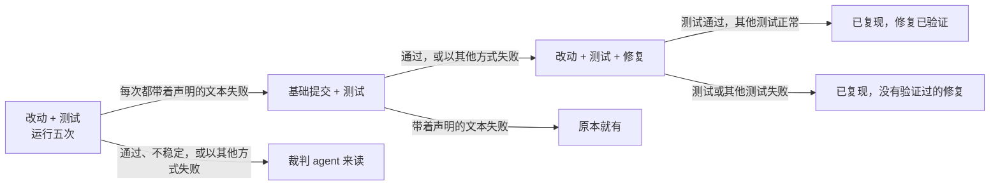

# 证据与验证

本页说明 eyeful 怎样判断一条发现有多可信。专家读代码、调用工具、提出测试；验证器是 `workflow` 里的一段普通 Go 代码，负责运行这些测试并记录结果。测试要通过审查的工作区来运行：本地是快照的一份一次性检出（见[本地运行](LOCAL.md#how-a-local-review-runs)），云端的沙箱还没有实现。

## 测试预言问题 {#oracle}

测试失败只能说明代码和测试对不上，说明不了测试本身是对的。如果专家误解了代码应有的行为，它会按自己的理解写一个失败的测试，再写一个让测试通过的修复，两步都能成功。会话应该在 `expires_at` 那一秒过期还是晚一秒过期，要看需求怎么规定，代码本身回答不了。软件测试里把这称为测试预言问题（oracle problem）。

所以，只有当测试所期望的行为有 agent 以外的来源时，复现才能让一条发现成为阻塞问题。每个复现测试都要声明它的判定依据（oracle），也就是期望行为从哪里来，验证器会把它记录下来。这几类不是 eyeful 自己定的：Barr 等人关于测试预言问题的综述按“正确行为的知识从哪里来”把所有测试预言分成四类，这里用的就是这四类（见[参考资料](REFERENCES.md)）：

| 判定依据    | 综述里的含义                                                 | 在 eyeful 里                                                            | 测试按所说的原因失败时，结果是 |
| ----------- | ------------------------------------------------------------ | ----------------------------------------------------------------------- | ------------------------------ |
| `specified` | 有规格说明什么是正确的                                       | 发现里引用的原文：issue、pull request 描述、文档、docstring、API schema | `fail`                         |
| `derived`   | 从系统的其他产物推导出来；回归测试里“上一个版本可以充当预言” | 仓库里原有的测试，现在失败了                                            | `fail`                         |
|             |                                                              | 基础提交上的行为不同，由一个在那里通过的新测试表明                      | `review`                       |
| `implicit`  | 不需要规格的常识：“缓冲区溢出和段错误几乎总是错误”           | 崩溃、未处理的错误、数据竞争（`-race`）、sanitizer 报告、超时           | `fail`                         |
| `human`     | 没有自动化的预言，人是“什么才正确”的最终来源                 | 只有 agent 自己对代码的理解，所以要由作者来判断                         | `review`                       |

最后一列是结果的[类别](#kind-and-severity)。`derived` 有两种形式，是因为综述里的回归预言只对改动本来要保留的功能成立：项目自己写的测试说明项目要保留它；而一个新测试只是在基础提交上通过，表明的差别可能正是改动想要的。

判定依据由验证器来评定，不采信 agent 自己的说法。`specified` 要写明引文所在的文件，引文出自这次改动的提交信息时不写文件，验证器会去查这段引文；忽略换行和空白之后仍然找不到，判定依据就降为 `human`。`implicit` 声称的是运行时自己打印的失败，比如崩溃，所以它的 `fails` 文本不能是测试自己写的：测试文件里包含这段文本时，期望其实出自测试本身，判定依据降为 `human`。不提交自己测试的 `derived` 指明仓库里已有的一个测试，由验证器去运行它。提交了新测试的 `derived` 由基础提交上的那次运行决定，不由 agent 决定：只有测试在基础提交上通过时它才成立；原本会降为 `human` 的判定依据，只要测试在基础提交上通过，就记为 `derived`，因为这时确实观察到了基础提交的行为不同。发现保留 agent 声明的判定依据，验证结果里记录实际运行的复现和评定后的判定依据，评测据此衡量判定依据规则带来的变化。

结果为 `review` 的复现不能作为阻塞问题，它会变成一个向作者提出的 `question`，并附上失败的测试。修复建议由另一个 agent 来写，它能看到发现和测试，看不到专家的推理过程，免得修复只是把专家的假设又写了一遍。

## 证据类型 {#evidence-kinds}

`evidence` 说明一条发现可以怎样检查。它的取值是需求工程标准 ISO/IEC/IEEE 29148 的验证方法，这个标准列出四种表明某件事成立的方式：检查（inspection）、分析（analysis）、演示（demonstration）和测试（test）（见[参考资料](REFERENCES.md)）：

| 方法         | 由谁产生                       | 在这里的含义                           | 运行了什么             |
| ------------ | ------------------------------ | -------------------------------------- | ---------------------- |
| `test`       | correctness、skeptic、security | 调用代码的测试能表明这个问题           | 一个在改动上失败的测试 |
| `analysis`   | skeptic、security              | 专家一步步推出问题是怎样被触发的       | 没有运行               |
| `inspection` | 所有专家                       | 专家对照标准、约定或代码的用法来读代码 | 没有运行               |

代码里现在只有这三种。第四种演示是操作系统并观察它的表现，要等能打开页面的工具实现之后才有；依靠其他工具结果的方法也要等那些工具（见[档位](LEVELS.md#planned)）。

专家只负责发现问题，不负责证明：它交出发现和触发它的场景，`test` 只表示这个问题能用测试说明。复现测试事后由另一个 agent 来写，所以证明的成本不会左右专家报什么。验证方式不是 `execution`、项目没有测试命令或装不起来时没法运行复现，这时改由裁判 agent 来读这条发现。

## 类别与严重度 {#kind-and-severity}

一条发现有多确定，和它会造成多大代价，是两个问题。两个问题 eyeful 都用 [SARIF 2.1.0](https://docs.oasis-open.org/sarif/sarif/v2.1.0/sarif-v2.1.0.html) 的词来回答，它是 OASIS 制定的代码分析结果标准，这样发现和读取它的工具之间不隔着一套 eyeful 自己的刻度。

类别由验证器和裁判 agent 决定，从不由专家决定：

| 类别     | SARIF 里的定义（§3.27.9）                   | 一条评论在什么时候是这一类                                                  |
| -------- | ------------------------------------------- | --------------------------------------------------------------------------- |
| `fail`   | 结果代表一个问题，其严重度由 level 属性给出 | 验证器看到它的复现在改动上失败、在基础提交上不失败，判定依据的结果是 `fail` |
| `review` | 结果需要由人来审阅，判断它是否代表一个问题  | 什么都没运行、裁判 agent 读代码后确认，或者复现的判定依据结果是 `review`    |
| `open`   | 工具认为信息不足，无法判断问题是否存在      | 专家报告了它，而裁判 agent 提出质疑                                         |

只有 `fail` 的评论才是 `issue (blocking)`（见[审查反馈](REPORT.md#comment-format)）。

严重度是专家对“这个问题如果原样合并会造成多大代价”的判断，用 SARIF 的级别（§3.27.10）：

| 严重度    | SARIF 里的定义                   | 专家在什么情况下给出                                                     |
| --------- | -------------------------------- | ------------------------------------------------------------------------ |
| `error`   | 发现了严重的问题                 | 数据丢失或泄露、系统无法使用，或者常走的路径上结果错误、崩溃、契约被破坏 |
| `warning` | 发现了问题                       | 同样的问题出在很少走的路径上，或者需要不寻常的输入或状态才出现           |
| `note`    | 发现了小问题，或者改进代码的机会 | 不改变任何行为：命名、风格、措辞、注释或小的简化                         |

SARIF 规定只有类别为 `fail` 的结果才带级别，其他类别的级别一律是 `none`。eyeful 写出的文件遵守这一点，专家为 `review` 或 `open` 的结果声明的严重度保存在 `properties` 里（见[以 SARIF 保存发现](#sarif)）。

## 测试用来证明发现

eyeful 不会为了提高覆盖率去写测试。测试是专家证明功能错误存在的方式：专家判断正确的话，一个小测试就会在改动上失败。这个测试属于这条发现，只会和它所证明的修复一起交给作者。

## 被改动弄坏的测试 {#regressions}

运行代码不只用来证明专家已经怀疑的问题，也用来发现问题。用 `execution` 时，在任何专家开始之前，验证器先在改动上运行项目的测试（`test`）。测试失败时，再在基础提交上运行一次；在那里通过、在改动上失败的，就是一处回归。这是关于改动的事实，光读 diff 读不出来。

每个能报告 `test` 发现的专家都会拿到失败的测试和失败那次运行的末尾输出。它要为自己的文件能解释的每个失败找出背后改动的那一行，并报告成一条写明这个失败测试的发现，于是复现就是这个现成的测试，判定依据是 `derived`。不管有没有专家解释，反馈里都会列出被改动弄坏的测试。

在本地，工作区分不清一条失败命令里是哪些测试失败，所以回归写的是命令名，具体的测试在输出里。在云端，[CI 校验](PLANNER.md#ci-check)已经要求项目自己的 CI 通过，所以这一步只能发现那套 CI 不运行的部分。测试根本跑不起来时，反馈里会说明，专家拿不到线索，修复也不算验证通过，因为 `pass_to_pass` 对比的就是这次运行。

## 验证器 {#the-verifier}

eyeful 中只有验证器会运行项目代码，而且只运行 [`.eyeful/config.yml`](CONFIGURATION.md#project) 里的命令和 eyeful 自己的工具。

类别要验证之后才知道，所以验证顺序不能依赖它。验证器按专家声明的严重度排，然后按有几个专家报告了同样的行来排。`note` 的发现完全不验证：它没有声称任何可以用测试或裁判 agent 检查的行为，会作为 nitpick 报告（见[审查反馈](REPORT.md#ranked-report)）。

对每条 `test` 发现，复现 agent 根据发现和它的场景写一个测试，所有发现的复现 agent 同时进行。只有测试依次通过下面每一道关卡，复现才会被接受。这些关卡来自基准测试接受一个缺陷或一个生成测试的做法：fail-to-pass 和 pass-to-pass 来自 SWE-bench，基础提交来自 Defects4J，重复运行来自 Meta 的 TestGen-LLM（见[参考资料](REFERENCES.md)）。

| 关卡               | 验证器做什么                                   | 不成立时                                      |
| ------------------ | ---------------------------------------------- | --------------------------------------------- |
| `runs`             | 把测试加进一份新的改动副本并运行               | 交给裁判 agent 读：复现测试无法运行           |
| `not_flaky`        | 运行五次，每次的结果必须相同                   | 交给裁判 agent 读：复现测试不稳定             |
| `fails_as_claimed` | 在失败输出里查找复现给出的 `fails` 文本        | 交给裁判 agent 读：测试通过，或以其他方式失败 |
| `introduced`       | 在基础提交上运行一次，不能以同样的文本失败     | `pre_existing`：照常报告，但不会阻塞          |
| `fail_to_pass`     | 在另一份加了测试的新副本上应用修复，再运行测试 | 已复现，没有验证过的修复                      |
| `pass_to_pass`     | 在这份副本上运行改动涉及的包的测试             | 已复现，没有验证过的修复                      |

`fails` 是复现 agent 声明的一小段文本，测试因为所说的原因失败时会打印它，比如测试自己的断言信息。它把发现所预测的失败和编译不过、导入不了被测代码这类失败区分开，否则后者也会被当成复现成功。在基础提交上，同一段文本用来区分两种情况：测试在那里也带着 `fails` 失败，说明问题原来就有；测试在那里以别的方式失败，通常是因为它调用的代码是新加的，这并不否定这条发现，验证继续进行。在用户电脑上，agent 交出测试之前没法自己运行它，所以前五次运行失败却没有出现 `fails` 文本时，验证器会带着运行过的那份复现、命令和输出，要求复现 agent 修正一次，再用修正后的版本从头过关卡。验证结果里记录的是最后运行的那份复现。另有两条规则保证测试可信：复现测试只能是新文件，不能替换已有的代码或测试；改动了复现测试的修复不算验证通过。专家常常把同一个缺陷报不止一遍，所以不同专家在同一文件两行以内的发现放在一起检查，同一个专家的两条发现则分开检查：只为其中严重程度最高的那条写复现并运行，其余几条不再单独检查，因为它们最后会并进同一条评论，评论的证据取自检查过的那条。复现什么都没说明时，这几条发现都交给裁判 agent，每条各得一个结论，这样一条错的发现不会连累旁边对的那条。`pass_to_pass` 对比的是审查之前在改动上的那次运行（见[被改动弄坏的测试](#regressions)）：修复之前通过的测试，修复之后不能失败。



每次验证都会按 SWE-bench 测试框架的测试状态记录运行的结果：在改动上的每一次运行、在基础提交上的运行和应用修复后的运行，各记为 `PASSED`、`FAILED`（带着 `fails` 文本失败）或 `ERROR`（以其他方式失败）。发现停在哪一道关卡可以从这些记录推出，[评测](EVALUATION.md)据此统计每道关卡挡掉了多少发现。复现成功的发现，类别由它的判定依据决定。测试没能说明问题的发现不会被直接丢掉，不管是没写出测试、测试在改动上通过、不稳定，还是以其他方式失败：出问题的可能是测试而不是发现，所以裁判 agent 会带着这次尝试的记录去读这条发现，确认或质疑它。裁判确认的和原本就有的发现保持 `review`，所以不会阻塞。

## 裁判 {#the-judge}

复现测试不是检查发现的唯一办法。用 `execution` 时，没法用测试说明的发现，以及测试没能说明问题的发现，交给裁判 agent；用 `read_only` 时不运行任何命令，所有发现都交给它。裁判 agent 读代码和这条发现，试过测试的还会读那次测试的记录，只有同时满足三点才判定发现属实：问题确实存在于改动后的代码里；是这次改动引入或暴露的（仓库里的调用方或公开接口的使用者仍然依赖的行为没有了，提交信息又没有声明，算作改动引入的）；它改变了可以观察到的行为，或者违反了明确的约定（issue、文档、API schema 或已有的测试）。风格方面的意见，以及说不出哪个输入会出错的担忧，都不算属实。评测的标注用的是同一个定义，所以两种条件的差别在证据，而不在对缺陷的定义。

一个裁判 agent 一起读计划里同一个分组的发现，一次最多八条，最多四个裁判同时运行。同一组的发现依赖的是同一批文件和调用方，原先每条发现配一个裁判，这些代码每次都要重读：在 Code Review Bench 的运行里，裁判占了一次审查 30% 到 50% 的 token。对同样的发现改成一起读之后，裁判只用了原来 55% 的 token，67 个结论里有 62 个和原来相同，这个差别不超过同一条发现评判两次本来就有的出入。跨分组凑满八条一批省不了更多，因为裁判读两个分组就要读两倍的代码。也考虑过让两个专家一致的发现跳过裁判，出于同样的原因没有这样做：开销在裁判读的文件上，不在它要回答的发现条数上，而且这样会让读的人最先看到的那些发现失去检查。每条发现仍然各有自己的结论和理由；裁判的回答漏掉的发现保持未验证，并列入不确定性清单。

裁判 agent 不决定一条发现是否展示。证据决定评论的类别，不决定它是否存在：被裁判 agent 驳回的发现仍然留在反馈里，成为一条 `open` 的、不阻塞的评论，折叠在“Disputed”下面，旁边附上裁判的理由（见[审查反馈](REPORT.md#ranked-report)），由读的人来决定。一个 agent 把一条发现读一遍，可靠程度不足以删掉它：对同一条发现的两次评判可能不同，而一次驳回如果直接删掉发现，真问题就会不留痕迹地丢掉。代价是要读的评论变多，[评测](EVALUATION.md)用精确率来测量它。

这一切的前提是项目能装起来、测试能跑起来，这也是这种方法在实际中最大的限制：很多仓库需要数据库之类的服务，或者不止一条安装命令。`setup` 失败时，审查改为只读审查继续进行，所有发现标为未验证，反馈里说明原因。

## 一个例子

审查 `app/auth/session.py` 的 correctness 专家提出了这个测试：

```python
from app.auth.session import Session, is_expired

def test_expired_at_exact_boundary():
    assert is_expired(Session(expires_at=100), now=100)
```

负责修复的 agent 给出：

```python
def is_expired(session, now):
    return now > session.expires_at  # [!code --]
    return now >= session.expires_at  # [!code ++]
```

测试在改动上失败，加上修复后通过。这条发现成为什么，要看判定依据。如果 pull request 里写了“会话在 `expires_at` 时过期”，判定依据是 `specified`，结果是 `fail`，这条发现就成为附带修复的 `issue (blocking)`。如果没有任何地方说明边界该怎么算，判定依据是 `human`，结果是 `review`，同一个测试就变成一个 `question`：“会话在正好 `expires_at` 时是否还应有效？这个测试在改动上失败。”结果由验证器写入，专家不能把自己的测试标为通过。

## 用 SARIF 保存发现 {#sarif}

所有发现，不管来自哪里，都以 [SARIF 2.1.0](https://docs.oasis-open.org/sarif/sarif/v2.1.0/sarif-v2.1.0.html) 的 result 保存。SARIF 是 OASIS 制定的静态分析结果格式。Semgrep、gitleaks 这类本来就输出 SARIF 的工具，结果直接读取；专家调用 `submit_report` 提交的内容会转换成同样的结构。标准字段按标准的定义使用，eyeful 自己的字段放在 `properties` 里：

| SARIF 字段         | 内容                                                                                                       |
| ------------------ | ---------------------------------------------------------------------------------------------------------- |
| `ruleId`、`taxa`   | 规则或工具检查项，有 CWE 编号时一并记录                                                                    |
| `kind`             | [类别](#kind-and-severity)：`fail`、`review` 或 `open`                                                     |
| `level`            | `fail` 结果的严重度；其他类别一律为 `none`，这是标准的要求                                                 |
| `baselineState`    | 复现成功的结果：`new`；基础提交上同样失败时为 `unchanged`                                                  |
| `message`          | 评论的标题和正文                                                                                           |
| `locations`        | 文件和行号                                                                                                 |
| `relatedLocations` | 同一个问题出现的其他位置                                                                                   |
| `codeFlows`        | 安全问题的触发路径，逐步列出                                                                               |
| `fixes`            | 修复建议，以文件改动的形式                                                                                 |
| `properties`       | `expert`、`severity`、`evidence`、`oracle`、`label`、`decorations`、`corroboratedBy`、`repro`、`objection` |

上面例子里的发现，以 pull request 描述作为判定依据：

```json
{
	"ruleId": "eyeful/correctness/boundary",
	"level": "error",
	"kind": "fail",
	"baselineState": "new",
	"message": { "text": "A session is still valid at exactly expires_at." },
	"locations": [
		{
			"physicalLocation": {
				"artifactLocation": { "uri": "app/auth/session.py" },
				"region": { "startLine": 11 }
			}
		}
	],
	"fixes": [
		{
			"description": { "text": "Treat the expiry second as expired" },
			"artifactChanges": [
				{
					"artifactLocation": { "uri": "app/auth/session.py" },
					"replacements": [
						{
							"deletedRegion": { "startLine": 11, "endLine": 11 },
							"insertedContent": { "text": "    return now >= session.expires_at\n" }
						}
					]
				}
			]
		}
	],
	"properties": {
		"expert": "correctness",
		"severity": "error",
		"evidence": "test",
		"oracle": "specified",
		"label": "issue",
		"decorations": ["blocking", "correctness"],
		"corroboratedBy": ["security"]
	}
}
```

同一份 SARIF 文件可以用来生成评审意见、上传到 GitHub code scanning，也直接用于[效果评测](EVALUATION.md)。

## 与 CI 的关系 {#relation-to-ci}

eyeful 没有运行的测试套件，仍以项目自己的 CI 结果为准。在云端，[CI 校验](PLANNER.md#ci-check)在审查开始前就已经要求它们全部通过。
