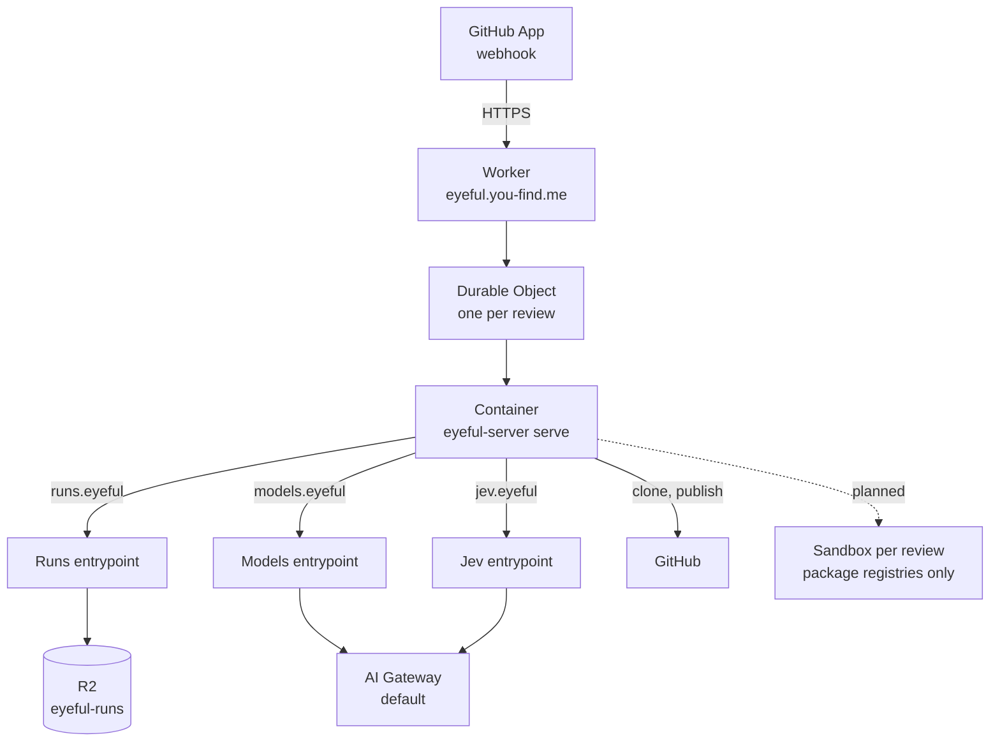

# 部署

这一页说明 eyeful 发布了什么、各部分运行在哪里，以及生产部署需要什么。从源码运行 eyeful 见[开发](../DEVELOPMENT.md)，所有变量见[配置](../CONFIGURATION.md#server)，发布时间见[路线图](../ROADMAP.md)。

云端运行在 Cloudflare 上：一个 Worker（`packages/worker`），每次审查一个 Durable Object 和一个 Container，阶段存档用 R2，模型和 Jev 走 AI Gateway。GitHub App 把 webhook 发给 Worker。本地部分是桌面应用和 `eyeful` 命令，不需要服务器。所有东西都要在 CI 通过后才发布：文档站在 `main` 上每次 CI 通过后发布到 GitHub Pages（`docs.yml`）；`v*` tag 先跑 CI 再跑 GoReleaser（`release.yml`、`.goreleaser.yml`），把 Linux 和 macOS 的 `eyeful` CLI 以压缩包、`.deb` 和 `.rpm` 形式附到 GitHub release 上。目前还没有打过任何版本。CI（`.github/workflows/ci.yml`）只运行 `mise run check`。

## 产物

| 产物              | 构建方式                                           | 运行在                          |
| ----------------- | -------------------------------------------------- | ------------------------------- |
| Worker 和服务镜像 | `packages/worker` 里的 `cf deploy`（`Dockerfile`） | Cloudflare Workers + Containers |
| 桌面应用          | `mise run package:desktop`（Wails）                | macOS、Windows、Linux           |
| `eyeful`          | `mise run install`，或 `v*` tag（GoReleaser）      | 用户的机器                      |
| 文档站            | `mise run build:docs`（VitePress）                 | `DOCS_URL` 上的 GitHub Pages    |

镜像里有 `eyeful-server`、git、pi `1.3.0`，以及 `packages/worker/pi/` 下 pi 的设置。

## 云端

`packages/worker/cloudflare.config.ts` 声明了全部内容：Worker `eyeful` 挂在自定义域名 `eyeful.you-find.me` 上，`workers.dev` 和 Preview URL 都关闭；Container `eyeful-server`（`standard-1`，最多五个）；R2 bucket `eyeful-runs`；Workers AI binding；gateway id（`default`）；以及五个必填 secret。Durable Object 在启动 Container 之前把三个内部地址路由到 Worker 的各个入口，所以 Container 里没有 gateway token、R2 凭据或 webhook secret（见[云端运行](CLOUD.md#credentials)）。

### AI Gateway

账号的 `default` gateway 开启了认证，provider 密钥存在它的 Secrets Store 里。模型使用 `volcengine` 自定义 provider，它的密钥是 secret `default_volcengine_default`。Jev 使用 Workers AI，不需要 provider 密钥。

### 部署 {#deploy}

账号需要 Workers Paid 计划，因为 Containers 需要它。Docker 必须在运行，因为 `cf deploy` 会构建镜像。

1. 按 `.env.example` 填好根目录的 `.env`。`EYEFUL_AI_GATEWAY_TOKEN` 是对该账号有 AI Gateway Run 和 Workers AI Read 权限的 Cloudflare API token；`EYEFUL_GITHUB_APP_PRIVATE_KEY` 是 App 的 PEM，写成一行、每个换行写成 `\n`，用双引号包起来。
2. 在 `packages/worker` 下，`pnpm exec cf deploy --secrets-file ../../.env` 会构建镜像，首次部署时创建 R2 bucket，并上传 Worker、Container 和 secret。
3. 在 GitHub App 里启用 webhook，URL 设为 `https://eyeful.you-find.me/webhook`，secret 设为 `EYEFUL_WEBHOOK_SECRET`，订阅 Pull request 事件，并授予 Contents（只读）、Pull requests（读写）、Issues（读写）、Actions（只读）和 Metadata（只读）。把 App 安装到要审查的仓库上。

之后用 `pnpm exec cf workers secrets update` 修改单个 secret；运行中的 Container 在下一个启动时才看到新值。

## 本地

本地模式只安装应用本身。它不需要服务器、数据库、eyeful 账号或模型密钥，因为 agent 就是用户已经登录的编码工具。

`eyeful review` 用 `eyeful connect` 选定的 agent 运行审查；桌面应用在窗口里做同样的事（见[桌面应用](../LOCAL.md#desktop)）。本地审查可以运行什么、怎样隔离，见[本地运行](../LOCAL.md)。
