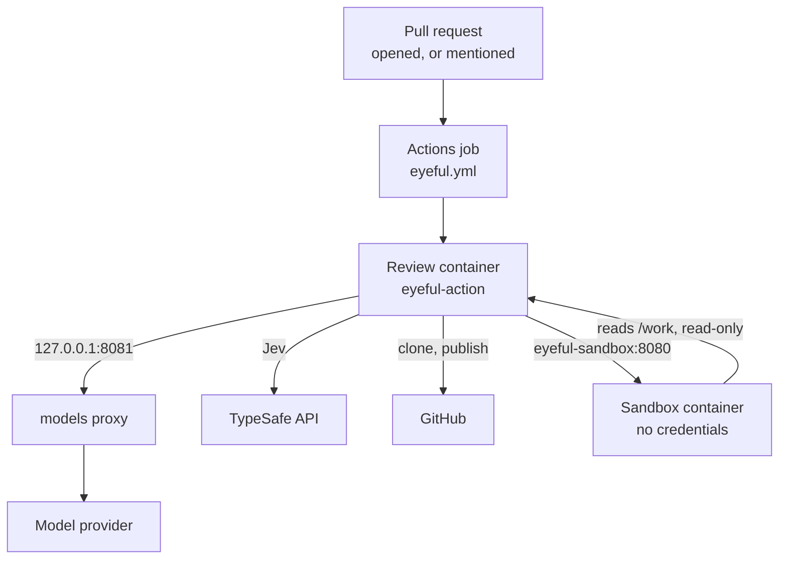
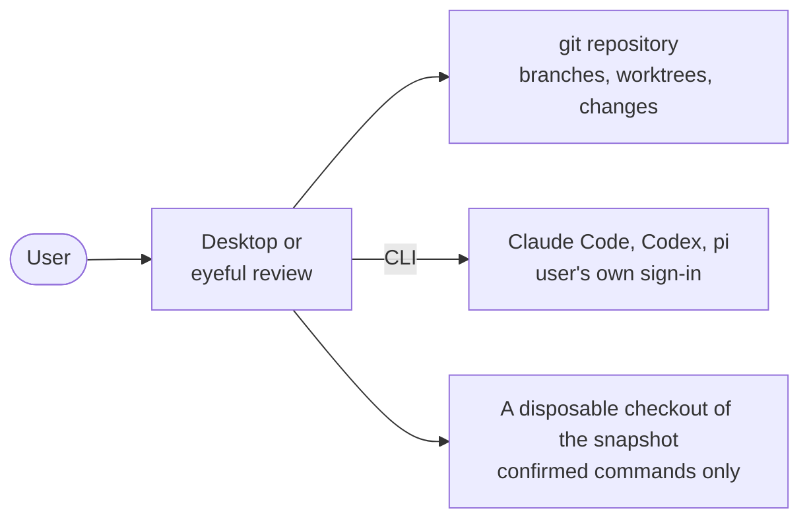

# 部署上线

这一页说明 eyeful 发布了什么、各部分运行在哪里，以及怎样开启云端审查。从源码运行 eyeful 见[开发](../DEVELOPMENT.md)，所有变量见[配置](../CONFIGURATION.md#action)，发布时间见[路线图](../ROADMAP.md)。

云端审查通过仓库根目录的 composite action `action.yml` 在 GitHub Actions 里运行。本地部分是桌面应用和 `eyeful` 命令，不需要服务器。所有东西都要在 CI 通过后才发布：文档站在 `main` 上每次 CI 通过后发布到 GitHub Pages（`docs.yml`）；`v*` tag 先跑 CI 再跑 GoReleaser（`release.yml`、`.goreleaser.yml`），把 Linux 和 macOS 的 `eyeful` CLI 以压缩包、`.deb` 和 `.rpm` 形式附到 GitHub release 上。目前还没有打过任何版本。CI（`.github/workflows/ci.yml`）运行 `mise run check`。

## 产物

| 产物               | 构建方式                                                              | 运行在                       |
| ------------------ | --------------------------------------------------------------------- | ---------------------------- |
| 审查镜像和沙箱镜像 | 每个 job 里由 `action.yml` 构建（`Dockerfile`、`Dockerfile.sandbox`） | GitHub Actions runner        |
| 桌面应用           | `mise run package:desktop`（Wails）                                   | macOS、Windows、Linux        |
| `eyeful`           | `mise run install`，或 `v*` tag（GoReleaser）                         | 用户的机器                   |
| 文档站             | `mise run build:docs`（VitePress）                                    | `DOCS_URL` 上的 GitHub Pages |

审查镜像里有 `eyeful-action`、git、`/opt/pi` 下的 pi `1.4.0`、带有 `cmd/eyeful-action/pi/` 中 pi 设置的用户 `agent`，以及以 `agent` 身份运行 pi 的 `/usr/local/bin/pi`。沙箱镜像里有 `eyeful-sandbox` 和 Go、Node、Python 工具链。

## 云端

两个容器共用 Docker 网络 `eyeful` 和目录 `$RUNNER_TEMP/eyeful`，挂载在 `/work`：审查容器可读写，沙箱只读。

### 开启审查 {#turn-on-reviews}

1. 添加仓库变量 `EYEFUL_MODEL_URL`，即提供 `cmd/eyeful-action/pi/models.json` 中模型的 provider 的 OpenAI 兼容地址；再添加仓库 secrets `EYEFUL_MODEL_KEY`（这个 provider 的密钥）和 `EYEFUL_TYPESAFE_API_KEY`（Jev 需要）。
2. 添加一个和 `.github/workflows/eyeful.yml` 类似的 workflow。在其他仓库里，把检出和 `uses: ./` 换成 `uses: Pleasurecruise/eyeful@main`。保留 job 的 `if`（只放行所有者、成员和协作者）和它的权限：Contents（读）、Pull requests（写）、Issues（写）、Actions（读）。
3. 不要在这个 workflow 里检出 pull request 的 head；`eyeful-action` 会自己克隆，并且只在沙箱里运行它的代码。

## 本地

本地模式只安装应用本身。它不需要服务器、数据库、eyeful 账号或模型密钥，因为 agent 就是用户已经登录的编码工具。

`eyeful review` 用 `eyeful connect` 选定的 agent 运行审查；桌面应用在窗口里做同样的事（见[桌面应用](../LOCAL.md#desktop)）。本地审查可以运行什么、怎样隔离，见[本地运行](../LOCAL.md)。
