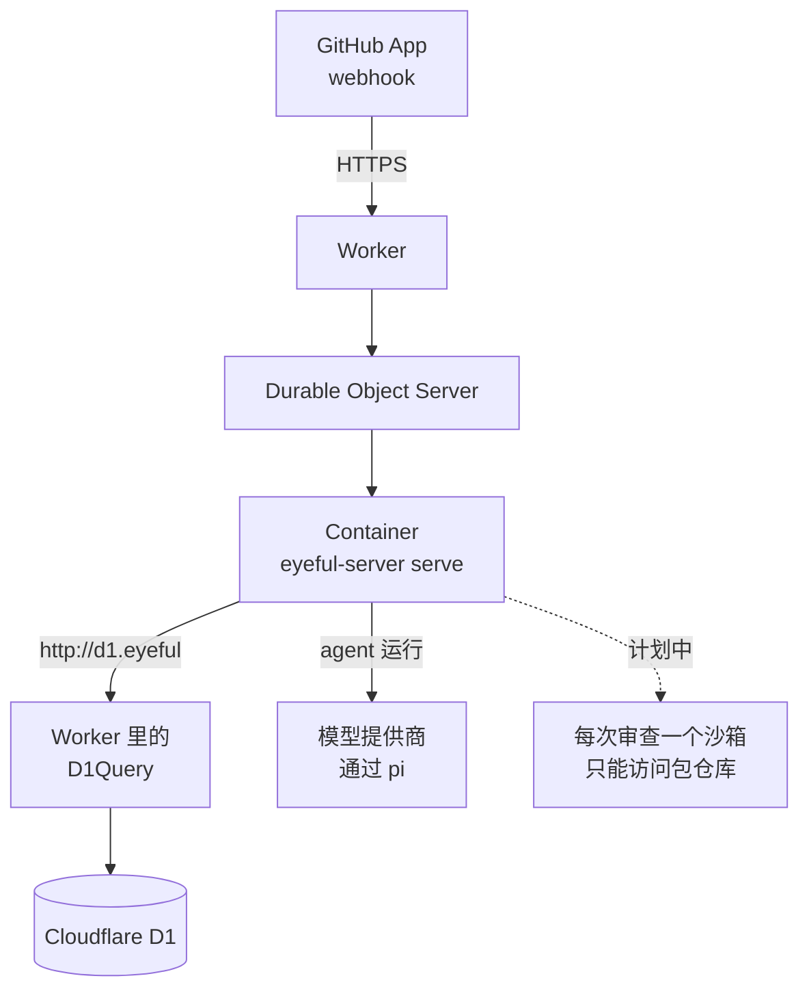

# 部署上线

本页介绍 eyeful 交付哪些产物、各自运行在哪里，以及生产部署需要什么。从源码运行见[本地开发](../DEVELOPMENT.md)，全部变量见[配置项参考](../CONFIGURATION.md#server)，发布时间见[版本路线图](../ROADMAP.md)。

云端运行在 Cloudflare 上：一个 Worker（`packages/worker`）在 Container 里启动 `eyeful-server serve`，并给它一个 D1 数据库。GitHub App 把 webhook 发给这个 Worker。本地部分是桌面端和 `eyeful` 命令，不需要服务端。任何东西都要先通过 CI 才会发布：`main` 上每次 CI 通过后，文档站点发布到 GitHub Pages（`docs.yml`）；推送 `v*` 标签会先运行 CI，再由 GoReleaser（`release.yml`、`.goreleaser.yml`）把 Linux 和 macOS 的 `eyeful` 命令行以压缩包、`.deb` 和 `.rpm` 的形式附到 GitHub release 上。目前还没有打过版本标签。CI（`.github/workflows/ci.yml`）目前只运行 `mise run check`。

## 产物

| 产物                | 构建方式                                              | 运行在                          |
| ------------------- | ----------------------------------------------------- | ------------------------------- |
| Worker 和服务端镜像 | 在 `packages/worker` 运行 `cf deploy`（`Dockerfile`） | Cloudflare Workers + Containers |
| 桌面端              | `mise run package:desktop`（Wails）                   | macOS、Windows、Linux           |
| `eyeful`            | `mise run install`，或 `v*` 标签（GoReleaser）        | 用户的电脑                      |
| 文档站点            | `mise run build:docs`（VitePress）                    | `DOCS_URL` 上的 GitHub Pages    |

镜像里有 `eyeful-server`、git 和 pi `1.3.0`。

## 云端

`packages/worker/cloudflare.config.ts` 声明了全部内容：Worker `eyeful`、D1 数据库 `eyeful`、Container `eyeful-server`（`standard-1`，一个实例）和三个必需的 secret。Worker 把每个请求交给同一个 Durable Object `Server`，它在第一个请求到来时启动 Container，再把请求转发到 8080 端口。虚线是沙箱。在它实现之前，审查不运行项目命令（见[云端运行](CLOUD.md)）。

### 容器访问 D1 {#d1-from-the-container}

服务端仍然用它的 REST 客户端。Worker 把 `EYEFUL_D1_API` 指向 `http://d1.eyeful/client/v4`，并用 `D1Query` 拦截这个主机：它在 D1 绑定上执行每条查询，按 REST 查询接口的格式返回。这样不需要 Cloudflare API token，查询也不计入每五分钟 1,200 次的 API 限流。`EYEFUL_D1_API_TOKEN` 里的 token 在 Container 每次启动时重新生成。

### 生命周期

Container 启动时，Worker 的全部 secret 和变量都作为它的环境变量传进去；改过的 secret 在下次启动时生效。最后一个请求之后十分钟，Container 停止。只要 D1 里还有排队或运行中的审查，Durable Object 的 alarm 每分钟检查一次，让 Container 保持运行，或重新启动它。Container 停止后磁盘会清空，所以中途被打断的审查会从头开始。滚动更新会发送 `SIGTERM`，服务端把运行中的审查放回队列（见[生命周期](SERVER.md#lifecycle)）。

### 部署 {#deploy}

Docker 必须在运行，因为 `cf deploy` 要构建镜像。在 `packages/worker` 下：

1. 在仓库外写一个 secret 文件，JSON 或 `.env` 格式，包含 `EYEFUL_WEBHOOK_SECRET`、`EYEFUL_GITHUB_APP_ID`、`EYEFUL_GITHUB_APP_PRIVATE_KEY`（PEM）和 pi 用的模型密钥，例如 `DEEPSEEK_API_KEY`。
2. `pnpm exec cf deploy --secrets-file <file>` 构建镜像，第一次部署时创建 D1 数据库，并上传 Worker 和 secret。
3. `pnpm exec cf d1 list` 打印数据库 id。用 `pnpm exec cf d1 migrations apply <id> --dir ../../internal/db/migrations` 应用表结构。
4. 在 GitHub App 里把 webhook URL 设为 `https://eyeful.<subdomain>.workers.dev/webhook`，secret 设为 `EYEFUL_WEBHOOK_SECRET`。App 需要的权限见[本地开发](../DEVELOPMENT.md#commands)。

之后要改某个 secret，用 `pnpm exec cf workers secrets update`。Container 起来后 `GET /health` 会应答；D1 应答 `SELECT 1` 之后 `GET /ready` 会应答。

## 本地

本地模式只需要安装应用本身，不需要服务端、数据库、eyeful 账号或模型密钥，因为 agent 就是用户已经登录的编码工具。

`eyeful review` 使用 `eyeful connect` 选定的 agent 进行审查；桌面端在窗口里做同样的事（见[桌面端](../LOCAL.md#desktop)）。本地审查允许运行什么、怎样隔离，见[本地运行](../LOCAL.md)。
