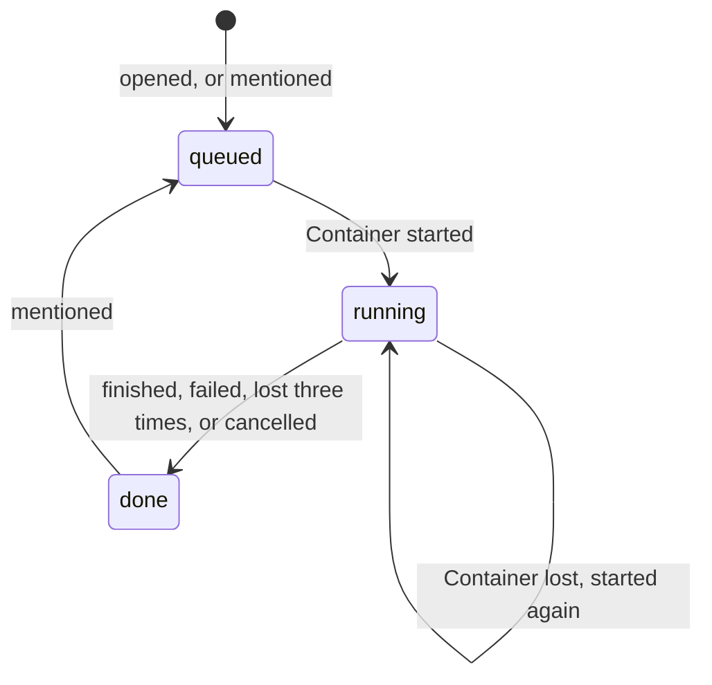

# 审查生命周期

每个 pull request 有一个 Durable Object，即 `packages/worker` 里的 `Server`，以仓库和 pull request 编号命名。它把当前的审查存在自己的 SQLite 存储里，并用 alarm 驱动这次审查的 Container。同一个 pull request 同时最多只跑一次审查。

| 机制     | 行为                                                                                                               |
| -------- | ------------------------------------------------------------------------------------------------------------------ |
| 一次     | 打开、重新打开或可审查的 pull request，从未审查过时自动审查；之后需要 @。                                          |
| @        | 允许名单里的用户 @ 时，审查当前 head，编号比上一次加一。                                                           |
| 忙碌     | 审查在排队或运行时被 @，只回复一句，不启动任何东西。                                                               |
| 已关闭   | 在已关闭的 pull request 上 @ 会被忽略。                                                                            |
| Alarm    | 接收时设置，审查运行期间每 30 秒一次。每次都读取存储的记录。                                                       |
| 启动     | 没有 Container 在运行时，alarm 带着 pull request 启动一个，并计一次尝试。                                          |
| 观察     | 有 Container 在运行时，alarm 读取它的 `GET /review`；`done` 或 `failed` 会被记录，Container 随即销毁。             |
| 启动超时 | 启动五分钟后仍未应答的 Container 会被销毁，记为丢失。                                                              |
| 丢失     | 三次尝试之后审查以 `done` 结束，它的 Check Run 以失败结束并写明原因。                                              |
| 检查     | 每次审查在 head 上创建一个 `eyeful` Check Run，审查结束时完成它。                                                  |
| 推送     | push 会在新 head 上加一个 `eyeful` Check Run：审查已结束时直接沿用上次结果完成，审查还在运行时等它结束后一起完成。 |
| 取消     | 关闭 pull request 或转回 draft 会销毁正在运行的 Container，并取消它的 Check Run。                                  |
| 空闲     | Container 十分钟没有请求就停止；alarm 的轮询会让运行中的审查保持活跃。                                             |
| 容量     | 同时最多五个 Container（`maxInstances`）。                                                                         |
| 沙箱     | 每次审查有自己的沙箱，审查结束时删除。                                                                             |

发布新版本或任何 `SIGTERM` 都会让 Container 停止；alarm 把它记为丢失，下一个从 R2 里的阶段继续（见[存储](PERSISTENCE.md)）。

## 尚未完成

- 等待 CI 发生在 Container 里，pull request 的检查运行期间 Container 一直开着。计划：由 alarm 等检查结束后再启动 Container。
- 由 @ 触发的审查还不会复用上一次审查的结论。
- 没有跨 Durable Object 的审查列表，也没有每天或每月的配额。
