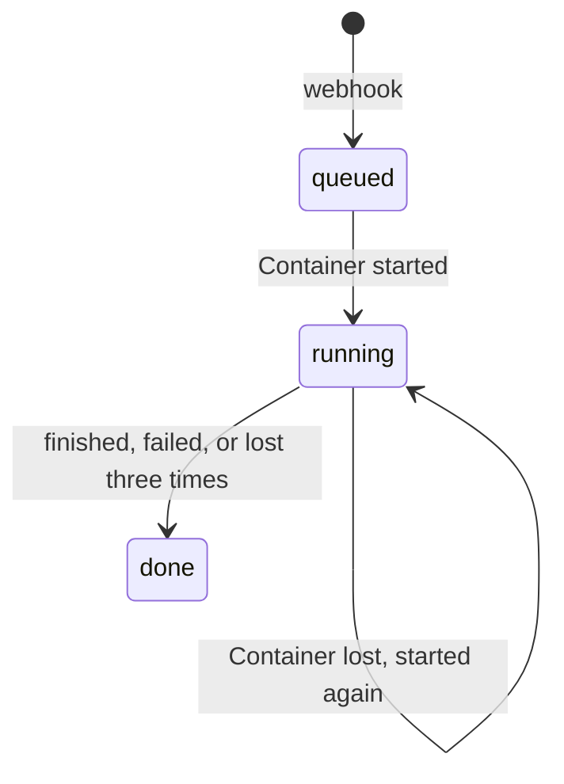

# 审查生命周期

每次审查是一个 Durable Object，即 `packages/worker` 里的 `Server`，以仓库、pull request 编号和 head 提交命名。它把审查的状态存在自己的 SQLite 存储里，并用 alarm 驱动这次审查的 Container。

| 机制     | 行为                                                                                                   |
| -------- | ------------------------------------------------------------------------------------------------------ |
| 接收     | 已接收过的 head 提交再次投递时返回第一次的审查；同一提交但 pull request 信息不同时返回 `409`。         |
| Alarm    | 接收时设置，审查运行期间每 30 秒一次。每次都读取存储的状态，所以重复触发没有副作用。                   |
| 启动     | 没有 Container 在运行时，alarm 带着 pull request 启动一个，并计一次尝试。                              |
| 观察     | 有 Container 在运行时，alarm 读取它的 `GET /review`。`done` 或 `failed` 会被记录，Container 随即销毁。 |
| 启动超时 | 启动五分钟后仍未应答的 Container 会被销毁，记为丢失。                                                  |
| 丢失     | 三次尝试之后，审查以 `done` 结束，原因是 `container lost N times`。                                    |
| 空闲     | Container 十分钟没有请求就停止；alarm 的轮询会让运行中的审查保持活跃。                                 |
| 容量     | 同时最多五个 Container（`maxInstances`）。                                                             |

发布新版本或任何 `SIGTERM` 都会让 Container 停止；alarm 把它记为丢失，下一个从 R2 里的阶段继续（见[存储](PERSISTENCE.md)）。

## 尚未完成

- 等待 CI 发生在 Container 里，pull request 的检查运行期间 Container 一直开着。计划：由 alarm 等检查结束后再启动 Container。
- 新的 push 不会取消旧 head 提交的审查。
- 没有跨 Durable Object 的审查列表。
