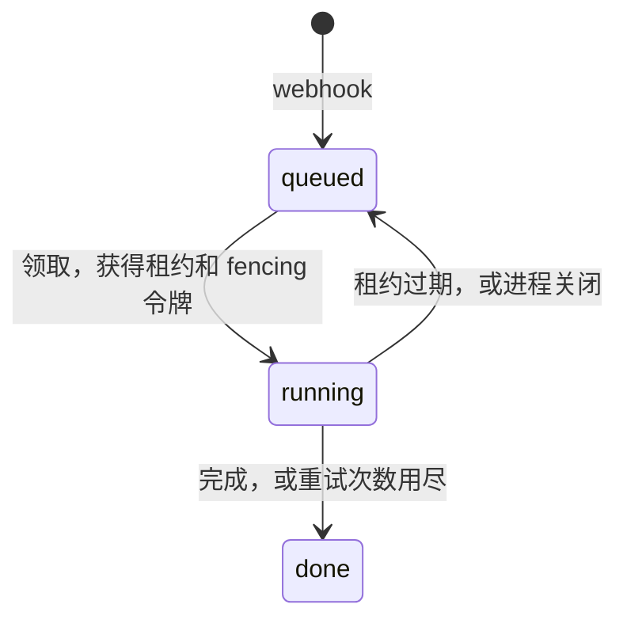

# 任务调度与租约

审查由 `internal/scheduler` 分配给工作进程，已经在运行。agent 的每次运行由 `internal/dispatch` 分配给模型提供商，已经写好并测试过，但还没有接入。

## 审查分配给工作进程 {#reviews-over-workers}



| 机制 | 行为                                                                                                                                |
| ---- | ----------------------------------------------------------------------------------------------------------------------------------- |
| 准入 | 用同一个幂等键再次创建时返回第一次创建的审查；输入不同则视为冲突                                                                    |
| 领取 | 一条 `UPDATE`，更新最早排队的审查。fencing 令牌是这条语句里的 `MAX(lease_token) + 1`。租约截止时间用工作进程的时钟                  |
| 续约 | 每隔 `--lease-ttl` 的三分之一续约一次；临时错误在下一次续约时重试                                                                   |
| 隔离 | 用过期令牌调用 `Renew`、`Finish`、`Release` 会返回 `ErrFenced`                                                                      |
| 完成 | 工作流结束时，包括 `ci_failed` 和 `partial`，执行器不返回错误，结果为 `complete`。执行器返回错误时，结果为 `none`，错误信息写入原因 |
| 回收 | 租约过期的审查回到队列；超过 `--max-attempts` 次后设为 `done`，结果为 `none`                                                        |
| 关闭 | 运行中的审查释放回队列，不计入重试次数                                                                                              |
| 容量 | 每个进程运行 `--workers` 个工作进程；要扩容就在同一个数据库上多开进程                                                               |

服务端使用 `review.Store`。`reviewtest.MemoryStore` 实现同样的接口约定，供测试使用（见[数据库与迁移](PERSISTENCE.md#tests)）。

## agent 运行分配给模型提供商 {#agent-runs-over-providers}

agent 只指定档次（`cheap`、`mid` 或 `strong`）。每个档次是一组候选，每个密钥一项：

```yaml
strong:
  - { model: anthropic/claude-sonnet-5-5, priority: 0, weight: 3 }
  - { model: openrouter/anthropic/claude-sonnet-5-5, priority: 0, weight: 1 }
  - { model: deepseek/deepseek-v4, priority: 1 }
```

| 机制     | 行为                                                                                      |
| -------- | ----------------------------------------------------------------------------------------- |
| 选择     | 先选可用的最低优先级，同一优先级内按权重随机；每次重试降一级优先级                        |
| 决定     | `Decide` 返回重试或停止，并附原因，如 `output_committed`、`non_retryable`                 |
| 冷却     | 余额不足：30 分钟。配额用尽：到配额重置。限流：按 `Retry-After`。其他：1 分钟起，每次翻倍 |
| 提交点   | agent 一旦报告过任何内容，之后再出错就直接算失败，不再换模型                              |
| 并发通道 | 每个密钥有 `max_concurrency` 上限，超出的请求按先进先出排队；排队不会触发换模型或冷却     |

计划中：同一次审查中每个角色固定使用同一个候选、模型提供商错误的分类。审查的预算由 `workflow` 管理（见[档位](../LEVELS.md#budget)）。

## 尚未完成

- 只负责领取和执行审查的 `runner` 命令。
- 续约失败超过 TTL 后自行停止的工作进程。在那之前，fencing 会丢弃失去连接的工作进程的结果，但它花掉的模型费用收不回来。
- 重试失败的 `Finish`。
