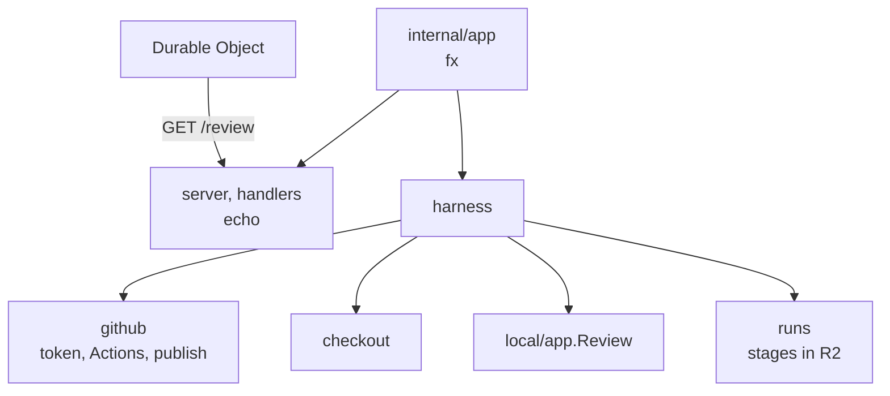
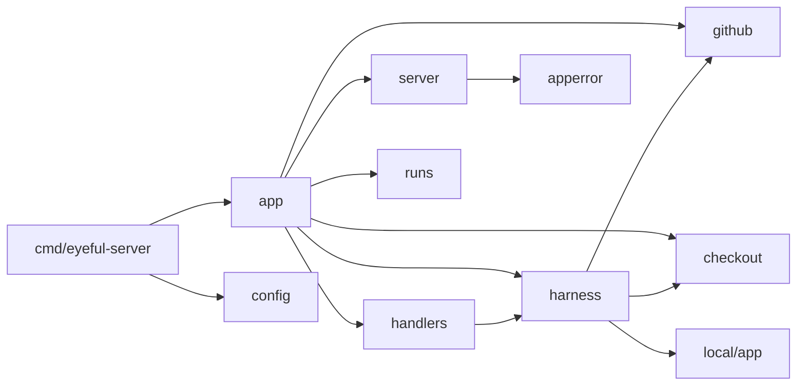

# 服务器

`eyeful-server` 是审查的 Container 里运行的程序：一个 Go 二进制 `cmd/eyeful-server`，包放在 `internal/` 下。一个进程处理一次 pull request 审查。它和本地 CLI 共用根模块，通过 `local/app` 运行审查，走的是和 `eyeful review` 相同的路径。它没有数据库、账号和公开 API，前面的 Worker 是它唯一的调用方（见[云端运行](CLOUD.md)）。

## 组件

## 路由与错误 {#routes}

| 路由          | 返回                                                            |
| ------------- | --------------------------------------------------------------- |
| `GET /review` | `{"state", "outcome", "reason"}`：`running`、`done` 或 `failed` |

Durable Object 轮询这个路由。所有错误都是 [RFC 9457](https://www.rfc-editor.org/rfc/rfc9457) Problem，类型为 `application/problem+json`，带有来自 `internal/apperror` 的稳定 `code` 和 `request_id`。

## 布局 {#layout}

| 路径                | 负责                                                           |
| ------------------- | -------------------------------------------------------------- |
| `cmd/eyeful-server` | 二进制（kong）：`serve`                                        |
| `internal/app`      | 组合根：fx 装配和生命周期                                      |
| `internal/config`   | `Config` 结构体，由 kong 填充                                  |
| `internal/server`   | echo、中间件、Problem 渲染                                     |
| `internal/handlers` | `GET /review`                                                  |
| `internal/apperror` | Problem 结构和错误码                                           |
| `internal/review`   | `Source`，Worker 交过来的 pull request                         |
| `internal/github`   | App token、Actions、pull request 描述、发布                    |
| `internal/checkout` | pull request 的 clone                                          |
| `internal/harness`  | 一次审查：checkout、`local/app.Review`、发布、`published` 记录 |
| `internal/runs`     | 基于 Worker 的 R2 入口实现的 `workflow.Archive`                |

`packages/worker` 里是 Worker、Durable Object 和 Container 访问的各个入口（见[部署](DEPLOYMENT.md)）。

## 依赖方向 {#dependency-direction}

箭头表示"导入"。

## 生命周期 {#lifecycle}

[fx](https://github.com/uber-go/fx) 是依赖注入容器，只有 `internal/app` 导入它。

1. `serve` 读取配置，从环境里删掉所有 `EYEFUL_` 变量，并连接 `EYEFUL_AGENT` 指定的 agent。
2. 启动时在一个 goroutine 里运行审查，并绑定 HTTP 监听。
3. 收到 `SIGTERM` 停止时，在同一个超时内取消审查、排空监听。这样被取消的审查会让 `GET /review` 停在 `running`；Durable Object 把停掉的 Container 记为丢失，再启动一个，新的从 R2 继续。

## 设计决定

1. 一个进程一次审查。扩容就是更多 Container，由 Durable Object 管理。
2. 服务端自己不保存状态；审查在 Durable Object 里，阶段在 R2 里。
3. 包按领域划分，各自拥有自己的类型和规则。
4. 每个后台任务都有归属，也有办法停止。

避免的做法：包级状态、没有归属的 goroutine、controller/service/model 分层、手写的 CLI 解析。
