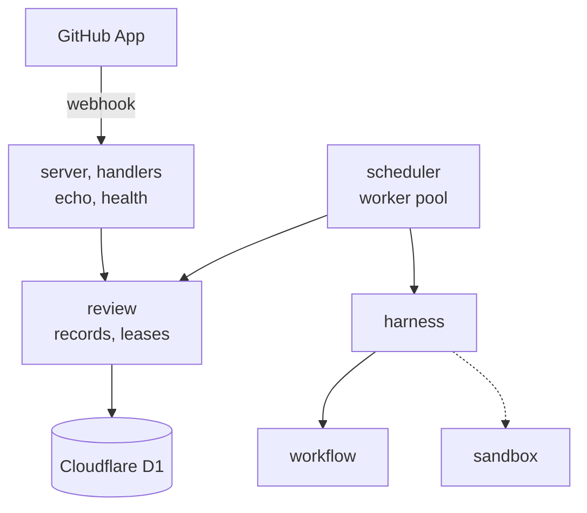
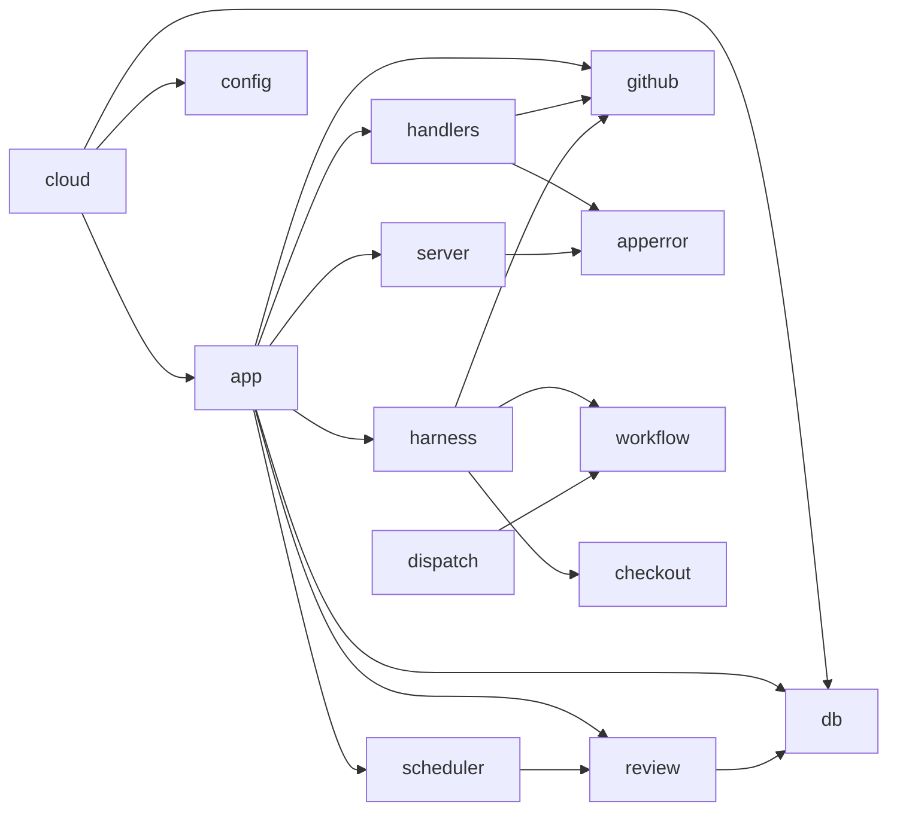
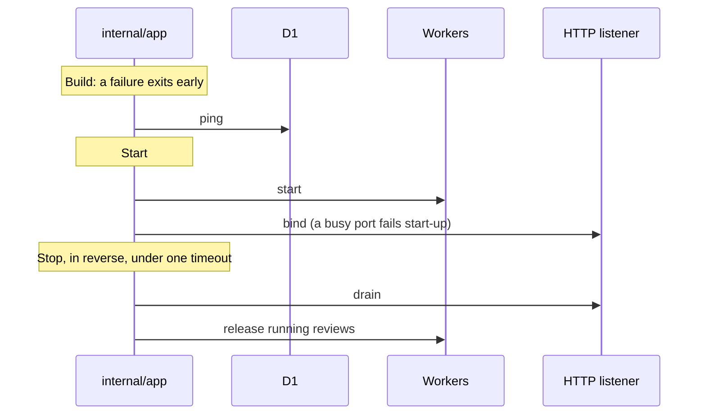

# 服务器

`eyeful-server` 是云端一侧：一个 Go 二进制 `cmd/eyeful-server`，它的包在 `internal/`，通过查询 API 访问 Cloudflare D1。它和本地 CLI 共用根模块，导入 `workflow` 和 `local`（见[模块](../ARCHITECTURE.md#layout)）。`local/app` 留在 CLI 和桌面端。它没有账号、没有控制台，也没有公开 API。GitHub App 的 webhook 是它唯一的输入。`POST /webhook` 为每个 head 提交排入一次审查，工作进程通过 `workflow` 运行这次审查。沙箱还没有实现，所以项目命令不运行（见[云端运行](CLOUD.md)）。

## 组件

`scheduler` 运行工作进程来领取排队中的审查。虚线是还没有实现的沙箱。

## 路由与错误 {#routes}

| 路由            | 回答                                      |
| --------------- | ----------------------------------------- |
| `GET /health`   | 存活检查                                  |
| `GET /ready`    | 就绪检查：数据库能应答                    |
| `POST /webhook` | pull request 事件：每个 head 提交一次审查 |

请求体最大 5 MiB。所有错误都是 [RFC 9457](https://www.rfc-editor.org/rfc/rfc9457) Problem，类型为 `application/problem+json`，带有来自 `internal/apperror` 的稳定 `code` 和 `request_id`。500 响应不包含底层错误；错误连同请求 id 写进日志。

## 布局 {#layout}

| 路径                 | 负责                                            |
| -------------------- | ----------------------------------------------- |
| `cmd/eyeful-server`  | 服务器二进制（kong）：`serve`                   |
| `internal/app`       | 云端的组合根：fx 装配和生命周期                 |
| `internal/config`    | `Config` 结构体，由 kong 填充                   |
| `internal/server`    | echo、中间件、Problem 渲染                      |
| `internal/handlers`  | 路由                                            |
| `internal/apperror`  | Problem 响应体和错误码                          |
| `internal/review`    | 审查记录和租约；`reviewtest` 里是内存存储       |
| `internal/scheduler` | 工作进程池                                      |
| `internal/dispatch`  | agent 运行的供应商路由（尚未接入）              |
| `internal/github`    | webhook 签名和解析、App 令牌、Actions、发布评论 |
| `internal/checkout`  | pull request 的克隆                             |
| `internal/harness`   | 工作进程的执行器：快照、`workflow`、发布评论    |
| `internal/db`        | D1 HTTP 客户端和迁移文件                        |

规划中：`internal` 下的 `sandbox` 和 `sink`（outbox）。

## 依赖方向 {#dependency-direction}

箭头表示“导入”。依赖从入口指向内部。

- handler 只翻译 HTTP，不包含业务规则。
- `server` 不认识任何路由。
- `app` 通过 `internal/db` 做就绪检查。`review` 通过它运行队列。

## 生命周期 {#lifecycle}

[fx](https://github.com/uber-go/fx) 是依赖注入容器。`internal/app` 是服务器里唯一导入它的包，并掌管所有启动和停止钩子。

关闭按相反顺序进行。TODO(sandbox)：沙箱和 agent 进程加入工作进程的停止钩子。

## 设计决策

1. 表结构由 `cf d1 migrations apply` 负责，二进制自己不做迁移。
2. 包按领域划分，各自拥有自己的类型、查询和规则。
3. 查询是带 `?` 占位符的 SQL 文本。
4. 每个后台任务都有所有者和停止的办法。
5. 失败只影响失败的那个单元，并记录原因。
6. 等待容量不算失败，已经提交的输出不会换个地方重试。
7. D1 一次执行一条语句，所以领取是一条 `UPDATE`，更新最早排队的那一行。多个进程共用这一个数据库。

刻意避免：包级状态、没有所有者的 goroutine、controller/service/model 分层，以及手写的 CLI 解析。
