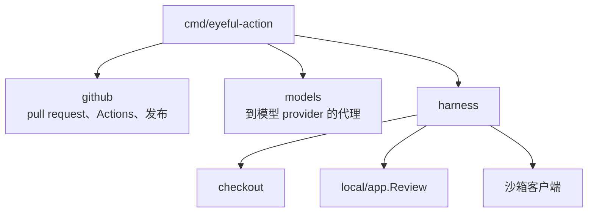
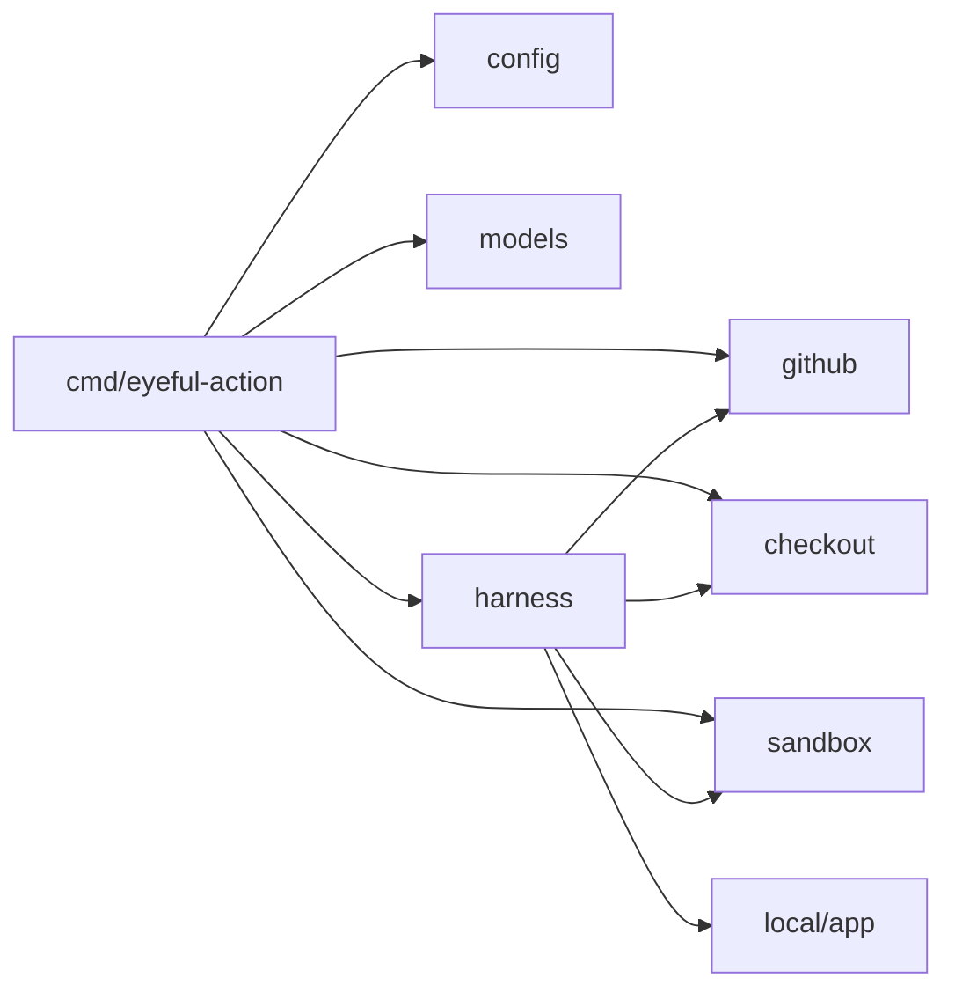

# Action 程序

`eyeful-action` 是审查容器里的程序：一个 Go 二进制 `cmd/eyeful-action`，包放在 `internal/`。一个进程审查一个 pull request 后退出。它和本地 CLI 共用根模块，通过 `local/app` 运行审查，和 `eyeful review` 走同一条路径。它没有数据库、账号或 API；由 `action.yml` 启动。

## 组件

## 目录 {#layout}

| 路径                 | 负责                                           |
| -------------------- | ---------------------------------------------- |
| `action.yml`         | composite action：构建镜像、启动沙箱、运行审查 |
| `cmd/eyeful-action`  | 二进制（kong）和 `pi/` 下 pi 的设置            |
| `cmd/eyeful-sandbox` | 沙箱的 HTTP 服务                               |
| `internal/config`    | 由 kong 填充的 `Config` 结构                   |
| `internal/review`    | `Source`，被审查的 pull request                |
| `internal/github`    | pull request、Actions、描述、发布              |
| `internal/models`    | 给 pi 的模型请求加上 provider 密钥的代理       |
| `internal/checkout`  | pull request 的克隆                            |
| `internal/harness`   | 一次审查：检出、`local/app.Review`、发布       |
| `internal/sandbox`   | 沙箱服务和它的客户端                           |

## 依赖方向 {#dependency-direction}

箭头表示「导入」。

## 生命周期 {#lifecycle}

1. 读取配置，从环境里删掉所有 `EYEFUL_` 变量，连接 `EYEFUL_AGENT` 指定的 agent。
2. 在 `127.0.0.1:8081` 监听 pi 的模型请求。
3. 读取 pull request；已关闭的直接结束 job，不做审查。
4. 运行审查，阶段结果存在 `<dir>/run` 下，审查失败时以非零状态退出。job 被取消时的 `SIGTERM` 会取消审查。

阶段结果只活到 job 结束。重新运行从头开始，靠隐藏标记只发布 GitHub 上还没有的内容。

## 设计决定

1. 一个进程，一次审查。扩容就是更多 job，由 Actions 负责。
2. job 之外不存任何东西；结果在 GitHub 上。
3. 包按领域划分，各自拥有自己的类型和规则。
4. 每个后台任务都有归属，也都有停止的办法。

避免：包级状态、没有归属的 goroutine、controller/service/model 分层、手写的 CLI 解析。
