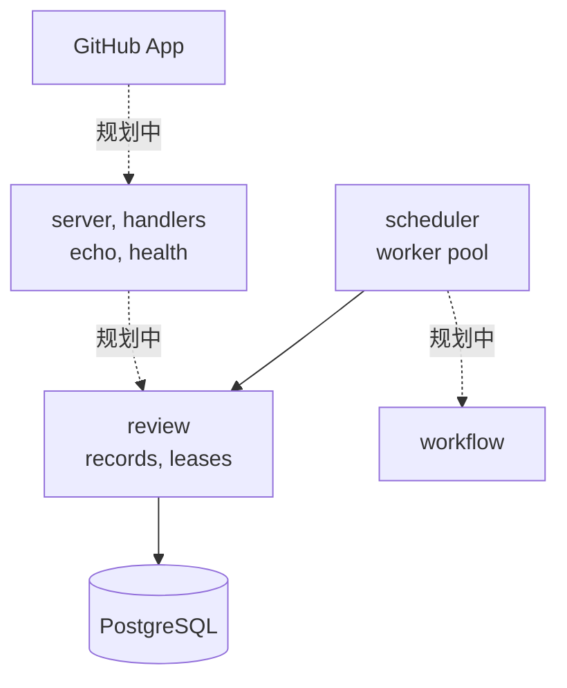
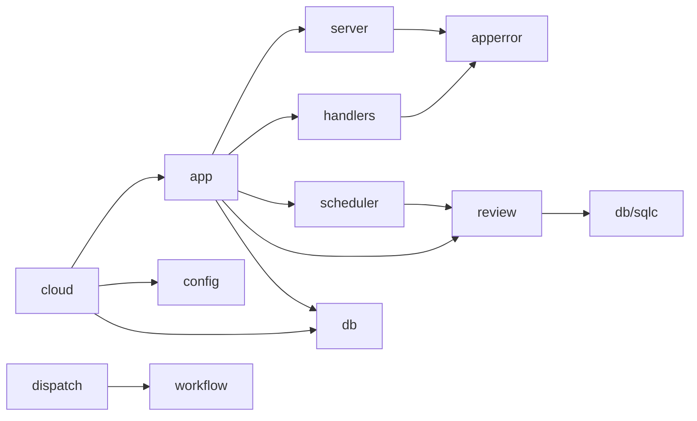
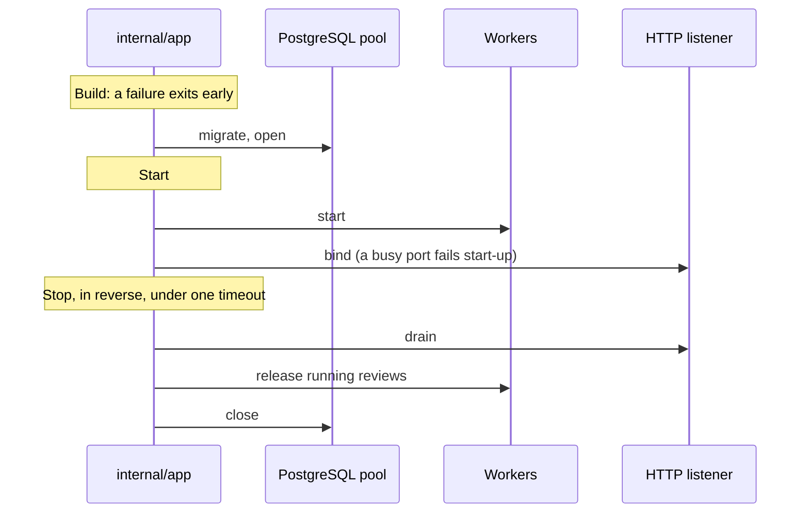

# 服务器

`eyeful-server` 是云端一侧：一个 Go 二进制 `cmd/eyeful-server`，它的包在 `internal/`，嵌入了迁移，唯一的依赖是 PostgreSQL。它和本地 CLI 共用根模块，只导入 `workflow`（见[模块](../ARCHITECTURE.md#layout)）。它没有账号、没有控制台，也没有公开 API；GitHub App 的 webhook 将是它唯一的输入。审查还不能在上面运行：webhook、pi 运行时和沙箱都没有实现，工作进程用占位执行器结束每次审查（见[云端运行](CLOUD.md)）。

## 组件

`scheduler` 运行工作进程来领取排队中的审查。虚线是规划中的部分。

## 路由与错误 {#routes}

| 路由            | 回答                      |
| --------------- | ------------------------- |
| `GET /health`   | 存活检查                  |
| `GET /ready`    | 就绪检查：数据库能应答    |
| `POST /webhook` | 规划中：pull request 事件 |

请求体最大 1 MiB。所有错误都是 [RFC 9457](https://www.rfc-editor.org/rfc/rfc9457) Problem，类型为 `application/problem+json`，带有来自 `internal/apperror` 的稳定 `code` 和 `request_id`。500 响应不包含底层错误；错误连同请求 id 写进日志。

## 布局 {#layout}

| 路径                 | 负责                                      |
| -------------------- | ----------------------------------------- |
| `cmd/eyeful-server`  | 服务器二进制（kong）：`serve`、`migrate`  |
| `internal/app`       | 云端的组合根：fx 装配和生命周期           |
| `internal/config`    | `Config` 结构体，由 kong 填充             |
| `internal/server`    | echo、中间件、Problem 渲染                |
| `internal/handlers`  | 路由                                      |
| `internal/apperror`  | Problem 响应体和错误码                    |
| `internal/review`    | 审查记录和租约；`reviewtest` 里是内存存储 |
| `internal/scheduler` | 工作进程池                                |
| `internal/dispatch`  | agent 运行的供应商路由（尚未接入）        |
| `internal/db`        | pgx 连接池、迁移、SQL 查询和 sqlc 输出    |

规划中：`internal` 下的 `source`（webhook）、`checkout`、`pi`、`sandbox` 和 `sink`。

## 依赖方向 {#dependency-direction}

箭头表示“导入”。依赖从入口指向内部。

- handler 只翻译 HTTP，不包含业务规则。
- `server` 不认识任何路由。
- 只有 `review` 调用 `internal/db/sqlc`。

## 生命周期 {#lifecycle}

[fx](https://github.com/uber-go/fx) 是依赖注入容器。`internal/app` 是服务器里唯一导入它的包，并掌管所有启动和停止钩子。

关闭按相反顺序进行。TODO(sandbox)：沙箱和 agent 进程加入工作进程的停止钩子。

## 设计决策

1. 二进制嵌入它需要的东西：迁移。
2. 包按领域划分，各自拥有自己的类型、查询和规则。
3. SQL 生成 Go：查询代码是生成的，不手写。
4. 每个后台任务都有所有者和停止的办法。
5. 失败只影响失败的那个单元，并记录原因。
6. 等待容量不算失败，已经提交的输出不会换个地方重试。
7. PostgreSQL 是唯一的数据库，因为队列依赖 `SKIP LOCKED`。

刻意避免：包级状态、没有所有者的 goroutine、controller/service/model 分层，以及手写的 CLI 解析。
