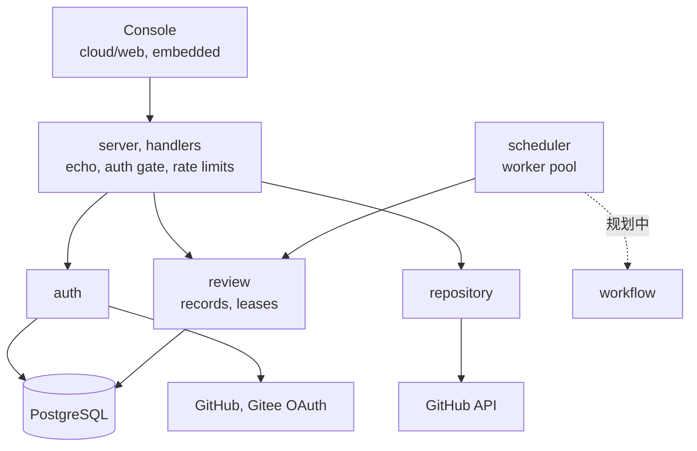
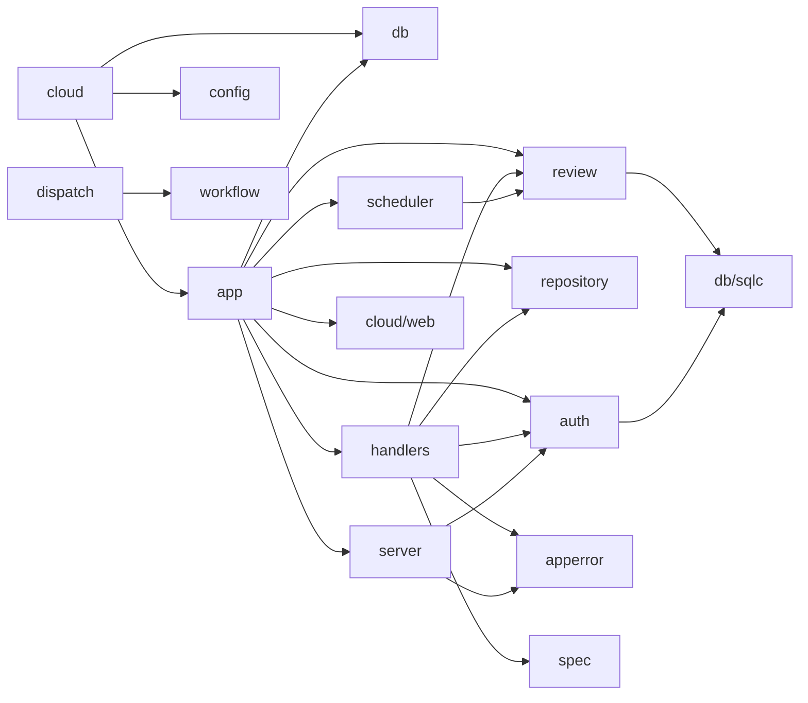
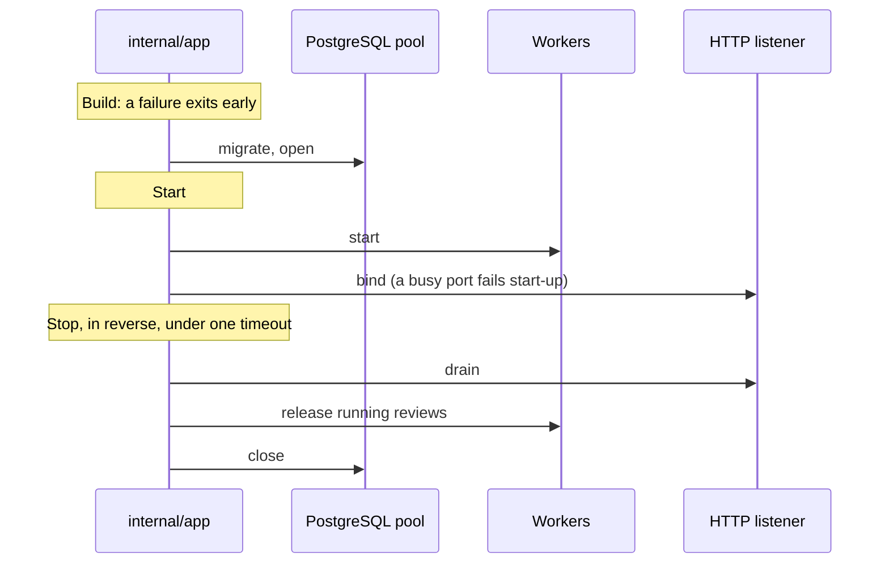

# 服务器

`eyeful-server` 是云端一侧：`cloud/` 里的一个 Go 二进制，嵌入了控制台、迁移和 API 文档，唯一的依赖是 PostgreSQL。它是独立的 Go 模块，只导入 `workflow`。审查还不能在上面运行：pi 运行时和沙箱没有实现，工作进程用占位执行器结束每次审查（见[云端运行](CLOUD.md)）。

## 组件

请求经过 `server`（认证、限流）到达 `handlers`，后者调用 `auth`、`review` 和 `repository`。`scheduler` 运行工作进程来领取排队中的审查。控制台只发同源请求，并使用 hash 路由，所以 `#/repositories` 不会和 API 路由 `/repositories` 冲突。

## 布局 {#layout}

| 路径                             | 负责                                               |
| -------------------------------- | -------------------------------------------------- |
| `cloud`                          | 服务器二进制（kong）：`serve`、`migrate`           |
| `cloud/web`                      | 云端控制台：SvelteKit，嵌入二进制                  |
| `cloud/internal/app`             | 云端的组合根：fx 装配和生命周期                    |
| `cloud/internal/config`          | `Config` 结构体，由 kong 填充                      |
| `cloud/internal/server`          | echo、中间件、认证关卡、限流、Problem 渲染         |
| `cloud/internal/handlers`        | 带 swag 注解的 CRUD 路由，每个资源一个文件         |
| `cloud/internal/apperror`        | Problem 响应体和错误码                             |
| `cloud/internal/auth`            | 用户、会话、API 密钥、登录、加密保存的供应商 token |
| `cloud/internal/repository`      | 已登录用户的 GitHub 仓库                           |
| `cloud/internal/review`          | 审查记录和租约；`reviewtest` 里是内存存储          |
| `cloud/internal/scheduler`       | 工作进程池                                         |
| `cloud/internal/dispatch`        | agent 运行的供应商路由（尚未接入）                 |
| `cloud/internal/db`、`cloud/db/` | pgx 连接池、迁移、SQL 查询和 sqlc 输出             |
| `cloud/spec/`、`cloud/sdk`       | 生成的 OpenAPI 3.1 文档和 TypeScript 客户端        |

规划中：`cloud/internal` 下的 `checkout`、`pi`、`sandbox`、`source`、`sink`、`outbox`，以及 `plugins/`。

## 依赖方向 {#dependency-direction}

箭头表示“导入”。依赖从入口指向内部。

- handler 只翻译 HTTP，不包含业务规则。
- `server` 不认识任何资源。它把 bearer token 和会话 cookie 交给 `auth`，而 `auth` 看不到 HTTP。
- 只有 `auth` 和 `review` 调用 `cloud/internal/db/sqlc`。
- `repository` 通过 `auth` 实现的接口拿 token，由 `app` 把两者接起来。

## 生命周期 {#lifecycle}

[fx](https://github.com/uber-go/fx) 是依赖注入容器。`cloud/internal/app` 是服务器里唯一导入它的包，并掌管所有启动和停止钩子。

关闭按相反顺序进行。TODO(sandbox)：沙箱和 agent 进程加入工作进程的停止钩子。

## 设计决策

1. 二进制嵌入它需要的东西：迁移、spec 和控制台。
2. 包按领域划分，各自拥有自己的类型、查询和规则。
3. 契约是生成的：注解生成 spec，spec 生成 TypeScript 客户端，SQL 生成 Go。
4. 每个后台任务都有所有者和停止的办法。
5. 失败只影响失败的那个单元，并记录原因。
6. 等待容量不算失败，已经提交的输出不会换个地方重试。
7. PostgreSQL 是唯一的数据库，因为队列依赖 `SKIP LOCKED`。

刻意避免：包级状态、没有所有者的 goroutine、controller/service/model 分层，以及手写的 CLI 解析。
